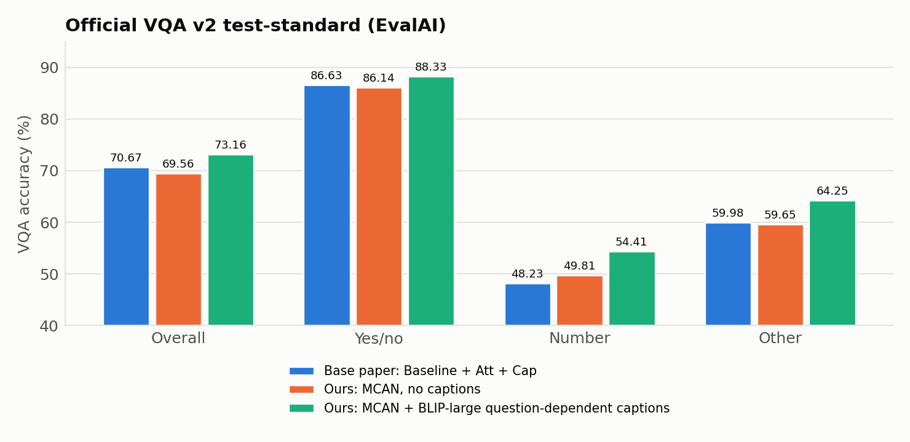
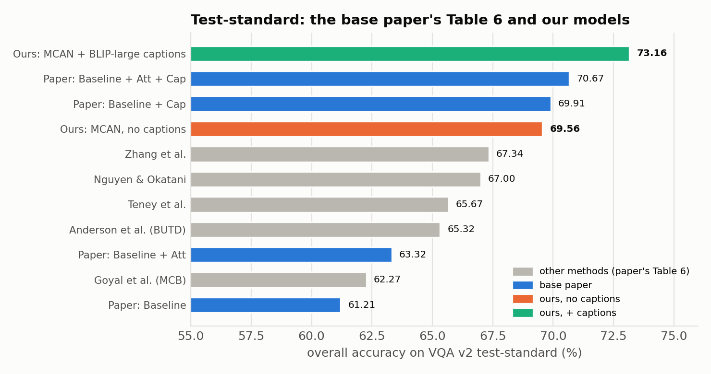

# Question-dependent captions improve VQA: official VQA v2 test-standard results

Final result of the thesis implementation. Our VQA model with **question-dependent BLIP-large captions** reaches **73.16 on
the official VQA v2 test-standard**, **+2.49 above the base paper** (Sharma & Jalal 2021, 70.67). On the same test, the captions add **+3.60** over an
identical model without captions.

| VQA v2 **test-standard** (EvalAI) | Overall | Yes/no | Number | Other |
|---|---:|---:|---:|---:|
| Base paper: Baseline + Att | 63.32 | 79.21 | 44.06 | 56.29 |
| Base paper: Baseline + Att + Cap (best) | 70.67 | 86.63 | 48.23 | 59.98 |
| **Ours: MCAN baseline, no captions** | **69.56** | 86.14 | 49.81 | 59.65 |
| **Ours: MCAN + BLIP-large question-dependent captions** | **73.16** | **88.33** | **54.41** | **64.25** |
| Our caption gain | **+3.60** | +2.19 | +4.60 | +4.60 |
| Ours vs the base paper | **+2.49** | +1.70 | +6.18 | +4.27 |

Both of our rows are 2-seed ensembles trained on all train2014 + val2014 questions. Test-dev gives the same picture: 72.87 vs 69.28 (+3.59).

**Summary**

- **The goal is reached:** 73.16 on test-standard against the paper's 70.67. We are better in every answer type, most of all on number
  (+6.2) and "other" questions (+4.3).
- **Captions help on the official test:** +3.60 over the same model without captions.
  - The baseline alone (69.56) is already almost as strong as the paper's full model, and the captions still add 3.6 points.
  - The gain is largest on number and "other" questions (+4.6 each), where a question-dependent caption carries the most information.
- **The result is fair by construction:**
  - Every caption is **cross-fitted**: no captioner ever describes an image it was trained on.
  - Test2015 images were seen by neither captioner.
  - The VQA model never sees an answer through its caption input.
- **The gain is stable from development to the official test:** +3.0 on our 10k val set (ensembles), +3.6 on test-standard.



---

## 1. The method

```
QD caption dataset (277,318 question / answer / question-dependent caption triples on train2014 images)
        │  fine-tune BLIP-large as a question-dependent captioner, prompt "question: <q> caption:"
        │  two folds: fold-k captioner trains only on fold-k images (cross-fitting)
        ▼
caption for every VQA question, written by the fold captioner that never saw that image
        │  train2014: the other fold's captioner; val2014 and test2015: split half/half
        ▼
VQA model (MCAN): question ──► encoder (6 × self-attention)
                  image (37 BUTD regions) + caption tokens ──► decoder (6 × self + guided attention)
                  ──► answer (3,148 classes)
        caption dropout 0.3: during training the caption is hidden for 30% of the questions
```

| Part | Final choice | Why (from the development rounds) |
|---|---|---|
| Captioner | **BLIP-large** (ViT-L/16, frozen) fine-tuned with the question as prompt, 4 epochs; `best.pt` = most right captions on val (AnswerHit + yes/no polarity) | BLIP-large: AnswerHit 61.1 vs 58.1 for BLIP-base, polarity 77.8 vs 75.1 (`../QuestionDependentImageCaptioner/CAPTIONER_SCALE_REPORT.md`) |
| Fairness | 2-fold cross-fitting of the captioners | without it, training captions would be better than test captions |
| VQA model | MCAN-small (6 + 6 layers, d = 512), GloVe 840B word vectors, batch 64 | stronger than Bottom-Up Top-Down; batch 64 + GloVe 840B: +0.65 for the baseline |
| Caption input | caption tokens appended to the image regions in the decoder: read **as a sequence**, not averaged | every region can attend to every caption word |
| Robustness | **caption dropout 0.3** | the model also learns to answer without a caption; much more robust to wrong captions (`VQA_ROUND2_REPORT.md`) |
| Gate | none | a learned caption-reliability gate found wrong captions (AUC 0.81) but gave no accuracy (`VQA_GATE_REPORT.md`); kept as an ablation |
| Final training | all 658,111 train2014 + val2014 questions, fixed 10 epochs, 2 seeds averaged | standard protocol for test-standard results |

---

## 2. Official results

| Submission (2-seed ensembles) | Phase | Overall | Yes/no | Number | Other |
|---|---|---:|---:|---:|---:|
| MCAN + BLIP-large captions | test-dev | 72.87 | 88.35 | 53.86 | 63.99 |
| MCAN baseline, no captions | test-dev | 69.28 | 85.94 | 49.99 | 59.43 |
| **MCAN + BLIP-large captions** | **test-standard** | **73.16** | **88.33** | **54.41** | **64.25** |
| MCAN baseline, no captions | test-standard | 69.56 | 86.14 | 49.81 | 59.65 |

Caption gain: test-dev **+3.59** (yes/no +2.41, number +3.87, other +4.56); test-standard **+3.60** (yes/no +2.19,
number +4.60, other +4.60). Test-dev and test-standard agree within 0.3 points, as expected.

---

## 3. Comparison with the base paper



| Test-standard | Overall | Yes/no | Number | Other |
|---|---:|---:|---:|---:|
| Goyal et al. (MCB) | 62.27 | 78.82 | 38.28 | 53.36 |
| Anderson et al. (Bottom-Up Top-Down) | 65.32 | 82.20 | 43.90 | 56.26 |
| Teney et al. | 65.67 | 82.20 | 43.90 | 56.26 |
| Nguyen & Okatani | 67.00 | 83.89 | 46.93 | 56.90 |
| Zhang et al. | 67.34 | 83.39 | 44.96 | 58.49 |
| Paper: Baseline | 61.21 | 78.30 | 44.21 | 53.19 |
| Paper: Baseline + Att | 63.32 | 79.21 | 44.06 | 56.29 |
| Paper: Baseline + Cap | 69.91 | 85.31 | 46.98 | 59.18 |
| Paper: Baseline + Att + Cap | 70.67 | 86.63 | 48.23 | 59.98 |
| **Ours: MCAN, no captions** | **69.56** | 86.14 | 49.81 | 59.65 |
| **Ours: MCAN + BLIP-large question-dependent captions** | **73.16** | **88.33** | **54.41** | **64.25** |

(Rows other than ours: Table 6 of Sharma & Jalal 2021.)

**How the two approaches differ**

| | Base paper | Ours |
|---|---|---|
| Captions | question-dependent captions from the paper's own captioning model | question-dependent captions from a fine-tuned BLIP-large, trained on our QD caption dataset |
| Fairness of the captions | not described | **cross-fitted**: no captioner captions an image it trained on |
| VQA model | attention baseline (63.32 without captions) | MCAN co-attention transformer (69.56 without captions) |
| Caption gain | +7.35 (63.32 → 70.67) | **+3.60** (69.56 → 73.16) |
| Final result | 70.67 | **73.16** |

- **Our caption gain is smaller in points but sits on a much stronger baseline.** A stronger VQA model already answers more
  questions correctly on its own, so the captions have less to add. We saw the same throughout development: with Bottom-Up Top-Down the captions added +6, with MCAN +2 to +3.4.
- **The improvement comes from both sides:**
  - a stronger VQA model: our baseline alone is 69.56, against the paper's 63.32 without captions;
  - better captions: a stronger captioner gave +1.45 on our val set, and caption dropout made the model robust.

---

## 4. From development to the official test

All design decisions were made on our own 10,001-question val2014 test set (models trained without those questions).

| Development step (our 10k val, mean of 2–3 seeds) | Without captions | With captions | Gain |
|---|---:|---:|---:|
| Bottom-Up Top-Down, 31k training questions | 46.56 | 59.79 (BLIP-base) | +13.2 |
| Bottom-Up Top-Down, all train2014 | 60.03 | 66.08 (BLIP-base) | +6.1 |
| MCAN + GloVe 6B, train + val | 65.74 | 67.80 (BLIP-base) | +2.1 |
| MCAN, batch 64 + GloVe 840B | 66.39 | 68.08 (BLIP-base) | +1.7 |
| + caption dropout 0.3 | — | 68.31 (BLIP-base) | +1.9 |
| + caption gate (ablation, no gain) | — | 68.13 / 68.53 | — |
| **+ BLIP-large captioner** | — | **69.76** | **+3.4** |
| 2-seed ensembles | 67.27 | **70.27** | **+3.0** |
| **Official test-standard** (final models, 2-seed ensembles) | **69.56** | **73.16** | **+3.6** |

**Development vs official test.** Before the submission we expected about 70.5 (captions) and 67.4 (baseline). Both
models scored about **2.5 points higher**: 73.16 and 69.56. The shift is the same for both, so our 10k val subset was simply harder than the official
test questions, and the **caption gain carried over unchanged** (+3.0 → +3.6). Two observations from the final runs support this:
- the agreement between seeds is the same on test2015 and on our val set;
- captions change the answer about equally often on both (`VQA_FINAL_RUNS_REPORT.md`).

---

## 5. Limitations

- **Two seeds.** The official test-standard numbers are 2-seed ensembles. The single models were submitted to test-dev
  (2026-11-26): captions 72.13 / 72.13, baseline 68.30 / 68.31 (gain +3.82). A third seed would give a more reliable std.
- **COCO pretraining of BLIP.** BLIP-large was pretrained on COCO captions (Karpathy split), which include some val2014 images. Those are
  generic image descriptions, not VQA answers, and test2015 images are not part of it.
- **Captioner strength.** A stronger captioner explains part of the gain over the paper. Every comparison in this work keeps the VQA
  model fixed and changes only the captions, so the caption effect is measured cleanly.
- **The QD caption dataset** (the captioner's training data) was built from train2014 VQA annotations. The captioner therefore learns
  the VQA answer style. Cross-fitting ensures this never leaks the answer of the image being captioned.

## 6. Possible next steps

| Step | Expected effect | Cost |
|---|---|---|
| Third seed for both final models | mean ± std over 3 seeds, slightly better ensemble | ~10 GPU h |
| Fine-tuned BLIP-2 captioner | possibly more right captions (zero-shot BLIP-2 already knows 9.8% of the answers BLIP-base misses) | ~1 week |

---

### Files

| | |
|---|---|
| Official results | `CaptionVQA/vqa_final_t3/vqa_final/Ensemble-VQA-With-Large-Blip-Test-Standard-Result-EvalAI.json`, `CaptionVQA/vqa_final_t4/vqa_final_baseline/Ensemble-VQA-BaseLine-Test-Standard-Result-EvalAI.json` |
| Submitted files | `vqa_final_ensemble_test2015.json` (captions), `vqa_final_baseline_ensemble_test2015.json` (baseline) |
| Earlier reports | `../QuestionDependentImageCaptioner/CAPTIONER_COMPARISON.md`, `VQA_REPORT.md`, `VQA_STRONG_REPORT.md`, `VQA_ROUND2_REPORT.md`, `VQA_GATE_REPORT.md`, `../QuestionDependentImageCaptioner/CAPTIONER_SCALE_REPORT.md`, `VQA_LARGE_REPORT.md`, `VQA_FINAL_RUNS_REPORT.md` |
| Figures | `CaptionVQA/scripts/official_results_figures.py` → `report_figs_official/` |
