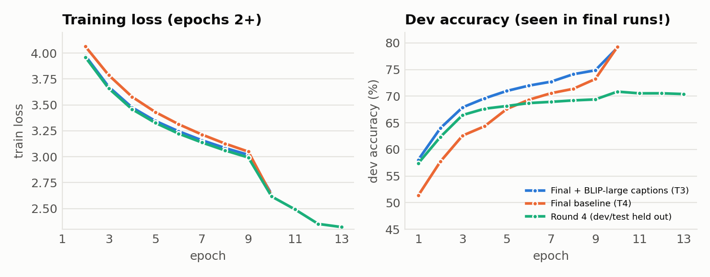
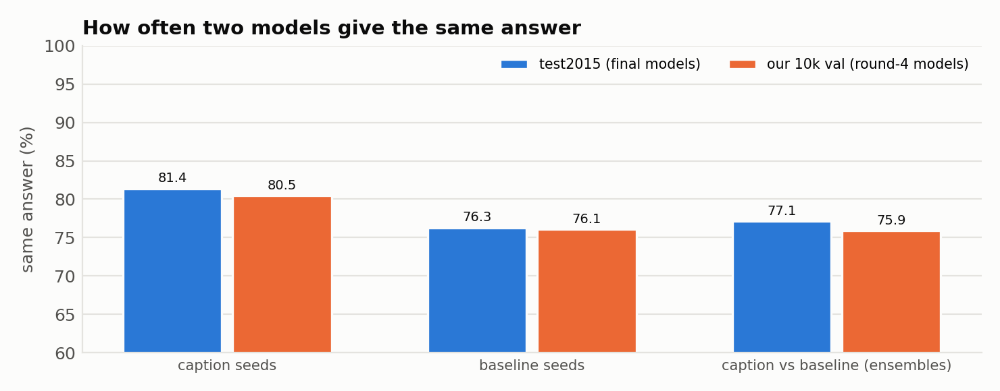

# Final models for the official test-standard: training runs and result files

This report covers the last training step before the official evaluation. The chosen setup is
**MCAN + BLIP-large question-dependent captions + caption dropout 0.3**. It was trained together with its baseline
without captions, both on **all** of train2014 + val2014, and both answered **all 447,793 VQA v2 test2015 questions**.
The result files are ready for the EvalAI server.

**The test2015 answers are not public**, so this report cannot contain the official accuracy yet. It shows:
- that the runs and files are correct;
- how the final models behave;
- what they are expected to score, calibrated on our labelled 10k val set.

The EvalAI numbers go into the table in section 5 when they arrive.

| | Final + BLIP-large captions (T3) | Final baseline, no captions (T4) |
|---|---|---|
| Training questions | 658,111 (all train2014 + val2014) | 658,111 |
| Epochs | 10 (fixed) | 10 (fixed) |
| Seeds | 0 and 1 | 0 and 1 |
| test2015 answers per file | 447,793 (every question once) | 447,793 |
| Result files | 2 single models + 2-seed ensemble | 2 single models + 2-seed ensemble |
| **Expected test-standard** (section 4) | **~70.0 single, ~70.5 ensemble** | ~66.6 single, ~67.4 ensemble |

**Summary**

- **Both runs finished correctly and the six result files are valid.**
  - Each answers exactly the 447,793 test2015 questions, once each, in the EvalAI format.
  - Both models kept epoch 10 as planned.
- **The final models behave like the validated round-4 models.** The seed agreement and the share of questions where captions
  change the answer are almost the same as on our 10k val set: 81.4% vs 80.5% (caption-model seeds), 76.3% vs 76.1%
  (baseline seeds), and captions change 22.9% vs 24.1% of the answers. So the val results should carry over.
- **Projected caption gain on test2015: about +2.9 points** (ensemble vs ensemble; on val it was +3.0). On val, where
  the caption model and the baseline disagree, the caption model is right much more often (47.2 vs 34.8 accuracy).
- **Next:** submit to EvalAI. First test-dev (several submissions allowed), then the ensemble once to test-standard. Then compare with the
  paper's 70.67.

---

## 1. The pipeline (notebooks T1–T4)

| # | Notebook | What it did | Output |
|---|---|---|---|
| T1 | test2015 image features | BUTD Faster R-CNN (Visual Genome) features for all **81,434 test2015 images**: 37 regions × 2048, packed | Kaggle dataset `butd-test2015` |
| T2 | test2015 captions | the two **BLIP-large fold captioners** wrote question-dependent captions for all 447,793 test2015 questions (beam 3, scores saved). Neither captioner ever saw these images; each image goes to fold model `image_id mod 2` | `captions_test2015_large.json` |
| — | train + val captions (step 2a) | the same captioners, cross-fitted: no captioner captions an image it was trained on | `captions_crossfit_large.json` (658,111) |
| T3 | **final model + captions** | trained on all train + val, then answered test2015 | 3 EvalAI files (`ashrafgerami/vqa-maman`, `RUN=vqa_final`) |
| T4 | **final baseline** | the same without captions | 3 EvalAI files (`ashrafgerami/vqa-baseline`, `RUN=vqa_final_baseline`) |

## 2. All settings

| Group | Setting | T3 (+ captions) | T4 (baseline) |
|---|---|---|---|
| Config | file | `configs/blip_final.yaml`, `MODE=crossfit`, `FINAL=1` | same, `MODE=baseline`, `FINAL=1` |
| Data | training questions | **658,111**: all train2014 (443,757) + all val2014 (214,354), including our former dev/test | same |
| | answers (seen ≥ 9 times) | 3,148 | 3,148 |
| | words | 18,138 (question + caption); GloVe 840B covers 16,466 | 15,997 (question); GloVe covers 15,113 |
| Image | features | 37 BUTD regions × 2048 (train/val from the earlier caches, test2015 from T1) | same |
| Captions | captioner | BLIP-large (ViT-L/16), 2 cross-fit folds, `best.pt` = most right captions on val (AnswerHit + polarity), beam 3 | — |
| Model | type | MCAN-small: 6 + 6 layers, d = 512, 8 heads, FFN 2048, dropout 0.1; caption tokens (own LSTM) appended to the regions | same without the caption branch |
| | parameters | 58.77M | 56.46M |
| Training | optimizer / schedule | Adam (0.9, 0.98), lr 1e-4, 2 warm-up epochs, × 0.2 from epoch 10, batch 64, gradient clip 5 | same |
| | epochs | **10, fixed** (the best dev epoch in every earlier MCAN run; no held-out data left for choosing) | same |
| | caption dropout | 0.3 | — |
| | gate | none | — |
| Runs | seeds | 0 and 1 in parallel on 2 T4 GPUs | same |
| | time per epoch | ~20 min (first epoch 27) | ~16 min (first 22) |

Compared with round 4 (`VQA_LARGE_REPORT.md`) the only differences are:
- the 15,001 former dev/test questions are now training data;
- the number of epochs is fixed at 10;
- the answer list has 3,148 entries instead of 3,091, because the extra questions add some answers that reach the 9-count threshold.

## 3. Training

- **The training loss** of both final runs follows the round-4 run almost exactly, with the same drop after the learning-rate decay in epoch 10.
  The caption model and the baseline end at almost the same loss (2.64 / 2.63).
- **The dev accuracy in the right panel is not a test result.** In the final runs those 5,000 questions are training data, so they
  climb to ~79 (green: the round-4 run, where dev was still unseen, peaks at 70.9). The same holds for the "test"
  accuracies in the final logs. **Only EvalAI gives a real number for these models.**

## 4. How the final models answer test2015

### 4.1 Validity and answer types

| Check | T3 | T4 |
|---|---|---|
| questions answered | 447,793 | 447,793 |
| duplicates / missing | 0 / 0 | 0 / 0 |
| same question set in all 6 files | yes | yes |
| answers "yes" / "no" / a number / other (ensemble) | 20.9% / 21.3% / 11.1% / 46.6% | 21.4% / 20.6% / 11.3% / 46.7% |
| most common answers | no, yes, 2, 1, 0, white, red, black, blue, 3 | yes, no, 2, 1, 0, white, 3, blue, black, red |

Both models give plausible answer distributions; the caption model says "no" a little more often (+0.7 points).

### 4.2 Agreement, and calibration on our 10k val

| Same answer | test2015 (final models) | our 10k val (round-4 models) |
|---|---:|---:|
| caption model, seed 0 vs seed 1 | 81.4% | 80.5% |
| baseline, seed 0 vs seed 1 | 76.3% | 76.1% |
| caption ensemble vs baseline ensemble | 77.1% | 75.9% |

The final models behave like the round-4 models, whose accuracy we know. Captions change the answer on **22.9%** of the
test2015 questions (102,489). Most changes stay within the same kind of answer: other → other 51.6k, number → number 17.2k,
yes ↔ no 27.5k.

On our val set, the same kind of change is worth a lot:

| Our 10k val, caption ensemble vs baseline ensemble | Value |
|---|---:|
| questions where they disagree | 24.1% |
| accuracy there: caption model / baseline | **47.2 / 34.8** |
| caption model better / baseline better (per question) | 41.1% / 26.0% |
| accuracy where they agree | 77.6 |
| overall: caption ensemble / baseline ensemble | **70.27 / 67.27** (+3.0) |

**Projection:** 22.9% changed answers × 12.5 points gain per change ≈ **+2.9 points** for the captions on test2015.

### 4.3 Expected test-standard accuracy

Our val numbers, adjusted for the slightly larger training set (+0.0 to +0.1) and the different test questions (±0.5–0.7):

| Model | Our val (10k, round 4) | **Expected test-standard** | Range |
|---|---:|---:|---:|
| Baseline, single seed | 66.39 | ~66.6 | 66.0–67.2 |
| Baseline, 2-seed ensemble | 67.27 | ~67.4 | 66.8–68.0 |
| **+ BLIP-large captions + dropout, single seed** | 69.76 | **~70.0** | 69.3–70.6 |
| **+ BLIP-large captions + dropout, 2-seed ensemble** | 70.27 | **~70.5** | 69.8–71.1 |
| Base paper (Sharma & Jalal 2021), Baseline + Att + Cap | — | 70.67 (reported) | — |

Expected by answer type for the caption ensemble: yes/no ~86.2, number ~52.5, other ~63.0. The paper reports 86.63 / 48.23 /
59.98: we expect to be clearly ahead on number and "other" questions and slightly behind on yes/no.

## 5. Official results (to fill in after EvalAI)

| Submission | Phase | Overall | Yes/no | Number | Other |
|---|---|---:|---:|---:|---:|
| T3 ensemble | test-dev | | | | |
| T3 seed 0 | test-dev | | | | |
| T3 seed 1 | test-dev | | | | |
| T4 ensemble (baseline) | test-dev | | | | |
| **T3 ensemble** | **test-standard** | | | | |
| T4 ensemble (baseline) | test-standard | | | | |
| Base paper, Baseline + Att + Cap | test-standard | 70.67 | 86.63 | 48.23 | 59.98 |

**How to submit:**
1. On eval.ai, open the VQA challenge → Participate (create a team).
2. Go to Submit, choose the phase and upload the JSON file. A file name like `vqa_OpenEnded_mscoco_test2015_<name>_results.json` is safest.
3. The scores appear under *My Submissions*.
4. Use test-dev for the single models and the baselines. Submit only the two ensembles to test-standard, once each.

---

### Files

| | |
|---|---|
| Result files (EvalAI) | `CaptionVQA/vqa_final_t3/vqa_final/vqa_final_ensemble_test2015.json`, `…_blip_s0_test2015.json`, `…_blip_s1_test2015.json`; `CaptionVQA/vqa_final_t4/vqa_final_baseline/vqa_final_baseline_ensemble_test2015.json`, `…_nocap_s0_…`, `…_nocap_s1_…` |
| Code | `CaptionVQA/configs/blip_final.yaml`, `make_split.py` (`final_train`, test2015 split), `train_vqa.py` (fixed epochs, test2015 prediction), `scripts/test2015_results.py`, `scripts/kaggle_test2015_cache.sh`, `scripts/kaggle_vqa_strong.sh` (`FINAL=1`) |
| Analysis / figures | `CaptionVQA/scripts/final_runs_analysis.py` → `final_runs_analysis.json`, `report_figs_final/` |
