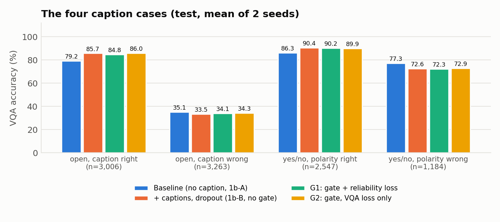
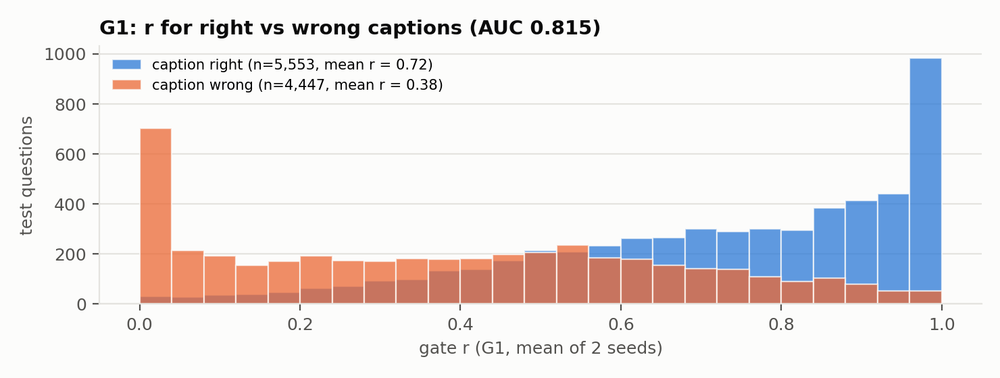
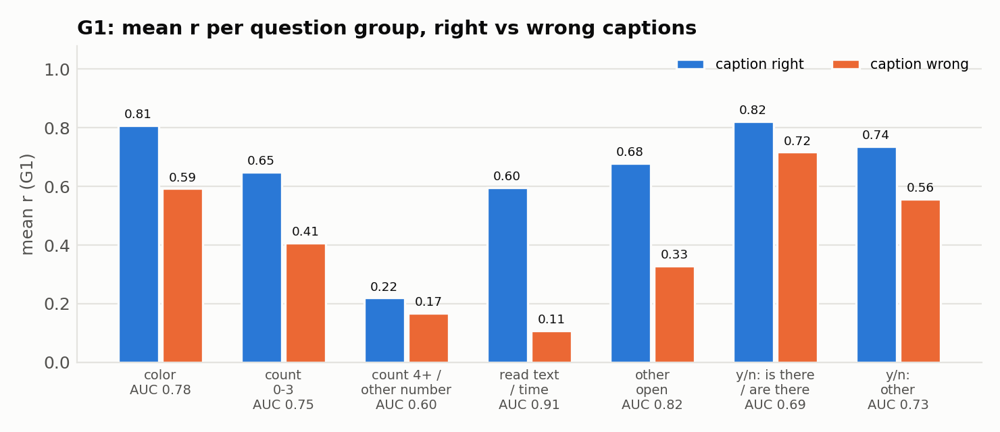
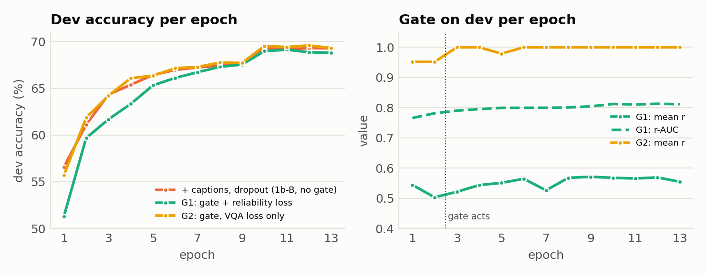
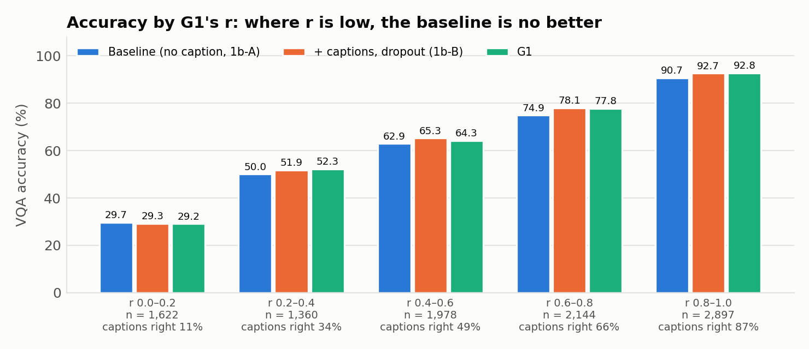

# Caption gate v1: a per-question reliability gate for the captions

This round tests the main remaining weakness from `VQA_ROUND2_REPORT.md`: **a correct caption helps a lot, but a wrong
caption still lowers accuracy.** A small **gate** inside the VQA model estimates, for every question, how reliable its
caption is (r between 0 and 1) and turns the caption down when r is low. Two versions were trained, 2 seeds each, and
compared with the same model without a gate.

Test set unchanged: **10,001 val2014 questions** (5,000 dev questions on other images). All numbers are the mean of 2 seeds.

| Model (test) | Dev | **Test** | Yes/no | Number | Other | Shuffled captions |
|---|---:|---:|---:|---:|---:|---:|
| Baseline, no caption (1b-A) | 66.89 | 66.39 ± 0.33 | 83.54 | 48.54 | 58.35 | — |
| + captions, caption dropout 0.3, **no gate** (1b-B) | 69.45 | 68.31 ± 0.35 | 84.90 | 51.21 | 60.49 | 64.48 |
| **G1:** + gate, trained with a reliability loss | 69.26 | 68.13 ± 0.04 | 84.65 | 50.81 | 60.42 | 64.51 |
| **G2:** + gate, trained by the VQA loss only | 69.59 | **68.53 ± 0.04** | 84.63 | 51.27 | **61.12** | **64.90** |
| Best ensemble (8 caption models + 2 baselines) | 70.73 | **69.67** | 85.76 | 52.49 | 62.25 | — |

**Summary**

- **G1's gate learned to tell right from wrong captions.** Its r separates them with an **AUC of 0.81**: mean r is 0.72 for right
  captions and 0.38 for wrong ones. That is clearly more than the question type alone gives (AUC 0.68).
  - For reading text and clock times the separation is almost perfect (AUC 0.91).
  - For counts of 4 or more it lowers r for almost every caption.
- **But the gate does not raise accuracy.** G1: 68.13, G2: 68.53, the model without a gate: 68.31. All three are within seed noise. In the
  four caption cases the gated models stay where the model without a gate was.
- **The reason:** where the gate says "unreliable", the baseline without captions is not better. For the 1,622 questions with
  r < 0.2 (only 11% right captions) the baseline scores 29.7 and the caption model 29.3: these are simply hard questions.
  In every other range of r the caption model beats the baseline, so turning the caption down cannot win anything.
  Using r to switch between the caption model and the baseline confirms it: no gain (section 5).
- **G2 (no reliability loss) opened its gate completely:** r = 1.000 for every question from the epoch the gate starts
  acting. Trained only to answer correctly, the model always wants the full caption. G2 is therefore the 1b-B
  model plus unused parameters, and its +0.2 is noise.
- **Thesis conclusion:** after caption dropout, the VQA model already uses captions about as well as a reliability
  signal allows. The remaining loss from wrong captions (about 1.5 points on open questions) sits on questions that are hard
  with or without a caption. The gate is still valuable as an **interpretable reliability estimate**: its r tracks
  answer accuracy from 29% to 93% (figure 5).

---

## 1. The two gated models and how they differ

Both gated models have **exactly the same architecture**: the 1b-B model plus the gate. The gate always computes r,
and r always acts on the caption. **The only difference is how the gate is trained.**

```
question ─► LSTM ─► 6× self-attention ─────────────► question summary q ─┐
image ─► 37 BUTD regions ─► Linear ─► question-guided pooling ─► v ──────┼─► MLP([q; v; c; q⊙c; v⊙c]) ─► r = σ(·)
caption ─► LSTM ─► caption tokens ─► attention pooling ─► c ─────────────┘
                                                                          │
DECODER (6 layers): regions + caption tokens attend to each other.        ▼
log r is added to the attention scores on every caption token, in all decoder layers and in the final pooling:
   r ≈ 1 → caption used as before;   r ≈ 0 → caption effectively hidden, answer from question + image.
```

| | G1: gate + reliability loss | G2: gate, VQA loss only |
|---|---|---|
| Architecture | 1b-B + gate (61.29M parameters) | identical |
| r computed and applied | yes | yes |
| Training signal 1: **VQA loss** (soft-score BCE on the answers) | yes | yes |
| Training signal 2: **reliability loss** (BCE between r and "caption right / wrong") | **yes, weight 1.0** | **no (weight 0)** |
| What the gate is taught | directly: "this caption contains the answer, r should be high" | only indirectly: r goes down only if that improves the final answer |
| `GATE_AUX` / `gate_aux_weight` | 1.0 | 0 |
| Kaggle | `vqa-firstbasepaper` version 85, `RUN=vqa_gate_aux` | version 87, `RUN=vqa_gate_noaux` |

**Reliability label (G1 only).** A caption counts as reliable (1) if it contains the majority human answer, or, for
yes/no questions, has the right polarity ("not …" for "no"). Otherwise it counts as unreliable (0). This is the same definition as in the
earlier reports. 56.1% of the training captions are reliable.
- The gold answer is used **only to build this training target**. It is never a model input, and at test time the gate sees only question, image and caption.
- Questions whose caption is hidden by caption dropout are left out of the reliability loss.

**Why G2 was trained:** it is the control experiment. If G1 beat G2, the reliability supervision would be what makes the
gate work. G2 shows what the gate does when nobody tells it which captions are right.

---

## 2. All settings

All four models share the data, split, features, captions and training schedule (first table). The second table lists
everything that differs between them.

| Group | Setting | Value |
|---|---|---|
| Data | training questions | 643,110 (all train2014 + val2014 outside dev/test) |
| | dev / test | 5,000 / 10,001 val2014 questions, no shared images, identical in every experiment |
| | answer vocabulary | 3,091 answers (seen ≥ 9 times as majority answer) |
| | words | 17,977 (question + caption words, min count 1) |
| | question / caption length | 14 / 24 tokens |
| Image | features | 37 BUTD regions × 2048 (Faster R-CNN, Visual Genome) |
| Captions | captioner | BLIP-base, question as prompt, frozen ViT, 4 epochs, beam 3 |
| | cross-fitting | two fold captioners; no captioner captions an image it trained on (658,111 captions) |
| Model | type | MCAN-small: 6 encoder + 6 decoder layers, d = 512, 8 heads, FFN 2048, dropout 0.1 |
| | word vectors | GloVe 840B, 300-d (16,282 of 17,975 words found) |
| | caption input | separate LSTM, caption tokens appended to the image regions in the decoder |
| Training | optimizer | Adam (0.9, 0.98), lr 1e-4, no weight decay, gradient clip 5 |
| | schedule | 13 epochs, 2 warm-up epochs, lr × 0.2 at epochs 10 and 12; best dev epoch kept |
| | batch | 64 |
| | loss | soft-score binary cross-entropy over the 3,091 answers |
| | **caption dropout** | **0.3** for all caption models: the caption of 30% of the training questions is hidden; dev/test always get their caption |
| Gate (G1, G2) | inputs | question summary, question-guided image summary, caption summary, products q⊙c, v⊙c |
| | network | MLP 2560 → 512 → 1, sigmoid; output bias initialised to +3 (r ≈ 0.95 at the start) |
| | where r acts | log r added to the attention on the caption tokens (all 6 decoder layers + final pooling); smooth floor r ≥ 1e-4 |
| | gate warm-up | the gate is trained but not applied in the 2 LR warm-up epochs, and acts from epoch 3 |
| | reliability loss weight | **G1: 1.0**, **G2: 0** |
| Runs | seeds | 0 and 1, trained in parallel, one per T4 GPU (Kaggle) |

| Model | Config | Captions | Caption dropout | Gate | Reliability loss | Parameters | Best epochs |
|---|---|---|---:|---|---:|---:|---|
| Baseline (1b-A) | `blip_strong_b64.yaml` | none | — | — | — | 56.38M | 12, 11 |
| 1b-B | `blip_strong_b64.yaml` + `CAPTION_DROPOUT=0.3` | yes | 0.3 | no | — | 58.66M | 10, 11 |
| G1 | `blip_strong_gate.yaml` | yes | 0.3 | yes | 1.0 | 61.29M | 11, 12 |
| G2 | `blip_strong_gate.yaml` + `GATE_AUX=0` | yes | 0.3 | yes | 0 | 61.29M | 12, 12 |

---

## 3. Results in the four caption cases



| Test questions | n | Baseline (no caption) | 1b-B (no gate) | G1 | mean r (G1) | G2 |
|---|---:|---:|---:|---:|---:|---:|
| Open, caption right | 3,006 | 79.2 | 85.7 | 84.8 | 0.69 | 86.0 |
| Open, caption wrong | 3,263 | 35.1 | 33.5 | 34.1 | 0.31 | 34.3 |
| Yes/no, polarity right | 2,547 | 86.3 | 90.4 | 90.2 | 0.75 | 89.9 |
| Yes/no, polarity wrong | 1,184 | 77.3 | 72.6 | 72.3 | 0.58 | 72.9 |

- The goal was: keep the gain on right captions (85.7, 90.4) and move the wrong-caption cases towards the baseline (35.1, 77.3).
  **Neither gated model does this.** G1 gains +0.6 on wrong open captions but loses −0.9 on right ones, and the yes/no cases do not move.
- On yes/no questions the gate stays fairly open even for wrong captions (r 0.58), because yes/no captions are hard to judge (section 4).
- **Shuffled captions** (every question gets another image's caption): 64.5 (1b-B), 64.5 (G1), 64.9 (G2). G1 lowers r to 0.48 on
  shuffled captions (0.57 on real ones). That is a sensible direction, but too weak to change the answers.

---

## 4. What the gate learned (G1)



| How well r separates right from wrong captions | AUC |
|---|---:|
| G1's r, seeds 0 / 1 / their mean | 0.807 / 0.810 / **0.815** |
| r against the "soft" label (any human answer in the caption) | 0.786 |
| only the question type (rate of right captions per type, 2-fold on test) | 0.676 |

- **r learned more than the question type.** It looks at the image and the caption, not only at "how many" or "what
  color".
- **r partly sees through the strict label.** Captions marked wrong that contain *another* human answer (e.g.
  "tennis shoes" when most people said "converse") get mean r 0.44. Truly wrong open captions get 0.25.



| Question group | n | Captions right | r (right) | r (wrong) | AUC within group |
|---|---:|---:|---:|---:|---:|
| Open: color | 994 | 70.3% | 0.81 | 0.59 | 0.78 |
| Open: count 0–3 | 804 | 55.7% | 0.65 | 0.41 | 0.75 |
| Open: count 4+ / other number | 434 | 13.8% | 0.22 | 0.17 | 0.60 |
| Open: read text / time | 600 | 24.7% | 0.60 | 0.11 | **0.91** |
| Open: other (objects, places, activities) | 3,437 | 48.0% | 0.68 | 0.33 | 0.82 |
| Yes/no: is there / are there | 568 | 76.4% | 0.82 | 0.72 | 0.69 |
| Yes/no: other | 3,163 | 66.8% | 0.74 | 0.56 | 0.73 |

- **Counting 4+:** the gate distrusts almost all of these captions (only 14% are right). That's the correct decision for the group, though it can't pick out the right ones.
- **Reading text / time:** the gate recognises the generic non-answers ("the number is a number") and keeps the few captions that actually read the text.
- **Yes/no** is the hardest to judge (AUC 0.69–0.73). A caption saying "the man is not smiling" looks equally plausible
  whether or not it is true. Only the image can decide, and that is exactly what the VQA model itself is doing.



- **G1** learns the reliability signal from the first epoch (dev AUC 0.77) and improves it slowly to 0.81. The
  reliability loss falls from 0.62 to 0.45. G1 learns the answers more slowly in the early epochs (dev 51.3 vs 55.7 after epoch 1)
  but catches up after the learning-rate decay.
- **G2**'s gate stays at its starting value (r = 0.95) during the warm-up. From epoch 3, when it starts acting, it jumps
  to r = 1.000 for every question and stays there. Without the reliability loss, the VQA loss only pushes r up.

---

## 5. Why a good reliability signal does not raise accuracy



| G1's r | n | Captions right | Baseline (no caption) | 1b-B (no gate) | G1 | Best of baseline / 1b-B per question |
|---|---:|---:|---:|---:|---:|---:|
| 0.0–0.2 | 1,622 | 11% | 29.7 | 29.3 | 29.2 | 34.0 |
| 0.2–0.4 | 1,360 | 34% | 50.0 | 51.9 | 52.3 | 58.5 |
| 0.4–0.6 | 1,978 | 49% | 62.9 | 65.3 | 64.3 | 71.6 |
| 0.6–0.8 | 2,144 | 66% | 74.9 | 78.1 | 77.8 | 82.6 |
| 0.8–1.0 | 2,897 | 87% | 90.7 | 92.7 | 92.8 | 94.2 |

- **Low r marks hard questions, not just bad captions.** When r < 0.2 the caption is almost always wrong, but the baseline
  without any caption is just as bad (29.7 vs 29.3). The caption model has already learned (via caption dropout) to
  rely little on these captions, so there is nothing left to recover by hiding them.
- **Even half-right captions help.** For r 0.2–0.6 most captions are "wrong" by the strict label, yet the caption model
  still beats the baseline by 2–2.5 points. A caption that names the right object or scene helps even without the exact answer word.
- **Using r as a switch between models gives the same picture** (no tuning, test only):

| Combination (scores averaged over 2 seeds) | Test |
|---|---:|
| Baseline alone | 67.27 |
| G1 alone | 68.66 |
| r · G1 + (1 − r) · baseline, per question | 68.65 |
| hard switch: r < 0.5 → baseline answer, else G1 | 68.55 |
| fixed 0.5 · G1 + 0.5 · baseline | 68.52 |
| 1b-B alone | 68.97 |
| r · 1b-B + (1 − r) · baseline | 68.83 |

The per-question "best of both" column shows a theoretical ceiling of a few points per range. Reaching it needs to know **which
model will be right**, not whether **the caption** is right. The two only partly overlap.

---

## 6. Ensemble

The gated models are different enough from the round-1b models to help an ensemble a little (weights chosen on dev):

| Ensemble (+ 2 Stage A+B baselines, caption weight w chosen on dev) | w | Dev | **Test** |
|---|---:|---:|---:|
| Previous best: 4 round-1b caption models (1b-B, 1b-C) | 0.9 | 70.70 | 69.56 |
| 4 gated models (G1, G2) | 0.9 | 70.31 | 69.43 |
| G1 + 1b-B | 0.9 | 70.45 | 69.30 |
| G2 + 1b-B + 1b-C | 1.0 | 70.68 | 69.65 |
| **all 8 caption models (1b-B, 1b-C, G1, G2)** | 0.9 | **70.73** | **69.67** |

+0.11 over the previous best, within noise. The ensemble stays a final add-on, not a contribution.

---

## 7. Conclusions and next steps

**For the thesis**
1. **Question-dependent captions help**: +1.9 to +2.1 over the identical model without captions (1b-A → 1b-B / G2).
2. **Caption dropout** is the effective way to make the model robust to wrong captions (shuffled captions: 60.5 → 64.5).
3. **A learned per-question reliability gate** finds unreliable captions well (AUC 0.81, beyond the question type).
   However, it does not improve accuracy: after caption dropout, the model's remaining caption errors sit on
   questions that are hard without a caption too. This is a clear negative result with an explanation. It also shows where the
   ceiling of caption-based VQA lies with the current captioner.
4. **Without explicit reliability supervision the gate stays fully open (G2).** The VQA objective alone never asks for less
   caption.

**Next steps**

| # | Step | Why | Cost |
|---|---|---|---|
| 1 | **Captioner confidence (beam scores, running now)**: measure its AUC against the same labels, locally | if the captioner's own confidence beats 0.81, gate v2 is worth one run; if not, the gate line ends here | analysis only |
| 2 | **r as a confidence score for the whole system** (selective answering: accuracy vs share of answered questions) | r tracks accuracy from 29% to 93%; a clean, interpretable use of the gate | analysis only |
| 3 | **Third seed** for the final models (baseline 1b-A, 1b-B, G2) | complete the 3-seed protocol | ~6 h per model |
| 4 | **Official test-dev evaluation** of the final model | the 10k questions have been used for decisions | test2015 features + captions (~1 day) |

---

### Files

| | |
|---|---|
| Code | branch `feat/captionvqa-blip`: `CaptionVQA/models_vqa.py` (`_CaptionGate`, `MCANVQA(caption_gate=True)`), `train_vqa.py` (reliability label and loss, gate warm-up, 4 cases, AUC), `configs/blip_strong_gate.yaml`, `scripts/kaggle_vqa_strong.sh` (`GATE_AUX`) |
| Results | `CaptionVQA/vqa_gate_aux/` (G1), `CaptionVQA/vqa_gate_noaux/` (G2), `gate_analysis.json`, `vqa_ensemble_gate*.md` |
| Analysis / figures | `CaptionVQA/scripts/gate_analysis.py` → `report_figs_gate/`; caption groups from `scripts/caption_error_analysis.py` |
