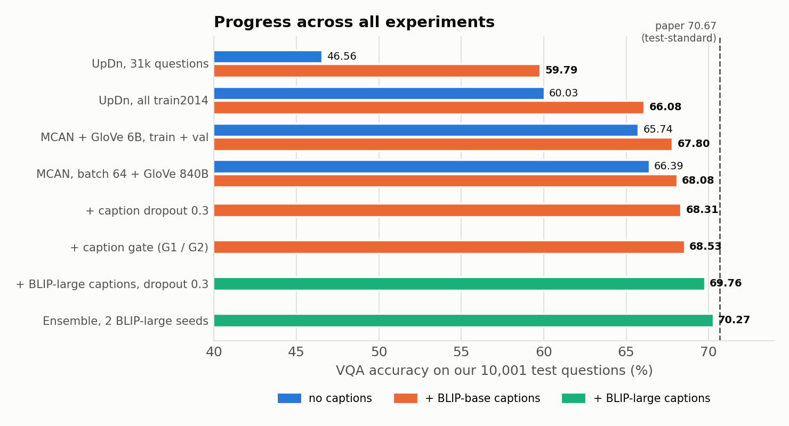
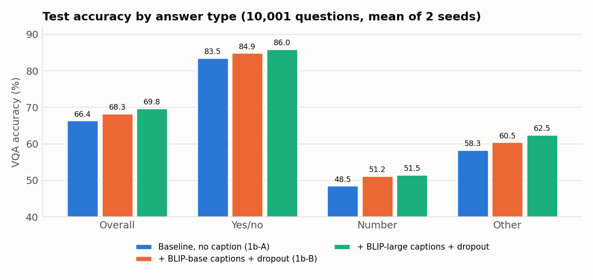
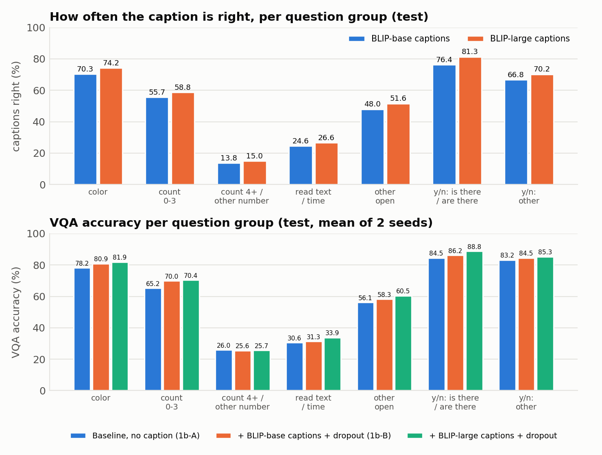
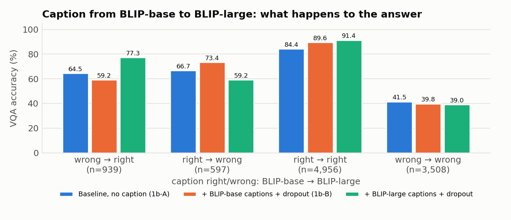
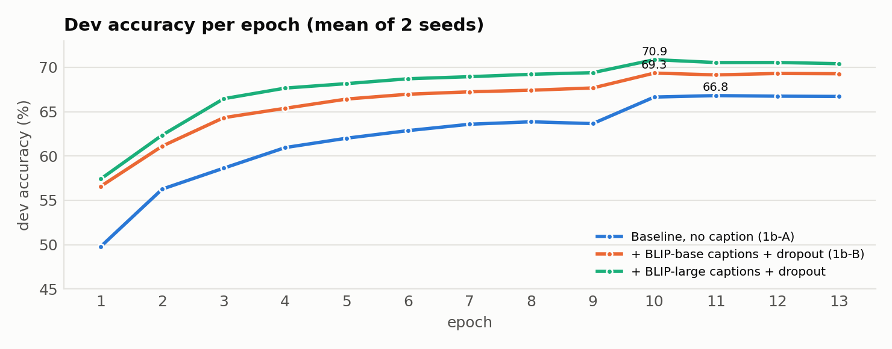

# VQA with BLIP-large captions: baseline vs + captions + caption dropout

This round replaces the captioner: **BLIP-large instead of BLIP-base**. Everything else stays the same: the same VQA model
(MCAN, batch 64, GloVe 840B, caption dropout 0.3, no gate), training data, split and test set. So the change in accuracy
comes from the captions alone.

Test set unchanged: **10,001 val2014 questions** (5,000 dev questions on other images). Single models: mean of 2 seeds.

| Model (test) | Dev | **Test** | Yes/no | Number | Other | Shuffled captions |
|---|---:|---:|---:|---:|---:|---:|
| VQA baseline, no caption (1b-A) | 66.89 | 66.39 ± 0.33 | 83.54 | 48.54 | 58.35 | — |
| VQA + BLIP-base captions + caption dropout (1b-B) | 69.45 | 68.31 ± 0.35 | 84.90 | 51.21 | 60.49 | 64.48 |
| **VQA + BLIP-large captions + caption dropout** | **70.86** | **69.76 ± 0.07** | **85.99** | **51.55** | **62.52** | 63.44 |
| Ensemble of the 2 BLIP-large seeds | 71.72 | **70.27** | 86.23 | 52.73 | 63.04 | — |

**Summary**

- **BLIP-large captions add +1.45 points** over BLIP-base captions (95% interval +1.0 to +1.9) and **+3.37 over the
  baseline without captions** (+2.8 to +3.9). The two seeds agree closely (69.71 / 69.81).
- **The gain grows with caption quality.** On the test questions, right captions rise from 55.5% to 58.9%. Where a caption changed
  from wrong to right (939 questions), accuracy rises from 59.2 to 77.3. Where it changed from right to wrong (597), it falls
  from 73.4 to 59.2. Together with better use of the captions that were already right, this accounts for the whole +1.45.
- **The caption gain over the baseline is the largest since we moved to the strong MCAN model** (+3.4, against +1.9 with
  BLIP-base). It is now positive in every question group except large counts. The biggest gains are on objects/activities (+4.4),
  small counts (+5.2), color (+3.7), "is there" questions (+4.3) and reading text (+3.3).
- **Best results so far on our test set: 69.76 for a single model and 70.27 for the ensemble of its two seeds**, the first result
  above 70. The paper's 70.67 is on the official test-standard set, so it is not directly comparable. That is the next step.
- **Decision:** BLIP-large + caption dropout is the final model setup. Next: train it on train + val and evaluate it on the
  official test-standard.

---

## 1. All VQA models trained so far

Every model is tested on the same 10,001 val2014 questions. All captions are cross-fitted: no captioner ever captions an image it
was trained on.

| # | Model | Training questions | Captions | Caption dropout | Gate | Test (mean of seeds) |
|---|---|---|---|---:|---|---:|
| 1 | UpDn baseline | 31k (train2014 subset) | — | — | — | 46.56 |
| 2 | UpDn + captions | 31k | BLIP-base | — | — | 59.79 |
| 3 | UpDn baseline | 443,757 (all train2014) | — | — | — | 60.03 ± 0.45 |
| 4 | UpDn + captions | 443,757 | BLIP-base | — | — | 66.08 ± 0.20 |
| 5 | MCAN + GloVe 6B, batch 128 | 643,110 (train2014 + val2014 outside dev/test) | — | — | — | 65.74 ± 0.31 |
| 6 | MCAN + GloVe 6B, batch 128 + captions | 643,110 | BLIP-base | — | — | 67.80 ± 0.06 |
| 7 | **MCAN + GloVe 840B, batch 64 (1b-A)** | 643,110 | — | — | — | **66.39 ± 0.33** |
| 8 | MCAN 840B, batch 64 + captions (1b-C) | 643,110 | BLIP-base | 0 | — | 68.08 ± 0.13 |
| 9 | MCAN 840B, batch 64 + captions (1b-B) | 643,110 | BLIP-base | 0.3 | — | 68.31 ± 0.35 |
| 10 | G1: 1b-B + gate + reliability loss | 643,110 | BLIP-base | 0.3 | yes (loss 1.0) | 68.13 ± 0.04 |
| 11 | G2: 1b-B + gate, VQA loss only | 643,110 | BLIP-base | 0.3 | yes (loss 0) | 68.53 ± 0.04 |
| 12 | **MCAN 840B, batch 64 + captions (this round)** | 643,110 | **BLIP-large** | 0.3 | — | **69.76 ± 0.07** |

| Ensemble (weights chosen on dev) | Dev | Test |
|---|---:|---:|
| 4 Stage A+B models (#5, #6, 2 seeds each) | 70.26 | 69.11 |
| 8 BLIP-base caption models (#8–#11) + 2 baselines (#5) | 70.73 | 69.67 |
| **2 BLIP-large seeds (#12)** | **71.72** | **70.27** |
| 2 BLIP-large + 4 BLIP-base caption models (#8, #9) + 1b-A baselines | 71.60 | 70.24 |
| all 10 caption models + 2 baselines | 71.07 | 70.07 |

The older BLIP-base models no longer help the ensemble: the BLIP-large model is right on most questions they get right.

---

## 2. What changed in this round, and all settings

**Captioner** (the only change)

| | BLIP-base (before) | BLIP-large (now) |
|---|---|---|
| Pretrained model | `Salesforce/blip-image-captioning-base` (ViT-B/16, ~225M) | `Salesforce/blip-image-captioning-large` (ViT-L/16, ~470M) |
| Fine-tuning | question as prompt, frozen ViT, 4 epochs, batch 48 per GPU (2 × T4), lr 3e-5, label smoothing 0.1 | identical |
| Choice of `best.pt` | best val CIDEr | **most right captions on val** (AnswerHit for open questions + polarity for yes/no) |
| Cross-fitting | 2 fold captioners, each trained on half of the train2014 images | identical (both BLIP-large folds retrained with the new `best.pt` rule) |
| Decoding | beam 3 | beam 3, all beams and their scores saved |
| Captions | 658,111 (all train2014 + val2014 questions) | 658,111 |

On 10,000 unseen QD rows the fold-0 BLIP-large captioner had AnswerHit 61.05 vs 58.10 and polarity 77.75 vs 75.10
(`../QuestionDependentImageCaptioner/CAPTIONER_SCALE_REPORT.md`; that measurement used the earlier, CIDEr-selected fold-0 model).

**VQA model** (unchanged from 1b-B; config `configs/blip_strong_b64.yaml` + `CAPTION_DROPOUT=0.3`)

| Setting | Value |
|---|---|
| Model | MCAN-small: 6 encoder + 6 decoder layers, d = 512, 8 heads, FFN 2048, dropout 0.1; caption tokens (own LSTM) appended to the image regions in the decoder |
| Image | 37 BUTD regions × 2048 (Faster R-CNN, Visual Genome) |
| Words | GloVe 840B 300-d; 18,039 words (question + caption, min count 1); questions ≤ 14, captions ≤ 24 tokens |
| Answers | 3,091 (majority answer seen ≥ 9 times); soft-score binary cross-entropy |
| Training | Adam (0.9, 0.98), lr 1e-4, 2 warm-up epochs, × 0.2 at epochs 10 and 12, 13 epochs, batch 64, gradient clip 5; best dev epoch kept (epoch 10 for both seeds) |
| Caption dropout | 0.3: for 30% of the training questions the caption is hidden; dev/test always get their caption |
| Gate | none (`caption_gate: false`; the gate code stays in the repository for the ablation) |
| Data | 643,110 training questions; dev 5,000 / test 10,001 val2014 questions, identical in all experiments |
| Parameters | 58.68M (1b-A baseline 56.38M; the difference is the caption LSTM and its larger vocabulary) |
| Kaggle | `mehdirouzmeh/vqa-with-blip-large`, `RUN=vqa_large_drop`, `CAPTIONS_FILE=captions_crossfit_large.json`, seeds 0 and 1 on 2 T4 GPUs |

---

## 3. Main comparison: VQA vs VQA + BLIP-large captions + caption dropout

### 3.1 Overall and by answer type

| Paired difference on the same 10,001 questions (mean of 2 seeds each) | Δ test | 95% interval |
|---|---:|---:|
| + BLIP-large captions vs baseline | **+3.37** | +2.84 … +3.87 |
| + BLIP-large captions vs + BLIP-base captions | **+1.45** | +1.01 … +1.94 |
| + BLIP-base captions vs baseline | +1.92 | +1.44 … +2.42 |

| Answer type (n) | Baseline | + BLIP-base | + BLIP-large | Gain over baseline |
|---|---:|---:|---:|---:|
| Yes/no (3,721) | 83.54 | 84.90 | 85.99 | +2.45 |
| Number (1,359) | 48.54 | 51.21 | 51.55 | +3.01 |
| Other (4,921) | 58.35 | 60.49 | **62.52** | **+4.17** |
| **Overall** | 66.39 | 68.31 | **69.76** | **+3.37** |

Most of the new gain is on "other" questions (objects, activities, places: +2.0 over BLIP-base). Those are the questions where
a stronger image encoder recognises more.

### 3.2 By question group

| Question group (n) | Captions right: BLIP-base → BLIP-large | Baseline | + BLIP-base | + BLIP-large | Gain over baseline |
|---|---|---:|---:|---:|---:|
| color (994) | 70.3 → 74.2 | 78.2 | 80.9 | 81.9 | +3.7 |
| count 0–3 (804) | 55.7 → 58.8 | 65.2 | 70.0 | 70.4 | +5.2 |
| count 4+ / other number (434) | 13.8 → 15.0 | 26.0 | 25.6 | 25.7 | −0.3 |
| read text / time (601) | 24.6 → 26.6 | 30.6 | 31.3 | 33.9 | +3.3 |
| other open: objects, places, activities (3,437) | 48.0 → 51.6 | 56.1 | 58.3 | **60.5** | **+4.4** |
| yes/no: is there / are there (568) | 76.4 → 81.3 | 84.5 | 86.2 | **88.8** | **+4.3** |
| yes/no: other (3,163) | 66.8 → 70.2 | 83.2 | 84.5 | 85.3 | +2.1 |
| **all** (10,001) | **55.5 → 58.9** | 66.4 | 68.3 | **69.8** | **+3.4** |

- **BLIP-large captions are right more often in every group**, and the VQA model gains in every group where captions are right
  reasonably often.
- **Large counts (4+) stay hopeless for both captioners** (15% right). The captions neither help nor hurt there.

**Largest question types** (n ≥ 250):

| Question type | n | Baseline | + BLIP-base | + BLIP-large | Δ vs BLIP-base |
|---|---:|---:|---:|---:|---:|
| how many | 977 | 54.0 | 57.5 | 58.1 | +0.6 |
| is the | 811 | 81.9 | 83.6 | 84.2 | +0.6 |
| what | 759 | 49.3 | 50.3 | 51.9 | +1.6 |
| what color is the | 638 | 79.9 | 84.2 | 85.0 | +0.8 |
| what is the | 551 | 53.9 | 56.6 | 59.0 | +2.4 |
| none of the above | 390 | 60.8 | 61.6 | 62.3 | +0.6 |
| is this a | 355 | 84.2 | 86.3 | 88.3 | +2.0 |
| is this | 351 | 87.1 | 87.8 | 88.0 | +0.2 |
| what is | 293 | 45.4 | 46.8 | 50.0 | +3.2 |
| what kind of | 270 | 60.2 | 60.3 | 65.0 | **+4.7** |
| are the | 258 | 79.7 | 79.4 | 81.7 | +2.3 |

---

## 4. Why it works: better captions turn into better answers

### 4.1 Questions whose caption changed

Each test question is sorted by whether its BLIP-base caption and its BLIP-large caption contain the right answer (or polarity):

| Caption: BLIP-base → BLIP-large | n | Baseline | + BLIP-base | + BLIP-large | Contribution to the +1.45 |
|---|---:|---:|---:|---:|---:|
| wrong → right | 939 | 64.5 | 59.2 | **77.3** | **+1.70** |
| right → wrong | 597 | 66.7 | **73.4** | 59.2 | −0.85 |
| right → right | 4,956 | 84.4 | 89.6 | **91.4** | +0.89 |
| wrong → wrong | 3,508 | 41.5 | 39.8 | 39.0 | −0.28 |

(Contribution = n × accuracy change / 10,001; the four rows add up to the +1.45. The changed captions give a net +0.85: there are more
wrong → right changes (939) than right → wrong (597), and each gains more than the other loses. The already-right captions
give another +0.89.)

- **This is direct evidence that the captions drive the answers.** The same question, answered by models with the same
  architecture and training, gains 18 points when its caption becomes right and loses 14 when it becomes wrong.
- **Captions that were already right help even more** (89.6 → 91.4). A model trained on more reliable captions learns to use
  them with more confidence.
- **Wrong → wrong:** a slight loss (−0.8). The flip side of that confidence, see 4.3.

### 4.2 The four caption cases (BLIP-large captions)

| Test questions (labels from the BLIP-large captions) | n | Baseline | + BLIP-large | Δ |
|---|---:|---:|---:|---:|
| Open, caption right | 3,211 | 77.7 | **87.2** | **+9.5** |
| Open, caption wrong | 3,058 | 33.8 | 31.9 | −1.9 |
| Yes/no, polarity right | 2,684 | 85.4 | **91.5** | **+6.1** |
| Yes/no, polarity wrong | 1,047 | 78.3 | 71.5 | −6.8 |

With BLIP-base captions the same table had 3,006 / 3,263 / 2,547 / 1,184 questions. BLIP-large moves **205 open and 137 yes/no
questions** from the "wrong" rows to the "right" rows. Those rows gain the most from captions.

**Who knows the answer** (test, BLIP-large captions; "VQA alone right" = baseline score ≥ 0.6):

| | BLIP-base | BLIP-large |
|---|---:|---:|
| only the caption (new information for VQA) | 11.3% | **12.7%** |
| only the VQA model (caption can only mislead) | 19.1% | **17.2%** |
| both | 44.3% | 46.2% |
| neither | 25.3% | 23.9% |

### 4.3 More reliance on captions

With completely shuffled captions (every question gets another image's caption) the BLIP-large model scores 63.44, against
64.48 for the BLIP-base model. It trusts its captions a little more because they are more often right, so random captions
hurt it a little more. The same effect shows in the "yes/no, polarity wrong" row (−6.8 against the baseline). Caption dropout
still keeps the model well above a caption-only system.

### 4.4 Training

The BLIP-large model is ahead of the BLIP-base model at every epoch (≈ +1.5 on dev) and peaks at the same epoch (10, after the
first learning-rate decay). Both seeds peak at 70.86 on dev.

---

## 5. Where we stand and next steps

| | Accuracy | Test set |
|---|---:|---|
| Ours, single model (BLIP-large + caption dropout) | **69.76** | our 10,001 val2014 questions |
| Ours, ensemble of 2 seeds | **70.27** | our 10,001 val2014 questions |
| Base paper (Sharma & Jalal 2021), Baseline + Att + Cap | 70.67 | official test-standard |

The paper's number is on a different test set and the 10k questions have been used for every decision in this project,
so the final comparison must be on the **official test-standard**.

**Final model:** MCAN + BLIP-large question-dependent captions + caption dropout 0.3 (no gate).

| # | Step | Status / cost |
|---|---|---|
| 1 | BLIP-large captions for all 447,793 test2015 questions (step 2b) | running / done on Kaggle |
| 2 | BUTD features for the 81,434 test2015 images | ~4–5 h on 2 T4s |
| 3 | Train the final model on **all** of train2014 + val2014 (including our dev/test questions), fixed 10 epochs as chosen on dev here, 2–3 seeds | ~6 h per notebook |
| 4 | Predict all test2015 questions, write the EvalAI results file (single model and seed ensemble) | small script |
| 5 | Submit to EvalAI: test-dev first, then once to **test-standard** (your account) | — |
| 6 | Same for the baseline without captions, so the caption gain is also shown on test-standard | ~6 h |

---

### Files

| | |
|---|---|
| Code | branch `feat/captionvqa-blip`: `QuestionDependentImageCaptioner/configs/b_blip_fold_large.yaml` (`select_metric: answer`), `scripts/kaggle_blip_fold_v2.sh`; `CaptionVQA/scripts/kaggle_caption_beams.sh` (`CAPTIONER=large`), `scripts/kaggle_vqa_strong.sh` (`CAPTIONS_FILE`) |
| Results | `CaptionVQA/vqa_large_drop/` (2 seeds; BLIP-large captions in `captions/`), `large_analysis.json`, `caption_error_analysis_large.md`, `vqa_ensemble_large*.md` |
| Figures | `CaptionVQA/scripts/large_analysis.py` → `report_figs_large/` |
