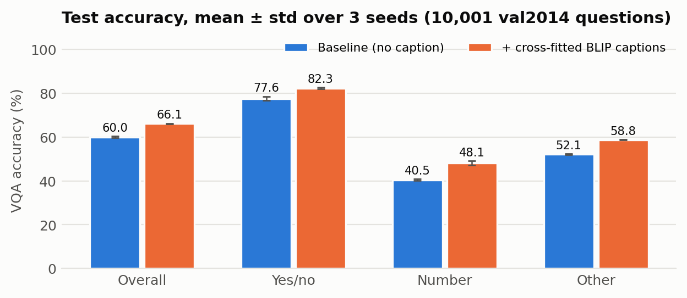
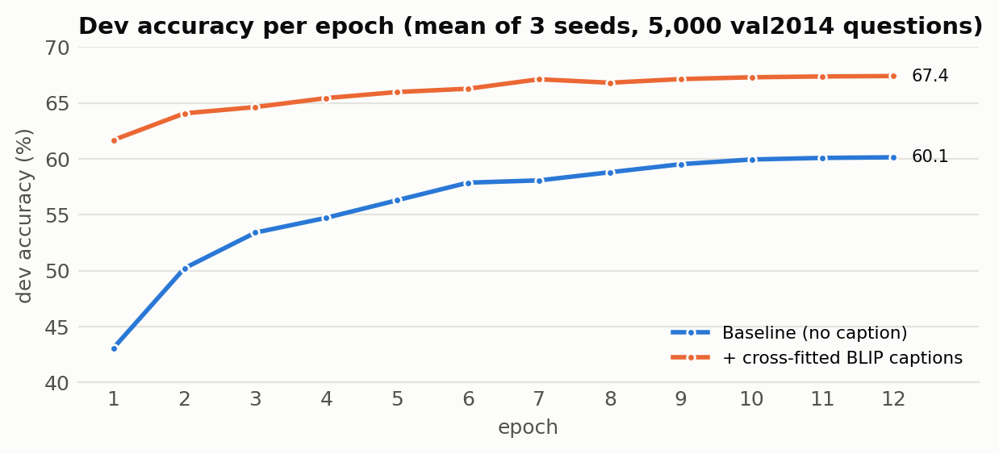
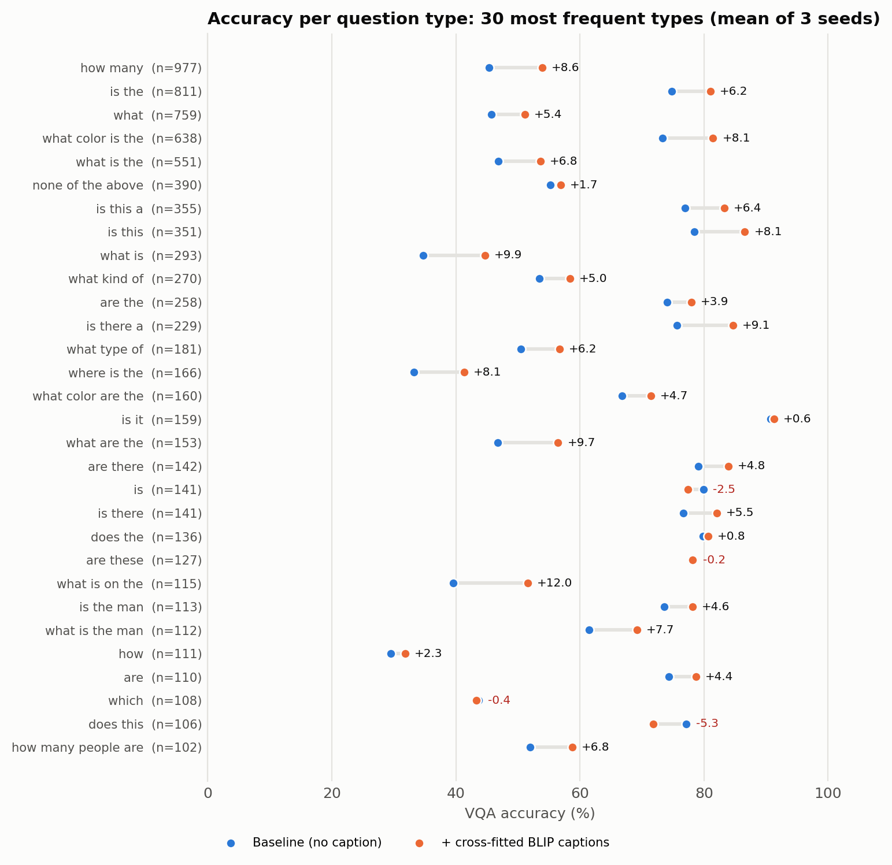
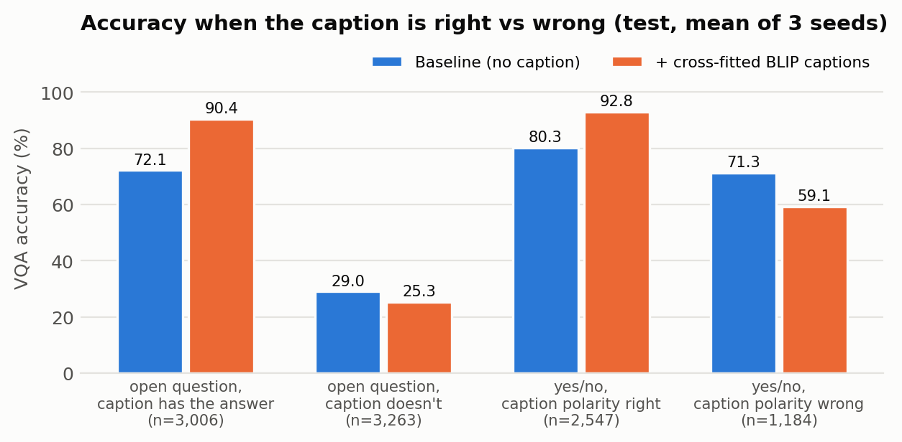

# Question-dependent captions improve VQA: baseline vs + cross-fitted BLIP captions

Stage 2 of the thesis pipeline. Two VQA models are trained on the same data with the same settings. They differ
**only** in one input: a question-dependent caption written by the BLIP captioner from stage 1.

| VQA model (all of train2014, test = 10,001 val2014 questions, 3 seeds) | Overall | Yes/no | Number | Other |
|---|---:|---:|---:|---:|
| Baseline (Bottom-Up Top-Down, no caption) | 60.03 ± 0.45 | 77.59 ± 0.98 | 40.47 ± 0.40 | 52.15 ± 0.29 |
| **+ cross-fitted BLIP captions** | **66.08 ± 0.20** | **82.30 ± 0.41** | **48.11 ± 1.01** | **58.77 ± 0.13** |
| **Gain** | **+6.05** | +4.72 | +7.64 | +6.62 |

**Summary**

- **Captions add +6.05 points of accuracy,** about 13 standard deviations of the seed spread. Every answer type
  improves, and 57 of the 65 VQA question types improve.
- **The comparison is fair.** Both models train on the same 443,757 questions. Through cross-fitting, every caption is
  written by a captioner that never saw that image: the captions are as good on training images (48.4% contain the
  answer) as on test images (48.0%).
- **The model really reads the captions.** With another image's caption, accuracy falls from 66.1 to 47.2,
  far below even the baseline. Correct captions add +18 points (open questions) and +13 (yes/no). Wrong yes/no
  captions cost −12: the main thing to improve.
- **Against the base paper** (Sharma & Jalal 2021: 70.67 on VQA 2.0 test-standard): the absolute numbers are not
  directly comparable (different test set, training data and model), but the **gain from captions has the same size**:
  the paper reports +7.35 (Baseline + Att → + Cap) on test-standard; we get +6.05.

---

## 1. Architectures

### 1.1 The captioner (stage 1): BLIP with the question as prompt

```
image (384×384) ──► BLIP ViT-B/16 image encoder (frozen) → 577 patch tokens × 768
decoder input:  [DEC] question: <question> caption: <caption> [SEP]
                ──► BLIP text decoder (BERT-base, 12 layers; each: causal self-attention over question + caption,
                    cross-attention to the image tokens, FFN) ──► caption (beam 3)
```

Fine-tuned on the question-dependent caption dataset (VQA question + answer → one caption that states the answer,
e.g. *"What color is the train?"* → *"The train is blue."*). For this experiment, **two** captioners are trained,
one per half of the train2014 images (cross-fitting, section 2.2). The architecture and settings are the same as the
captioner chosen in stage 1 (4 epochs, AdamW 3e-5, best epoch by validation CIDEr).

### 1.2 VQA baseline: Bottom-Up Top-Down (Anderson et al. 2018)

Code: `CaptionVQA/models_vqa.py`, class `UpDnVQA(use_caption=False)`.

```
question ──► word embedding (300, vocabulary 11,841 words) ──► GRU (512) ──► q
image ──► BUTD Faster R-CNN (ResNet-101, Visual Genome objects + attributes, frozen)
          36 regions + 1 mean token × 2048 ──► LayerNorm + Linear 512 + ReLU ──► v_1 … v_37
TOP-DOWN ATTENTION over regions:  α_i = softmax(w · (FC(v_i) ⊙ FC(q))),   v̂ = Σ α_i v_i
FUSION:      h = FC(q) ⊙ FC(v̂)
CLASSIFIER:  h ──► Linear 1024 ──► ReLU ──► Linear → 5,862 answers (answers seen ≥ 3 times in train)
LOSS:        soft-score binary cross-entropy over the 10 human answers (VQA v2 standard)
```

13.44M parameters.

### 1.3 VQA + captions: the same model plus one caption branch

`UpDnVQA(use_caption=True)`: everything above is unchanged. Added:

```
BLIP caption ──► the same word embedding table ──► BiGRU (2 × 256) ──► one state per caption word c_1 … c_L
QUESTION-GUIDED ATTENTION over caption words:  β_j = softmax(w · (FC(c_j) ⊙ FC(q))),   ĉ = Σ β_j c_j
GATE:        g = σ(W [q ; v̂ ; ĉ])                      (how much to trust the image vs the caption)
FUSION:      h = FC(q) ⊙ ( g ⊙ FC(v̂) + (1 − g) ⊙ FC(ĉ) )
CLASSIFIER:  same as the baseline
```

16.27M parameters; the vocabulary grows to 13,154 words because caption words are added.

**The caption is read as a sequence, not averaged.** In *"the dog is not running"*, the BiGRU state of *running*
carries the *not* before it, so it stays far from *"the dog is running"*. The question then picks the words it needs.
An average of word vectors would make the two sentences almost identical.

### 1.4 Training (identical for both models)

| Setting | Value |
|---|---|
| Optimizer | AdamW, learning rate 1e-3, weight decay 1e-4, 1 warm-up epoch, cosine decay |
| Batch, epochs | 256, 12; the epoch with the best dev accuracy is kept |
| Seeds | 3 per model (0, 1, 2), run in parallel on 2× T4 (Kaggle) |
| Accuracy | official VQA v2 metric: min(#humans who gave the answer / 3, 1), averaged over 10 leave-one-out subsets |

---

## 2. Data, split and cross-fitting

### 2.1 Split

| Split | Source | Questions | Images | Used for |
|---|---|---:|---:|---|
| Train | VQA v2 **train2014**, all questions | 443,757 | 82,783 | training |
| Dev | VQA v2 **val2014** | 5,000 | 879 | choosing the epoch |
| Test | VQA v2 **val2014**, other images | 10,001 | 1,900 | all reported numbers |

- **Dev and test share no image.** They are identical to those of the first, small experiment, so all numbers in this
  project can be compared.
- **Test answer types:** yes/no 3,721, number 1,359, other 4,921.

### 2.2 Cross-fitting

The captioner learns from captions written from the **correct answers**. If it captions an image it was trained
on, it partly *remembers* the answer, and the caption is better than any caption at test time. A VQA model trained
on such captions would learn to trust them too much.

Cross-fitting prevents this. The train2014 images are split into two halves (`CaptionVQA/data/crossfit_folds.json`,
seeded), and each question's caption comes from the captioner that **never saw its image**:

```
train2014 images ──► fold 0: 41,391 images ──► BLIP fold-0, trained on their 138,557 QD captions
                 └─► fold 1: 41,392 images ──► BLIP fold-1, trained on their 138,761 QD captions

captions for fold-0 images  ◄── BLIP fold-1   (never saw fold 0)
captions for fold-1 images  ◄── BLIP fold-0   (never saw fold 1)
dev/test (val2014) images   ◄── half from each fold model
```

**Check: caption quality is the same on train and test**, so there is no train/test mismatch:

| Captions | Answer in caption (non-yes/no) | Yes/no polarity correct |
|---|---:|---:|
| Train, written by fold-0 model (138k / 83k questions) | 48.5% | 68.7% |
| Train, written by fold-1 model (138k / 84k questions) | 48.3% | 68.3% |
| **Train, all** | **48.4%** | **68.5%** |
| **Test** | **48.0%** | **68.3%** |

### 2.3 Why the full-data experiment was needed

A first, small experiment trained the VQA models on only the 30,952 train2014 questions whose images the
(non-cross-fitted) captioner had never seen. Captions raised accuracy from 46.6 to 59.8 (+13.2). But that captioner had
been trained on 264k question–answer pairs, 9× more than the VQA model saw. The baseline trained on all of
train2014 reaches 60.0, so the small experiment could not separate "captions help" from "more data helps". Here both
models see the same 443,757 questions, and the captioners see the same data without leakage. The +6.05 is the
effect of the captions themselves.

---

## 3. Results

### 3.1 Overall and by answer type



| Model | Seed 0 | Seed 1 | Seed 2 | Mean ± std |
|---|---:|---:|---:|---:|
| Baseline | 60.16 | 59.53 | 60.39 | 60.03 ± 0.45 |
| + captions | 66.31 | 65.92 | 66.01 | **66.08 ± 0.20** |

### 3.2 Training curves



- **The caption model learns much faster:** 61.6% after the first epoch, a level the baseline reaches only at the end (60.1).
- **Both models were still rising slightly at epoch 12:** the best epoch was 10–12. A few more epochs could add a little to both.

### 3.3 By question type



- **57 of the 65 question types improve.** The largest gains are on *what is on the* (+12.0), *what is* (+9.9),
  *what are the* (+9.7), *is there a* (+9.1), *how many* (+8.6) and *what color is the* (+8.1).
- **8 types drop, all small:** *does this* (−5.3), *do* (−3.9), *do you* (−3.5), *is* (−2.5), *what room is*
  (−1.1), *has* (−1.0), *which* (−0.4) and *are these* (−0.2). Most are vague yes/no questions, where a caption with the
  wrong polarity misleads the model (section 3.4).

All 65 types (mean of 3 seeds, test accuracy %):

| Question type | Test n | Baseline | + captions | Gain |
|---|---:|---:|---:|---:|
| how many | 977 | 45.3 | 53.9 | +8.6 |
| is the | 811 | 74.8 | 81.0 | +6.2 |
| what | 759 | 45.7 | 51.1 | +5.4 |
| what color is the | 638 | 73.3 | 81.5 | +8.1 |
| what is the | 551 | 46.8 | 53.6 | +6.8 |
| none of the above | 390 | 55.2 | 56.9 | +1.7 |
| is this a | 355 | 76.9 | 83.3 | +6.4 |
| is this | 351 | 78.4 | 86.6 | +8.1 |
| what is | 293 | 34.7 | 44.7 | +9.9 |
| what kind of | 270 | 53.4 | 58.4 | +5.0 |
| are the | 258 | 74.1 | 78.0 | +3.9 |
| is there a | 229 | 75.6 | 84.7 | +9.1 |
| what type of | 181 | 50.5 | 56.7 | +6.2 |
| where is the | 166 | 33.2 | 41.3 | +8.1 |
| what color are the | 160 | 66.8 | 71.4 | +4.7 |
| is it | 159 | 90.7 | 91.3 | +0.6 |
| what are the | 153 | 46.8 | 56.5 | +9.7 |
| are there | 142 | 79.1 | 83.9 | +4.8 |
| is | 141 | 79.9 | 77.4 | -2.5 |
| is there | 141 | 76.6 | 82.1 | +5.5 |
| does the | 136 | 79.8 | 80.6 | +0.8 |
| are these | 127 | 78.3 | 78.1 | -0.2 |
| what is on the | 115 | 39.6 | 51.6 | +12.0 |
| is the man | 113 | 73.6 | 78.2 | +4.6 |
| what is the man | 112 | 61.5 | 69.2 | +7.7 |
| how | 111 | 29.5 | 31.8 | +2.3 |
| are | 110 | 74.3 | 78.7 | +4.4 |
| which | 108 | 43.6 | 43.3 | -0.4 |
| does this | 106 | 77.2 | 71.8 | -5.3 |
| how many people are | 102 | 52.0 | 58.8 | +6.8 |
| what is in the | 85 | 50.0 | 57.9 | +7.8 |
| what is this | 76 | 63.9 | 72.6 | +8.8 |
| what are | 74 | 58.1 | 67.4 | +9.3 |
| do | 73 | 77.8 | 73.8 | -3.9 |
| what does the | 72 | 21.6 | 26.2 | +4.7 |
| what color | 68 | 71.9 | 75.0 | +3.1 |
| what time | 68 | 24.3 | 26.2 | +2.0 |
| why | 66 | 12.7 | 16.2 | +3.5 |
| where are the | 65 | 34.6 | 45.5 | +10.9 |
| what color is | 61 | 76.3 | 86.6 | +10.2 |
| are there any | 59 | 74.9 | 87.9 | +13.1 |
| how many people are in | 59 | 49.1 | 64.0 | +14.9 |
| are they | 57 | 74.2 | 80.8 | +6.6 |
| who is | 51 | 29.9 | 34.1 | +4.2 |
| can you | 48 | 59.6 | 77.2 | +17.6 |
| is this an | 46 | 74.5 | 84.9 | +10.4 |
| what brand | 46 | 39.5 | 47.4 | +7.9 |
| what is the person | 45 | 59.9 | 69.9 | +10.1 |
| what sport is | 43 | 88.8 | 94.2 | +5.3 |
| is he | 42 | 85.6 | 89.0 | +3.3 |
| what animal is | 41 | 80.0 | 83.6 | +3.6 |
| what room is | 41 | 95.3 | 94.1 | -1.1 |
| has | 40 | 73.8 | 72.8 | -1.0 |
| what is the woman | 40 | 54.8 | 72.9 | +18.2 |
| is the woman | 39 | 71.5 | 81.8 | +10.3 |
| was | 39 | 75.3 | 82.8 | +7.5 |
| what is the color of the | 39 | 82.1 | 83.0 | +0.9 |
| what number is | 38 | 6.3 | 8.9 | +2.6 |
| what is the name | 37 | 9.4 | 16.5 | +7.1 |
| do you | 35 | 75.6 | 72.1 | -3.5 |
| is that a | 35 | 74.7 | 81.6 | +7.0 |
| is the person | 33 | 78.2 | 85.1 | +6.9 |
| is this person | 30 | 62.8 | 70.4 | +7.7 |
| could | 27 | 76.4 | 83.0 | +6.5 |
| why is the | 18 | 23.9 | 24.4 | +0.6 |

### 3.4 Does the model use the captions?

| Test | Baseline | + captions |
|---|---:|---:|
| Normal | 60.03 | **66.08** |
| **Captions shuffled** (each question gets another image's caption) | — | **47.20** |
| Gate g (1 = only image, 0 = only caption) | — | 0.55 |

With wrong captions, accuracy falls **19 points**, far below the baseline: the model relies on the captions
heavily, and the gate splits the trust about equally between image and caption.



| Test questions | n | Baseline | + captions | Δ |
|---|---:|---:|---:|---:|
| Open question, caption contains the answer | 3,006 | 72.1 | 90.4 | **+18.3** |
| Open question, caption doesn't | 3,263 | 29.0 | 25.3 | −3.7 |
| Yes/no, caption polarity right | 2,547 | 80.3 | 92.8 | **+12.6** |
| Yes/no, caption polarity wrong | 1,184 | 71.3 | 59.1 | **−12.2** |

- **Correct captions help strongly:** +18 points (open questions) and +13 (yes/no).
- **Wrong captions hurt only a little for open questions** (−3.7), where the model falls back on the image.
- **Wrong yes/no captions cost −12 points:** a caption that says *"there is no …"* pulls the model to "no".
  This is the clearest place to improve, e.g. by giving the model the captioner's confidence, or several beam captions.

---

## 4. Comparison with the base paper

**Base paper:** H. Sharma & A. S. Jalal, *Image captioning improved visual question answering*, Multimedia Tools and
Applications (2021), doi:10.1007/s11042-021-11276-2. Their model fuses a caption-based vector with attended visual
features (32 object regions, LSTM-based attention and answer generation, AdaMax, word dictionary of 9,500 words).

### 4.1 The paper's results on VQA 2.0 (test-standard, Table 6 of the paper)

| Paper model | Number | Yes/no | Other | Overall |
|---|---:|---:|---:|---:|
| Baseline | 44.21 | 78.30 | 53.19 | 61.21 |
| Baseline + Att | 44.06 | 79.21 | 56.29 | 63.32 |
| Baseline + Cap | 46.98 | 85.31 | 59.18 | 69.91 |
| **Baseline + Att + Cap (full model)** | **48.23** | **86.63** | **59.98** | **70.67** |
| *Anderson et al. (Bottom-Up Top-Down), as listed in the paper* | 43.90 | 82.20 | 56.26 | 65.32 |

The paper's ablation on the validation split (its Table 3; it doesn't say which dataset version) gives Baseline 57.12,
+ Att 62.91, + Cap 63.63, full model 66.82.

### 4.2 Our results next to the paper's

| | Paper (test-standard) | Ours (10,001 val2014 questions) |
|---|---:|---:|
| VQA model **without** captions | Baseline + Att: 63.32 | Bottom-Up Top-Down: 60.03 |
| VQA model **with** captions | Baseline + Att + Cap: **70.67** | + cross-fitted BLIP captions: **66.08** |
| **Gain from captions** | **+7.35** | **+6.05** |
| Yes/no: without → with | 79.21 → 86.63 (+7.42) | 77.59 → 82.30 (+4.72) |
| Number: without → with | 44.06 → 48.23 (+4.17) | 40.47 → 48.11 (+7.64) |
| Other: without → with | 56.29 → 59.98 (+3.69) | 52.15 → 58.77 (+6.62) |

Our UpDn model (with attention) corresponds to the paper's *Baseline + Att*, so the fair gain comparison is
+7.35 vs +6.05. Our gain is spread more evenly: larger on *number* and *other*, smaller on *yes/no*.

### 4.3 Why the absolute numbers are not directly comparable

| | Paper | Ours |
|---|---|---|
| **Test set** | official **VQA 2.0 test-standard** (answers hidden, scored by the evaluation server) | **10,001 questions held out from val2014** (answers public) |
| VQA training data | not stated for test-standard; usually train + val | **train2014 only** (443,757 questions) |
| Seeds | not reported | 3, mean ± std |
| Image features | 32 object regions | 36 BUTD regions + 1 mean token |
| Leakage control | not described | cross-fitted captions, image-disjoint dev/test |

Test-standard and our val2014 subset are different question sets, and models are usually trained on train + val
before a test-standard submission. That typically adds a few points. So:

- the paper's 70.67 and our 66.08 **can't be ranked against each other directly**;
- **our gain from captions (+6.05) is comparable in size to the paper's (+7.35),** and ours is measured without any
  leakage, with 3 seeds;
- the original Bottom-Up Top-Down paper (Anderson et al. 2018) reports about **63.2** on VQA 2.0 val for a single
  model (trained with extra Visual Genome questions). Our baseline (60.0, train2014 only, no pretrained word vectors,
  12 epochs) is somewhat below that reference. Closing this gap would lift both of our models.

### 4.4 To compare on the same footing (next stage)

1. **Train on train2014 + val2014** (except our held-out test), as is standard before a test-standard submission. The
   fold captioners never saw val2014, so its captions are already honest.
2. **Submit to the official VQA 2.0 evaluation server** (EvalAI, test-dev / test-standard), so our number is measured
   exactly like the paper's 70.67.
3. **Stronger VQA model and standard tricks:** GloVe word vectors, longer training, a transformer co-attention model
   (MCAN-style) over regions, question and caption words, and a seed ensemble.
4. **Use the captioner's confidence** (beam captions + scores) to cut the −12 points from wrong yes/no captions.

---

### Files

| | |
|---|---|
| Code | branch `feat/captionvqa-blip`: `CaptionVQA/models_vqa.py`, `train_vqa.py`, `scripts/kaggle_vqa_full.sh`, `QuestionDependentImageCaptioner/scripts/kaggle_blip_fold.sh` |
| Results | `CaptionVQA/vqa_full_baseline/`, `CaptionVQA/vqa_full_crossfit/` (per-seed `results.json`, `history.json`, `test_predictions.json`; captions) |
| Tables / figures | `CaptionVQA/vqa_full_summary.md`, `scripts/report_vqa_figures.py` → `report_figs_vqa/` |
| This report | `CaptionVQA/VQA_REPORT.md`, PDF via `QuestionDependentImageCaptioner/scripts/build_report_pdf.py` |
