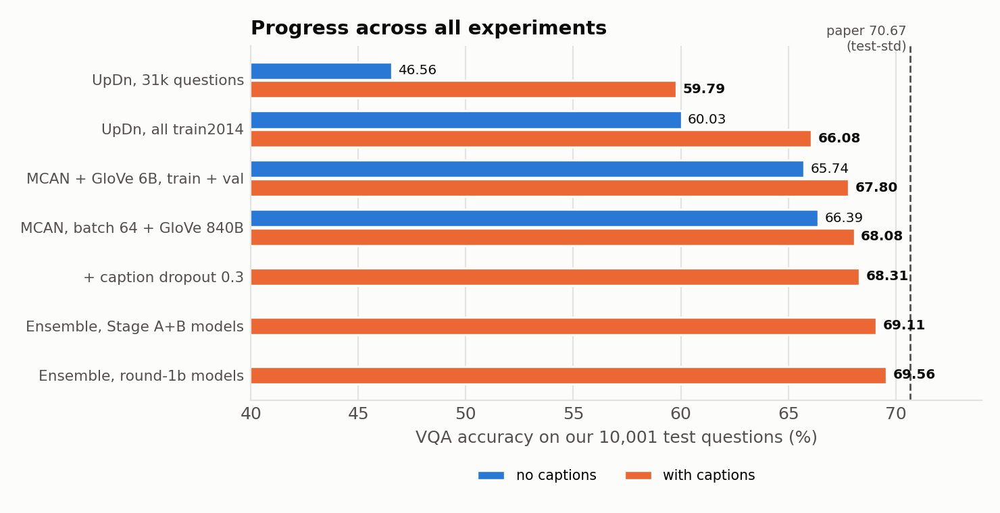
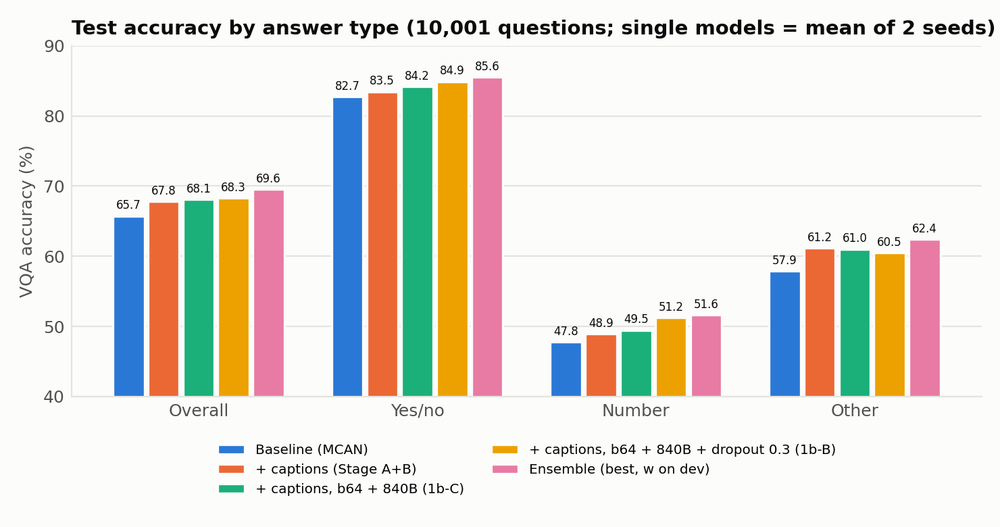
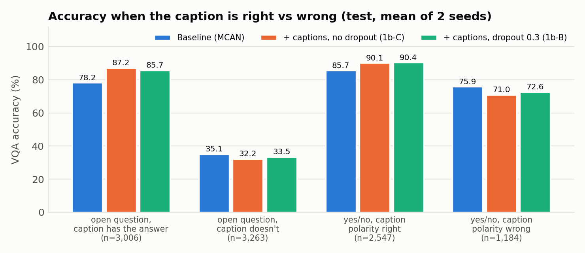
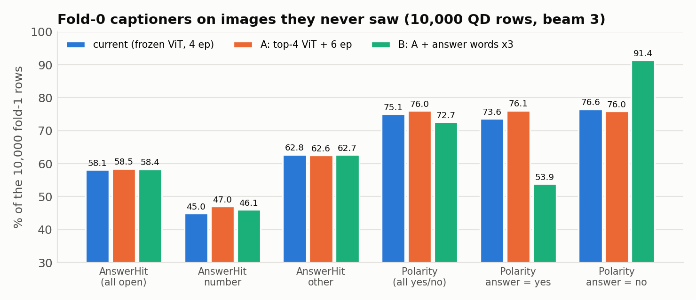
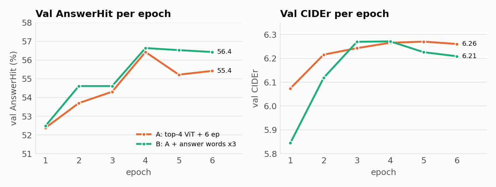
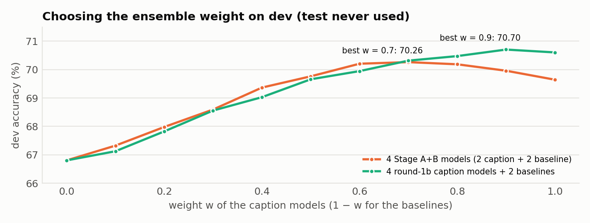

# Caption dropout, better fold captioners and ensembles

This report covers three changes after the Stage A+B report (`VQA_STRONG_REPORT.md`):
- **Round 1b:** a closer-to-reference MCAN setup (batch 64, GloVe 840B) and **caption dropout**.
- **Round 2:** two attempts to train **better fold captioners**: part of the ViT trained, more epochs, and an answer-weighted loss.
- **Ensembles:** averaging the answer scores of several trained VQA models.

The VQA test set is unchanged: **10,001 val2014 questions** (5,000 dev questions on other images). Single models are
the mean of 2 seeds.

| Model (test) | Overall | Yes/no | Number | Other |
|---|---:|---:|---:|---:|
| Stage A+B baseline (MCAN, no caption) | 65.74 ± 0.31 | 82.70 | 47.76 | 57.88 |
| Stage A+B + captions | 67.80 ± 0.06 | 83.45 | 48.93 | 61.17 |
| 1b-A baseline, batch 64 + GloVe 840B | 66.39 | — | — | — |
| 1b-C + captions, batch 64 + GloVe 840B | 68.08 ± 0.13 | 84.20 | 49.47 | 61.03 |
| **1b-B + captions, batch 64 + GloVe 840B + caption dropout 0.3** | **68.31 ± 0.35** | 84.90 | 51.21 | 60.49 |
| Ensemble, Stage A+B models (previous best) | 69.11 | 84.69 | 51.77 | 62.11 |
| **Ensemble, round-1b caption models + baselines** | **69.56** | **85.55** | **51.63** | **62.42** |

**Summary**

- **Best single model: 68.31,** the caption model with caption dropout. Captions still add +1.9 over the baseline
  trained the same way (66.39).
- **Caption dropout makes the model much harder to mislead.** With shuffled (wrong) captions it scores **64.5**
  instead of 60.5. It gains on number (+1.7) and yes/no (+0.7) questions and loses 0.5 on "other" questions. Overall: +0.23.
- **The captioner changes did not give clearly better captions.**
  - Variant A (top 4 ViT layers trained, 6 epochs) gains +0.4 AnswerHit and +0.9 polarity on images it never saw. That is too little to justify re-captioning 658k questions.
  - Variant B (answer words × 3 in the loss) learned to write "not …" far too often (69% of yes/no captions, while 50% of the answers are "no"). Its polarity fell by 2.4.
- **Best result: 69.56,** an ensemble of the 4 round-1b caption models and 2 baselines (dev 70.70). This is +0.45 over the
  previous ensemble and **1.1 points below the paper's 70.67** (measured on a different test set, see section 5).



---

## 1. What changed

| Part | Before (Stage A+B) | Now |
|---|---|---|
| VQA batch size | 128 | **64** (closer to the MCAN reference) |
| Word vectors | GloVe 6B (300-d) | **GloVe 840B** (300-d, larger vocabulary) |
| Caption during training | always shown | **caption dropout 0.3:** for 30% of the training questions the caption is hidden (all its tokens set to padding); dev and test questions always get their caption |
| Fold captioners | BLIP-base, ViT frozen, 4 epochs | tried: top 4 ViT layers trained (variant A), + answer-weighted loss (variant B), 6 epochs |
| Final answer | one model | **ensemble:** average of the answer scores of several models |

Everything else is identical to Stage A+B: the MCAN-small architecture, 643,110 training questions, 3,091 answers, 13 epochs
with learning-rate decay at epochs 10 and 12, and the cross-fitted BLIP captions (no captioner ever captions an image it
trained on).

---

## 2. Round 1b: batch 64 + GloVe 840B, and caption dropout

### 2.1 Caption dropout

The caption model reads the caption as a token sequence next to the image regions. With caption dropout, each
training question has a 30% chance that its whole caption is replaced by padding. The model then sees the question
and the image only:

```python
if use_caption and cap_drop > 0:
    drop = torch.rand(b["cap"].size(0), device=device) < cap_drop
    b["cap"] = b["cap"].masked_fill(drop[:, None], 0)      # 0 = PAD → the caption is masked out
```

The goal: the model should not trust the caption blindly, because about half the captions do not contain the answer.

### 2.2 Results



| Model | Dev | **Test** | Yes/no | Number | Other | Test, shuffled captions | Best epoch |
|---|---:|---:|---:|---:|---:|---:|---|
| Stage A+B baseline | 66.29 | 65.74 ± 0.31 | 82.70 | 47.76 | 57.88 | — | 11, 10 |
| Stage A+B + captions | 69.17 | 67.80 ± 0.06 | 83.45 | 48.93 | 61.17 | 60.21 | 10, 12 |
| 1b-A baseline | — | 66.39 (66.62 / 66.16) | — | — | — | — | — |
| 1b-C + captions | 69.63 | 68.08 ± 0.13 | 84.20 | 49.47 | 61.03 | 60.48 | 10, 10 |
| **1b-B + captions + dropout 0.3** | 69.45 | **68.31 ± 0.35** | **84.90** | **51.21** | 60.49 | **64.48** | 10, 11 |

- **Batch 64 + GloVe 840B** helps the baseline more (+0.65) than the caption model (+0.28). Better word vectors matter
  most when there is no caption to lean on.
- **Caption dropout** adds +0.23 on test. On dev it is 0.18 lower, so the overall gain is within seed noise. The
  shift between answer types and the robustness to wrong captions are clear, however.
- **The caption gain** over the matching baseline stays near +2 points: +2.06 for Stage A+B, +1.92 for 1b-B vs 1b-A.

### 2.3 What caption dropout changes

The test questions are split by whether their caption is right (same captions for all models):



| Test questions (mean of 2 seeds) | n | Baseline | + captions, no dropout | + captions, dropout 0.3 |
|---|---:|---:|---:|---:|
| Open question, caption contains the answer | 3,006 | 78.2 | **87.2** | 85.7 |
| Open question, caption doesn't | 3,263 | **35.1** | 32.2 | 33.5 |
| Yes/no, caption polarity right | 2,547 | 85.7 | 90.1 | **90.4** |
| Yes/no, caption polarity wrong | 1,184 | **75.9** | 71.0 | 72.6 |
| Shuffled captions (all questions) | 10,001 | — | 60.5 | **64.5** |

- **Dropout trades a little trust for robustness.** When the caption is right the model follows it slightly less
  (−1.5 on open questions). When it is wrong it is misled less (+1.3 on open, +1.6 on yes/no). With completely wrong
  captions the gap is 4 points.
- **A wrong caption still costs accuracy:** both caption models are below the baseline when the caption is wrong. The
  model cannot yet tell on its own when a caption is unreliable. A caption confidence signal (section 6) would target
  exactly this.
- **Dropout is kept** for future runs: it gives the best single model and makes the system safer when captions get worse
  (for example on new images).

---

## 3. Round 2: better fold captioners

The VQA model gets +9 points on open questions when the caption contains the answer. Better captions are therefore
the most direct lever. Two variants of the fold-0 captioner were trained (BLIP-base, same fold-0 data: 137,069 QD rows
on 39,339 train2014 images):

| | Current fold captioner | Variant A | Variant B |
|---|---|---|---|
| ViT (12 layers) | frozen | **top 4 layers + final LayerNorm trained**, learning rate × 0.1 | as A |
| Epochs | 4 | **6** | 6 |
| Loss | label-smoothed cross-entropy | as before | **answer words in the caption weighted × 3** |
| Batch | 48 / GPU | 24 / GPU × 2 accumulation steps (same 96 total) | as A |
| Trainable parameters | 137.9M | 166.2M (+28.4M from the ViT) | as A |
| Training time on 2× T4 | ~2–2.5 h | 4 h 17 min (43 min / epoch) | 4 h 02 min (40 min / epoch) |

**Answer weighting (variant B).** For every training caption, the tokens that carry the answer count three times in the
loss:
- text or number answers: the answer's words, each content word of a multi-word answer, and the digit ↔ word form (2 ↔ two);
- answer "no": the negation word (not, no, none, n't …);
- answer "yes": nothing.

### 3.1 How the captioners are compared

Each fold-0 captioner captions **10,000 QD rows of fold 1**: images it never trained on, the same situation as in the
cross-fitted VQA data. The rows are a fixed random sample (seed 0). The "current" row uses the captions already
produced for the VQA experiments, so all three captioners are scored on exactly the same rows.
- **AnswerHit:** for open questions, the share of captions that contain the answer.
- **Polarity:** for yes/no questions, the share of captions whose negation matches the answer.

### 3.2 Results



| Fold-0 captioner (10,000 fold-1 rows, beam 3) | AnswerHit | number | other | Polarity | answer = yes | answer = no | negated captions | CIDEr | BLEU-4 |
|---|---:|---:|---:|---:|---:|---:|---:|---:|---:|
| current | 58.10 | 44.97 | **62.77** | 75.10 | 73.62 | 76.56 | 51.6% | 6.39 | 64.56 |
| **A: top-4 ViT + 6 epochs** | **58.51** | **47.02** | 62.59 | **76.04** | **76.13** | 75.96 | 50.0% | **6.40** | **64.46** |
| B: A + answer words × 3 | 58.36 | 46.11 | 62.71 | 72.69 | 53.86 | **91.38** | **68.9%** | 6.32 | 63.25 |

Rows: 6,719 open (1,761 number, 4,958 other) and 3,281 yes/no (1,634 "yes", 1,647 "no", so 50.2% "no").

**Paired difference to the current captioner** (95% bootstrap interval over the same rows):

| | AnswerHit | Polarity |
|---|---|---|
| A − current | +0.40 [−0.27, +1.03] | +0.94 [0.00, +1.98] |
| B − current | +0.25 [−0.40, +1.01] | **−2.41 [−3.87, −0.85]** |

- **Variant A is slightly better, mainly on counting:** number answers +2.0. Training the top ViT layers lets the model
  look closer at the image. "Other" answers do not improve, and the overall AnswerHit gain is not significant.
- **Variant B fails on yes/no.** Weighting the negation word × 3 made "not …" captions too cheap a guess: B negates 69%
  of its yes/no captions, while only 50% of the answers are "no". It is right on 91% of the "no" questions but only 54%
  of the "yes" questions. For open answers, the extra weight did not make the answer appear more often (62.7 vs 62.6 on
  "other").
- **Translated to VQA:** with about +0.3 VQA points per AnswerHit point, variant A would give roughly +0.1 to +0.3. That
  is not worth retraining both folds and re-captioning all 658,111 questions (about 15 GPU hours).

### 3.3 Training curves



- Both variants peak in **val AnswerHit at epoch 4** (A 56.4, B 56.6) and drop afterwards. The extra epochs 5–6 add
  nothing for the answer, although A's CIDEr still rises slightly.
- `best.pt` is chosen on val CIDEr (as for the current captioners), so A uses epoch 5 and B epoch 4. Choosing on val
  AnswerHit would pick epoch 4 for both; the difference on 1,488 val rows is small.

**Decision:** keep the current captions. The two experiments show that the remaining caption errors are not fixed by
more training of the same BLIP-base model; section 6 lists what can.

---

## 4. Ensembles

### 4.1 Method

Each trained VQA model gives a score (sigmoid) for each of the 3,091 answers. The ensemble averages these scores and
answers with the highest one:

`score = w × mean(caption models) + (1 − w) × mean(baselines)`

The weight `w` is chosen on **dev only** (grid 0, 0.1, …, 1). Test is computed once with that weight. Only the saved
score files are needed (`dev_scores.npy`, `test_scores.npy`, `answers.json`), not the checkpoints.

### 4.2 Results



| Ensemble | Dev | **Test** | Yes/no | Number | Other |
|---|---:|---:|---:|---:|---:|
| Previous: 2 Stage A+B caption models + 2 baselines (w = 0.7) | 70.26 | 69.11 | 84.69 | 51.77 | 62.11 |
| Caption-model pair with dropout (1b-B, 2 seeds) | 70.22 | 68.97 | — | — | — |
| Caption-model pair without dropout (1b-C, 2 seeds) | 70.29 | 68.79 | — | — | — |
| 4 round-1b caption models (1b-B + 1b-C) | 70.60 | 69.37 | 85.28 | 51.48 | 62.28 |
| 4 round-1b caption models + 2 baselines, equal weight | 70.30 | 69.50 | 85.86 | 51.77 | 62.02 |
| **4 round-1b caption models + 2 baselines, w = 0.9** | **70.70** | **69.56** | 85.55 | 51.63 | **62.42** |
| All 6 caption models + 2 baselines, w = 0.9 | 70.83 | 69.49 | 85.28 | 51.48 | 62.52 |

(The 2 baselines are the Stage A+B baselines; the 1b-A baseline scores are not downloaded yet.)

- **Mixing different models helps more than more seeds of one model.** The dropout pair alone gives 68.97 and the
  no-dropout pair 68.79. Together they give 69.37: the two training styles make different mistakes.
- **The baselines matter less now** (best w = 0.9, before 0.7). The round-1b caption models already cover most
  questions the baseline gets right.
- **Adding the 2 older caption models does not help on test** (69.49 vs 69.56) although dev rises slightly. Their
  errors overlap with the round-1b models, and a 0.1 difference on dev is within noise.

---

## 5. Where we stand against the paper

| | Ours, best single model | Ours, ensemble | Paper (Sharma & Jalal 2021) |
|---|---:|---:|---:|
| Accuracy | 68.31 | **69.56** | 70.67 |
| Test set | 10,001 val2014 questions | 10,001 val2014 questions | official test-standard (~107k questions) |
| Caption gain | +1.9 (same training, without captions) | — | +7.35 over its own baseline (63.32 → 70.67) |

- **The test sets differ.** Our 10,001 val2014 questions have been the fixed test set of every experiment in this
  thesis, so all numbers above compare fairly with each other, but not exactly with the paper. A final comparison on
  equal terms needs our best model on the official test-standard server.
- **Our caption gain is honest but smaller.** Cross-fitting guarantees that no caption was written by a captioner that
  saw the image, which mirrors deployment. The baseline we compare against is also much stronger (66.4 vs 63.3).

---

## 6. Next steps

| # | Step | Why | Expected gain | Cost |
|---|---|---|---|---|
| 1 | **Add the 1b-A baseline scores to the ensemble** | they are better baselines (66.39 vs 65.74) trained like the round-1b caption models | +0.1–0.3 | download 2 × 2 score files, no GPU |
| 2 | **Caption confidence:** keep the beam score of each caption and let the VQA model see it (or skip captions below a threshold) | wrong captions still cost 3–5 points (section 2.3) | +0.3–1 | re-caption 658k questions with scores (~4–5 h), retrain 1 model |
| 3 | **More diverse ensemble members:** caption dropout 0.5, a third seed, the UpDn caption model | diversity, not seeds, gave the ensemble gain (section 4.2) | +0.2–0.5 | ~4–5 h per model |
| 4 | **A stronger captioner** (BLIP-large) instead of more training of BLIP-base | round 2 showed BLIP-base has reached its limit on these captions | +0.5–1.5 (if AnswerHit +3–5) | 2 fold captioners + re-captioning (~15 h) |
| 5 | **Visual Genome QA** as extra training data | standard for MCAN-level results | +1–1.5 | data + features + captions (~6–8 h once) |

Steps 1–3 are cheap and target the remaining weak point: trusting wrong captions. Steps 4–5 are the larger
investments if the thesis needs to pass 70 on our test set.

---

### Files

| | |
|---|---|
| Code | branch `feat/captionvqa-blip`: `CaptionVQA/train_vqa.py` (`--caption-dropout`), `configs/blip_strong_b64.yaml`, `scripts/kaggle_vqa_strong.sh`, `ensemble_vqa.py` (runs from saved scores); `QuestionDependentImageCaptioner/train_blip.py` (`unfreeze_vision_layers`, `vision_lr_scale`, `answer_weight`), `configs/b_blip_fold_v2.yaml`, `scripts/kaggle_blip_fold_v2.sh`, `scripts/eval_fold_captioner.py` |
| Results | `CaptionVQA/vqa_b64_crossfit/` (1b-C), `CaptionVQA/vqa_b64_crossfit_drop/` (1b-B), `vqa_ensemble_1b.md`, `vqa_ensemble_all.md`; `QuestionDependentImageCaptioner/outputs/round2/` (variants A, B), `outputs/fold_eval/fold0_current.json` |
| Figures | `CaptionVQA/scripts/report_round2_figures.py` → `report_figs_round2/` |
