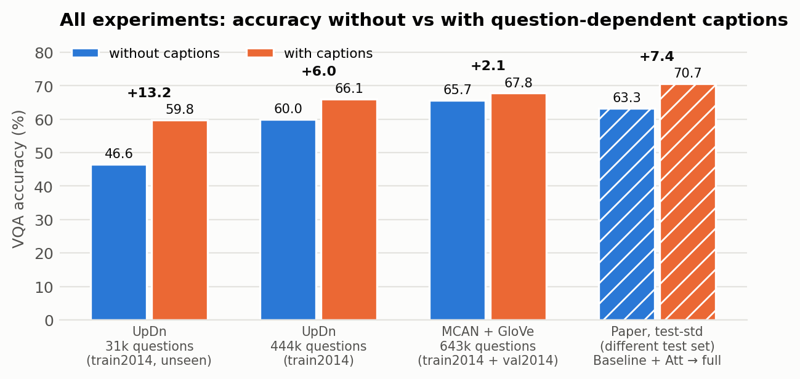
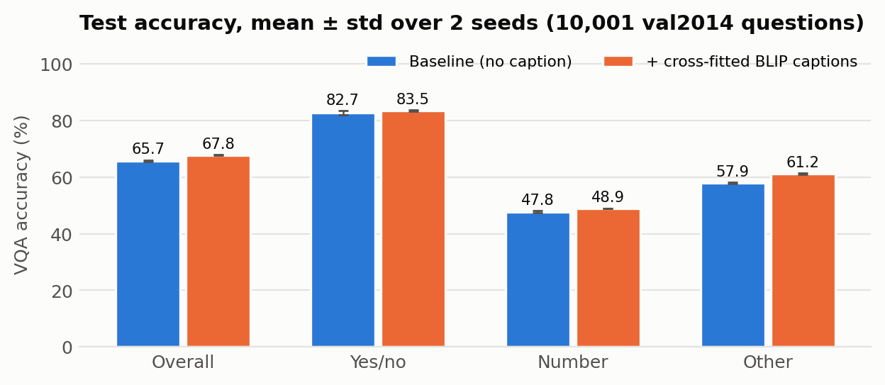
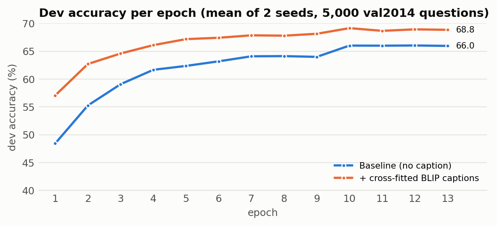
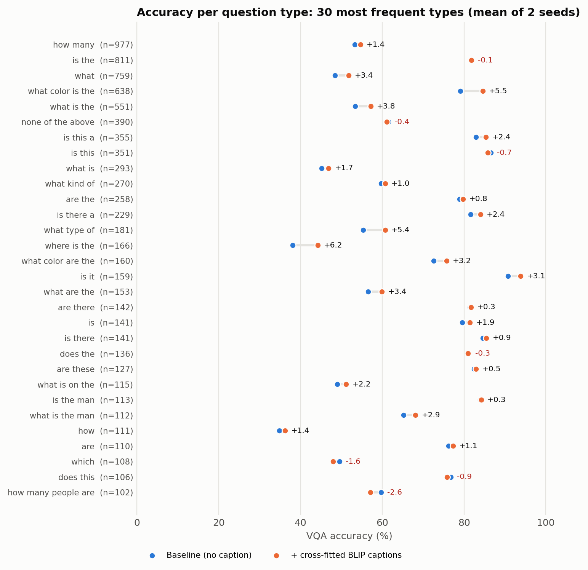
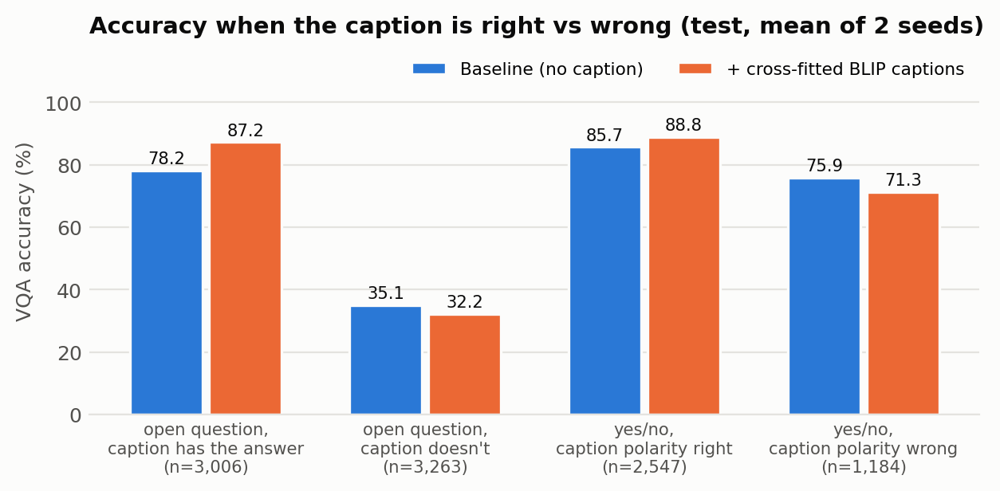

# Stronger VQA model on train2014 + val2014: baseline vs + question-dependent BLIP captions

Stages A and B of the thesis plan:
- **Stage A, a stronger VQA model:** an MCAN-style co-attention transformer with GloVe word vectors, replacing Bottom-Up Top-Down.
- **Stage B, more training data:** train2014 + val2014 (643,110 questions).

Both models are tested on the **same 10,001 val2014 questions** as every earlier experiment.

| Model (test, mean ± std over 2 seeds) | Overall | Yes/no | Number | Other |
|---|---:|---:|---:|---:|
| Stronger baseline (MCAN + GloVe, no caption) | 65.74 ± 0.31 | 82.70 ± 0.67 | 47.76 ± 0.40 | 57.88 ± 0.23 |
| **+ cross-fitted BLIP captions** | **67.80 ± 0.06** | **83.45 ± 0.23** | **48.93 ± 0.09** | **61.17 ± 0.32** |
| **Gain** | **+2.06** | +0.75 | +1.17 | +3.30 |

**Summary**

- **The stronger model and the extra data raise the baseline by 5.7 points** (60.03 → 65.74) and the caption model by
  1.7 (66.08 → 67.80). Our best model is now **67.80**.
- **Captions still help (+2.06), but less than with UpDn (+6.05).** The stronger VQA model answers many questions
  correctly on its own, so the captions add less new information. Most of the gain is on "other" questions (+3.3).
- **The stronger model uses the captions more carefully.** A wrong yes/no caption now costs −4.5 points (−12.2 with UpDn),
  and with shuffled captions it still scores 60.2 (47.2 with UpDn).
- **The two models are complementary:** answering each question with whichever model is right would give 73.6. An
  ensemble of the two models is the cheapest next step.
- **Why not 70%:** the paper's 70.67 is on a different test set (official test-standard) with a different training
  setup. Our baseline is also still 1–2 points below what MCAN normally reaches. Section 4 explains this, and section 5
  lists the steps that can close the gap.



---

## 1. Architectures

### 1.1 Captioner (stage 1, unchanged)

BLIP-base: a frozen ViT-B/16 image encoder, plus a BERT text decoder fine-tuned with the question as a prompt
(`[DEC] question: <q> caption: <c> [SEP]`). Two captioners are trained, one per half of the train2014 images, for
cross-fitting (section 2.2).

### 1.2 Stronger baseline: MCAN-style encoder–decoder co-attention

Code: `CaptionVQA/models_vqa.py`, class `MCANVQA(use_caption=False)`. It follows Yu et al., *Deep Modular Co-Attention
Networks for VQA* (CVPR 2019), "small" size.

```
question ──► GloVe word vectors (300-d, glove.6B; 94% of the vocabulary covered) ──► LSTM 512 ──► question tokens
             ──► ENCODER: 6 × [ self-attention (8 heads) → FFN 2048 ], post-LayerNorm
image ──► BUTD Faster R-CNN (frozen): 36 regions + 1 mean token × 2048 ──► Linear 512
             ──► DECODER: 6 × [ self-attention over the image tokens
                                → guided attention: image tokens attend to the question tokens
                                → FFN 2048 ]
AttFlat(question tokens) + AttFlat(image tokens) ──► LayerNorm ──► Linear → 3,091 answers
loss: soft-score binary cross-entropy over the 10 human answers
```

56.4M parameters (vocabulary 15,924 words).

### 1.3 + Captions: the same model, with the caption words added to the decoder

`MCANVQA(use_caption=True)`: the only change is the decoder's input sequence.

```
caption ──► the same GloVe table ──► separate LSTM 512 ──► caption tokens (+ type embedding "caption")
DECODER input = [ 37 image tokens (+ type "region") ; caption tokens ]
```

58.7M parameters (vocabulary 17,977 words).

- **In every decoder layer**, image regions and caption words attend to each other (self-attention), and both attend
  to the question (guided attention).
- **The caption is read as a sequence:** "not" in *"the dog is not running"* stays attached to *running*.

### 1.4 Training (identical for both)

| Setting | Value |
|---|---|
| Optimizer | Adam (β = 0.9, 0.98), learning rate 1e-4, 2 warm-up epochs, × 0.2 at epochs 10 and 12 (MCAN schedule) |
| Batch, epochs | 128, 13; the epoch with the best dev accuracy is kept |
| Answers | 3,091 (answers seen at least 9 times in training; the standard VQA v2 list has 3,129) |
| Seeds | 2 per model (0 and 1), run in parallel on 2× T4 (Kaggle). Run time: baseline ~12 min/epoch, caption model ~16 min/epoch |

---

## 2. Data, split and cross-fitting

### 2.1 Split

| Split | Source | Questions | Images |
|---|---|---:|---:|
| Train | all of train2014 + the val2014 questions on images outside dev/test | **643,110** (443,757 + 199,353) | 120,508 |
| Dev | val2014 (choosing the epoch) | 5,000 | 879 |
| Test | val2014, other images (all reported numbers) | 10,001 | 1,900 |

- **Dev and test are identical** to every earlier experiment, and share no image with training.
- **Training on train + val** is the usual setup before an official test-server submission.

### 2.2 Cross-fitting

A captioner never captions an image it was trained on:

| Questions | Caption written by |
|---|---|
| on fold-0 train2014 images (41,391) | the fold-1 captioner |
| on fold-1 train2014 images (41,392) | the fold-0 captioner |
| on val2014 images (train part, dev, test): no captioner was trained on val2014 | half by each captioner (`data/crossfit_folds.json`, now covering all 40,504 val2014 images) |

The 458,758 captions from the previous experiment were reused unchanged, and the 199,353 new val2014 questions were
captioned for this one. **Caption quality is the same everywhere**, so the model sees the same caption quality in
training and at test time:

| Captions | Answer in caption (non-yes/no) | Yes/no polarity correct |
|---|---:|---:|
| train2014 (cross-fitted), 276k / 168k questions | 48.4% | 68.5% |
| val2014 train part (new), 124k / 75k questions | 48.7% | 68.6% |
| **test** | **48.0%** | **68.3%** |

---

## 3. Results

### 3.1 Overall and by answer type



| Model | Seed 0 | Seed 1 | Mean ± std |
|---|---:|---:|---:|
| Stronger baseline | 65.52 | 65.96 | 65.74 ± 0.31 |
| + captions | 67.75 | 67.84 | **67.80 ± 0.06** |

### 3.2 Training curves



- **The caption model leads at every epoch,** by 8.6 points after epoch 1 and 2.8 at the end.
- **Both models jump at epoch 10, then flatten:** that's the learning-rate drop. More epochs would not help much;
  the remaining gains must come from the model, the data or the captions.

### 3.3 By question type



- **47 of 65 question types improve.** The largest gains are on open "what …" questions and colors.
- **18 types drop, by at most 6 points.** They're small (most under 150 test questions) and mostly yes/no types, where
  the baseline was already strong.

All 65 types (mean of 2 seeds, test accuracy %):

| Question type | Test n | Baseline | + captions | Gain |
|---|---:|---:|---:|---:|
| how many | 977 | 53.3 | 54.7 | +1.4 |
| is the | 811 | 81.9 | 81.8 | -0.1 |
| what | 759 | 48.4 | 51.8 | +3.4 |
| what color is the | 638 | 79.1 | 84.6 | +5.5 |
| what is the | 551 | 53.4 | 57.2 | +3.8 |
| none of the above | 390 | 61.5 | 61.1 | -0.4 |
| is this a | 355 | 82.9 | 85.4 | +2.4 |
| is this | 351 | 86.5 | 85.8 | -0.7 |
| what is | 293 | 45.2 | 46.9 | +1.7 |
| what kind of | 270 | 59.7 | 60.7 | +1.0 |
| are the | 258 | 78.9 | 79.7 | +0.8 |
| is there a | 229 | 81.6 | 84.0 | +2.4 |
| what type of | 181 | 55.4 | 60.7 | +5.4 |
| where is the | 166 | 38.0 | 44.2 | +6.2 |
| what color are the | 160 | 72.5 | 75.7 | +3.2 |
| is it | 159 | 90.7 | 93.8 | +3.1 |
| what are the | 153 | 56.5 | 59.9 | +3.4 |
| are there | 142 | 81.4 | 81.7 | +0.3 |
| is | 141 | 79.6 | 81.5 | +1.9 |
| is there | 141 | 84.6 | 85.5 | +0.9 |
| does the | 136 | 81.2 | 80.9 | -0.3 |
| are these | 127 | 82.4 | 83.0 | +0.5 |
| what is on the | 115 | 49.0 | 51.2 | +2.2 |
| is the man | 113 | 83.9 | 84.2 | +0.3 |
| what is the man | 112 | 65.2 | 68.1 | +2.9 |
| how | 111 | 34.8 | 36.2 | +1.4 |
| are | 110 | 76.2 | 77.3 | +1.1 |
| which | 108 | 49.5 | 47.9 | -1.6 |
| does this | 106 | 76.7 | 75.8 | -0.9 |
| how many people are | 102 | 59.7 | 57.1 | -2.6 |
| what is in the | 85 | 60.0 | 59.7 | -0.3 |
| what is this | 76 | 64.0 | 72.5 | +8.5 |
| what are | 74 | 60.2 | 60.6 | +0.4 |
| do | 73 | 78.9 | 77.9 | -1.0 |
| what does the | 72 | 22.8 | 24.2 | +1.4 |
| what color | 68 | 74.5 | 79.2 | +4.7 |
| what time | 68 | 24.7 | 26.8 | +2.1 |
| why | 66 | 23.3 | 24.7 | +1.4 |
| where are the | 65 | 38.5 | 46.8 | +8.3 |
| what color is | 61 | 77.6 | 82.3 | +4.7 |
| are there any | 59 | 85.6 | 89.3 | +3.7 |
| how many people are in | 59 | 63.9 | 68.8 | +4.9 |
| are they | 57 | 76.3 | 82.5 | +6.2 |
| who is | 51 | 47.9 | 46.6 | -1.4 |
| can you | 48 | 71.5 | 67.9 | -3.5 |
| is this an | 46 | 81.6 | 85.1 | +3.5 |
| what brand | 46 | 39.3 | 44.2 | +4.9 |
| what is the person | 45 | 62.7 | 74.0 | +11.3 |
| what sport is | 43 | 92.0 | 96.3 | +4.3 |
| is he | 42 | 89.5 | 88.2 | -1.3 |
| what animal is | 41 | 85.4 | 84.6 | -0.7 |
| what room is | 41 | 96.6 | 94.4 | -2.2 |
| has | 40 | 83.8 | 77.9 | -5.9 |
| what is the woman | 40 | 58.8 | 70.0 | +11.2 |
| is the woman | 39 | 87.2 | 81.2 | -6.0 |
| was | 39 | 75.8 | 87.3 | +11.5 |
| what is the color of the | 39 | 85.8 | 87.4 | +1.7 |
| what number is | 38 | 8.3 | 6.2 | -2.1 |
| what is the name | 37 | 12.2 | 17.2 | +5.0 |
| do you | 35 | 72.4 | 72.6 | +0.1 |
| is that a | 35 | 80.9 | 85.9 | +5.0 |
| is the person | 33 | 75.8 | 87.0 | +11.2 |
| is this person | 30 | 74.8 | 73.7 | -1.2 |
| could | 27 | 74.6 | 79.6 | +5.0 |
| why is the | 18 | 28.9 | 28.9 | +0.0 |

### 3.4 How the model uses the captions

| Test | Stronger baseline | + captions |
|---|---:|---:|
| Normal | 65.74 | **67.80** |
| **Captions shuffled** (each question gets another image's caption) | — | 60.21 (−7.6) |



| Test questions | n | Baseline | + captions | Δ | Δ with UpDn (previous report) |
|---|---:|---:|---:|---:|---:|
| Open question, caption contains the answer | 3,006 | 78.2 | 87.2 | **+9.0** | +18.3 |
| Open question, caption doesn't | 3,263 | 35.1 | 32.2 | −2.8 | −3.7 |
| Yes/no, caption polarity right | 2,547 | 85.7 | 88.8 | +3.2 | +12.6 |
| Yes/no, caption polarity wrong | 1,184 | 75.9 | 71.3 | **−4.5** | −12.2 |

- **The stronger baseline already answers 78% of the "caption has the answer" questions correctly,** so the caption can add less.
- **The model is much harder to mislead:** a wrong yes/no caption costs −4.5 points instead of −12.2, and shuffled captions drop accuracy by 7.6 points instead of 19.
- **The two models are complementary.** On seed 0, 817 questions are answered correctly only with captions and 604
  only without them. Picking the better model per question would reach **73.6**: a ceiling, not an achievable score,
  but a strong sign that an ensemble of the two would gain.

---

## 4. Why the score doesn't reach 70%

### 4.1 Different measuring stick

| | Base paper (70.67) | Ours (67.80) |
|---|---|---|
| Test set | official VQA 2.0 **test-standard** | **10,001 held-out val2014 questions** |
| Training data | not stated for test-standard | train2014 + val2014 (643k questions) |
| Seeds | not reported | 2, mean ± std |

The two numbers come from different question sets, so a 2.9-point difference isn't directly a ranking. The paper's
gain from captions (+7.35) was also measured on a weaker baseline (63.32), just like our +6.05 with UpDn.

### 4.2 Our baseline is still below a typical MCAN

The MCAN paper reports about **67%** on VQA 2.0 val for its small model trained on train only, and about **70.6%** on
test-dev when trained on train + val + Visual Genome. (These are approximate figures from that paper.) Our MCAN
baseline reaches 65.7 on our val subset with more training data. Likely reasons:

| Difference | Ours | MCAN paper |
|---|---|---|
| Image regions | fixed 36 (+ 1 mean) per image | **10–100 adaptive** regions (more regions on busy images) |
| Extra training questions | none | **Visual Genome QA** (~0.5M questions) |
| Word vectors | GloVe 6B: 6% of words missing | GloVe 840B (larger vocabulary) |
| Batch / learning rate | 128 / 1e-4 | 64 / 1e-4 (twice as many updates) |

Each of these is typically worth about 0.5–1.5 points.

### 4.3 The captions carry the answer only half the time

The captions contain the answer for 48% of open questions, and have the right polarity for 68% of yes/no questions. The
stronger the VQA model, the more of those answers it already finds itself, so the **caption gain is limited by
caption quality**. The ground-truth captions contain the answer 98% of the time; with UpDn, oracle captions (answer
given) reached 83.3. **A better captioner would raise the ceiling of the caption model directly.**

---

## 5. Suggested next steps (to pass 70%)

Ordered by expected gain per GPU hour. All gains are estimates from typical results; each step gets measured with and
without captions.

| # | Step | Why | Expected gain | Cost |
|---|---|---|---|---|
| 1 | **Ensemble** the caption model with the baseline and across seeds (average the answer scores) | the models are complementary (best-of-both ceiling 73.6) | **+1–2** | inference only: save test scores from the existing checkpoints |
| 2 | **Close the MCAN gap:** batch 64, GloVe 840B, adaptive 10–100 regions | match the reference MCAN setup (section 4.2) | +1–2 | features must be re-extracted for adaptive regions (~4–5 h once) |
| 3 | **Visual Genome QA augmentation** | standard for MCAN-level results; captions for VG images come from the cross-fit folds | +1–1.5 | VG questions + features + captions (~6–8 h once) |
| 4 | **A better captioner** (BLIP-large or BLIP-2, more epochs) | the caption gain is capped by 48% answer-in-caption | +0.5–2 | 2 new fold captioners + re-captioning (~10 h) |
| 5 | **Caption confidence:** 3 beam captions + their scores | the model can learn when to ignore a caption | +0.3–1 | small code change + captions |
| 6 | **Seed 2** for both models | complete the 3-seed protocol of the earlier reports | — | ~3.5 h per model |

**Rough projection:** 67.8 + ensemble (~1.5) + MCAN fixes (~1) + Visual Genome (~1) ≈ **70–71** on our val2014 test.
Steps 1–3 are the most direct path past 70%. For a final comparison with the paper on equal terms, the best model
would then go to the official test-standard server.

---

### Files

| | |
|---|---|
| Code | branch `feat/captionvqa-blip`: `CaptionVQA/models_vqa.py` (`MCANVQA`), `train_vqa.py`, `configs/blip_strong.yaml`, `scripts/kaggle_vqa_strong.sh`, `scripts/kaggle_val2014_cache.sh` |
| Results | `CaptionVQA/vqa_strong_baseline/`, `CaptionVQA/vqa_strong_crossfit/` (per-seed `results.json`, `history.json`, `test_predictions.json`; 658,111 captions) |
| Tables / figures | `CaptionVQA/vqa_strong_summary.md`; `scripts/report_vqa_figures.py --baseline vqa_strong_baseline --caption vqa_strong_crossfit --seeds 0,1 --out report_figs_vqa_strong` |
