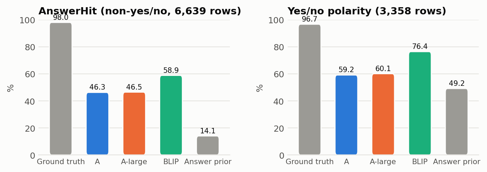
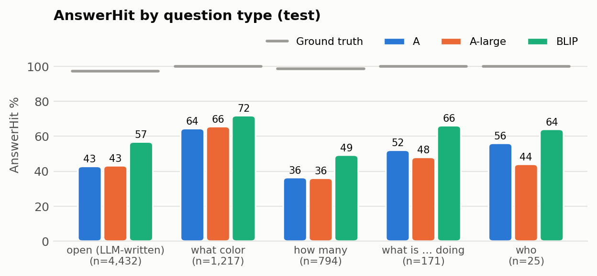
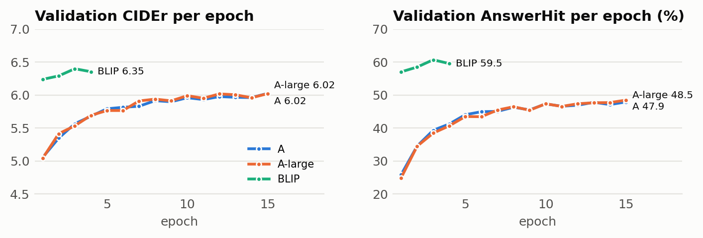
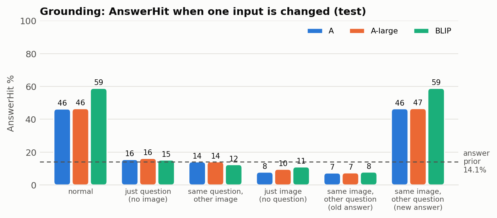
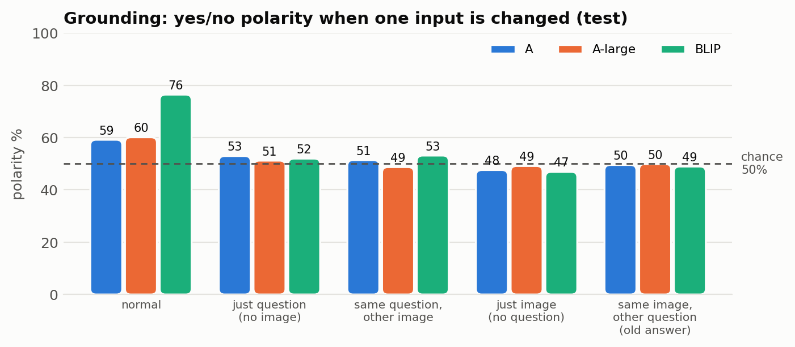

# Question-dependent captioner comparison: BUTD + Transformer vs BLIP

Stage 1 of the thesis pipeline: given an image and a question, write a caption that answers the question.
Three captioners were trained on the same data and split, and tested on the same 9,997 test rows:

| Model | Visual input | Language model | Trained params |
|---|---|---|---:|
| **A** `a_full_butd` | BUTD Faster R-CNN regions (frozen, cached) | Transformer encoder–decoder + copy, from scratch, 3 layers | 23.5M |
| **A-large** `a_full_butd_large` | same | same, 6 layers | 51.8M |
| **B** `b_blip_full` | BLIP ViT-B/16 patches (frozen) | BLIP BERT decoder, pretrained, fine-tuned with the question as prompt | 137.9M |

**Summary**

- **BLIP is the best captioner on every metric:** AnswerHit 58.9% vs 46.3%, yes/no polarity 76.4% vs 59.2%, CIDEr 6.38 vs 5.94. It is ahead on every question type.
- **The data is not the bottleneck.** The ground-truth captions contain the answer in 98.0% of the test rows; the best model, in 58.9%.
- **Both models are really grounded in the image.** With the wrong image or no image, AnswerHit falls to the level of a no-model answer prior (12–16% vs 14.1%). So all the useful answers come from looking at the image.
- **Both models follow the question.** Given another question about the same image, they answer the new question as well as their own. Without a question, they write generic captions that almost never contain the answer.
- **BLIP is better grounded for yes/no questions.** Its polarity drops by 23 points without the right image, vs 8 points for model A. Model A mostly guesses yes/no.
- **More capacity does not help model A** (6 vs 3 layers: same results in every test).

---

## 1. Architectures

### Model A: BUTD regions + multimodal Transformer with copy

Code: `models/captioner_mmtransformer_copy.py`.

```
image ──► BUTD Faster R-CNN (ResNet-101 C4, Visual Genome: 1,600 objects / 400 attributes), FROZEN
          36 detected regions + 1 mean token = 37 × 2048 features + box (x1, y1, x2, y2, area)
          ──► LayerNorm + Linear 2048→512  (+ Linear box 5→512, + type embedding "region")
question ──► word embedding 512 (question vocab 4,763) + position + type embedding "question"

[ 37 region tokens ; question tokens ]
          ──► JOINT ENCODER: N pre-LN Transformer layers (d = 512, 8 heads, FFN 1024 / 2048)
              self-attention over regions AND question words together: in every layer each region
              attends to the question words and each question word attends to the regions (early fusion)
          ──► memory (regions + question, both question-aware)

caption so far ──► DECODER: N layers, each: causal self-attention → cross-attention to memory → FFN
          ──► output = tied word embedding (caption vocab 7,029)
          ──► COPY HEAD (pointer-generator): attention over the question part of the memory;
              p_gen · P_vocab + (1 − p_gen) · P_copy(question word)
```

| | A | A-large |
|---|---|---|
| Encoder / decoder layers | 3 / 3 | 6 / 6 |
| d_model, heads, FFN | 512, 8, 1024 | 512, 8, 2048 |
| Trained params | 23.5M | 51.8M |
| Training | from scratch, 15 epochs, AdamW 3e-4, batch 128 (2× T4), label smoothing 0.1 | same |
| Best epoch (val CIDEr) | 15 | 15 |

The detector is frozen; its features were extracted once into a packed cache.

### Model B: BLIP-base with the question as a decoder prompt

Code: `train_blip.py`.

```
image (384×384) ──► BLIP ViT-B/16 image encoder, FROZEN
                    12 layers, d = 768, 12 heads → 577 tokens (576 patches + CLS) × 768
                    (the image encoder never sees the question)

decoder input:  [DEC] question: <question> caption: <caption> [SEP]
                ──► BLIP text decoder (BERT-base, pretrained, fine-tuned)
                    12 layers, each: causal self-attention over the prompt + caption so far
                                     → cross-attention to the 577 image tokens → FFN 3072
                ──► LM head (WordPiece vocab 30,524); loss only on the caption tokens
```

| | B |
|---|---|
| Start point | `Salesforce/blip-image-captioning-base` (pretrained on image–text data, fine-tuned for COCO captioning) |
| Trained | text decoder only: 137.9M params (the ViT, ~86M, is frozen) |
| Training | 4 epochs, AdamW 3e-5, cosine schedule, batch 96 (2× T4), label smoothing 0.1 |
| Best epoch (val CIDEr) | 3 |

### The main design difference

| | A (BUTD + Transformer) | B (BLIP) |
|---|---|---|
| Visual units | 36 object regions with attribute-trained features | 576 grid patches |
| Where image and question meet | **in the encoder**: regions and question attend to each other both ways in every layer, then the decoder cross-attends | **in the decoder only**: the question is a causal prefix, and each decoder layer cross-attends to image features that don't depend on the question |
| Language knowledge | none: learned from 264k QD captions | pretrained on large image–text data |
| Copying question words | explicit copy head | not needed (WordPiece covers the vocabulary) |

*Caveat on pretraining:* both visual front-ends were pretrained on data that overlaps COCO, so some test images may have been seen before:
- **BLIP:** its COCO captioning fine-tuning used COCO images, with generic human captions.
- **A's BUTD detector:** trained on Visual Genome, which contains about half of the COCO images, with object and attribute labels.

Neither has seen these questions or answers. Only the captioners trained here saw the QD captions, and their test images are disjoint from their training images.

---

## 2. Dataset and split

**Source:** `QuestionDependentCaptionGenerator/outputs/vqa_v2_question_dependent_captions_train2014.json`, built from VQA v2 train2014 questions and answers.
- 443,757 VQA questions → 283,707 kept as directly visual. The rest were not directly visual or needed OCR (15,824), plus 88 duplicates and 8 empty.
- A rule fills the caption from the question and answer (what_color 37,788, how_many 23,903, what_is_doing 4,940, who 628). The other 216,448 were written by an LLM (qwen2.5-3B).
- An LLM judge checked every caption:

| Judge verdict | ok | GRAMMAR_ISSUE_ONLY | WRONG |
|---|---:|---:|---:|
| First pass | 250,987 | 4,567 | 28,153 |
| After regenerating the 28,153 WRONG (26,476 fixed) | **277,318** | 4,712 | 1,677 |

**Used for training:** only `caption_quality_verdict == "ok"`, i.e. **277,318 rows on 79,568 images**. Captions are short (5.7 words on average), and 32% of the answers are yes/no.

**Split** (`scripts/prepare_full_qd.py`): rows sorted by `image_id`; the last ~10k rows are test and the ~3k before them val. Boundaries are moved to image changes, so **no image appears in two splits**.

| Split | Rows | Share | Images |
|---|---:|---:|---:|
| Train | 264,318 | 95.3% | 75,872 |
| Val (checkpoint choice) | 3,003 | 1.1% | 860 |
| Test (all numbers below) | 9,997 | 3.6% | 2,836 |

### Answer in the ground-truth captions

| Rows | AnswerHit (non-yes/no) | YesNoPolarity (yes/no) |
|---|---:|---:|
| All 283,707 (any verdict) | 98.0% | 97.5% |
| **ok (277,318)** | **98.1%** | **97.5%** |
| GRAMMAR_ISSUE_ONLY (4,712) | 96.2% | 99.5% |
| WRONG (1,677) | 93.6% | 97.3% |
| Train / val / test | 98.1% / 97.8% / **98.0%** | 97.5% / 97.5% / **96.7%** |

The answers are in the data. The few misses are mostly the strict string rule, e.g. answer "none" vs "This person is not wearing a hat".

---

## 3. Metrics

| Metric | What it measures |
|---|---|
| BLEU-4, METEOR, ROUGE-L, CIDEr-D | how close the caption is to the ground-truth caption (wording). One reference per row; CIDEr on the ×10 scale used throughout this repo. METEOR = NLTK `meteor_score`. |
| **AnswerHit** | non-yes/no rows (6,639 test rows): share whose caption contains every word of the VQA answer (number words = digits, "0" = no/none) |
| **YesNoPolarity** | yes/no rows (3,358 test rows): share where the caption is negated (not / no / none / n't …) exactly when the answer is "no" |

AnswerHit and YesNoPolarity are the metrics that matter for VQA: they measure whether the caption carries the answer.

Example of AnswerHit (BLIP, test):

| Question | Answer | Predicted caption | Result |
|---|---|---|---|
| What color is the train? | blue | the train is **blue**. | hit |
| What is the dog holding in his paws? | water bottle | the dog is holding a **water bottle** in its paws. | hit |
| How many pieces of sandwich are in the photo? | 6 | there are **eight** pieces of sandwich. | miss |
| Is that a real dog? | no | that is **not** a real dog. | polarity correct |

---

## 4. Results on the test split (9,997 rows, beam 3)

| Model | BLEU-4 | METEOR | ROUGE-L | CIDEr | **AnswerHit** | **YesNoPolarity** |
|---|---:|---:|---:|---:|---:|---:|
| Ground-truth captions | — | — | — | — | 98.0% | 96.7% |
| A (3 layers) | 0.611 | 0.775 | 0.777 | 5.94 | 46.3% | 59.2% |
| A-large (6 layers) | 0.612 | 0.774 | 0.776 | 5.96 | 46.5% | 60.1% |
| **B (BLIP)** | **0.641** | **0.803** | **0.800** | **6.38** | **58.9%** | **76.4%** |
| Answer prior (no model, no image) | 0.000 | — | 0.091 | 0.13 | 14.1% | 49.2% |



### By question type



| Type | Rows | GT | A | A-large | BLIP |
|---|---:|---:|---:|---:|---:|
| open (LLM-written) | 4,432 | 97.2% | 42.8% | 43.2% | **56.7%** |
| what color | 1,217 | 100.0% | 64.4% | 65.6% | **71.8%** |
| how many | 794 | 98.7% | 36.4% | 36.0% | **49.2%** |
| what is … doing | 171 | 100.0% | 52.0% | 48.0% | **66.1%** |
| who | 25 | 100.0% | 56.0% | 44.0% | **64.0%** |

| Yes/no polarity | answer = yes | answer = no | captions negated |
|---|---:|---:|---:|
| A | 54.8% | 62.7% | 54.5% |
| A-large | 59.7% | 60.8% | 51.2% |
| BLIP | **78.0%** | **75.1%** | 50.2% |

(53% of the yes/no test answers are "no".)

### Training curves



**Reading the results:**
- **BLIP leads everywhere**, by about +12 points of AnswerHit and +17 points of yes/no polarity. The largest gains are in counting (+13) and the open questions (+14).
- **The wording metrics are close** (CIDEr 5.9 vs 6.4): all models write in the dataset's style. They differ in **whether the stated answer is right**, which only AnswerHit and polarity show.
- **A-large gives nothing over A.** Both were still rising slowly at epoch 15 (val CIDEr +0.05 over the last 3 epochs). BLIP peaked at epoch 3 of 4.
- **Counting is the hardest type for all three models** (36–49%).
- 2,631 test rows have the answer in the ground-truth caption but not in BLIP's caption: mostly wrong counts, colors and objects.

---

## 5. Visual and question grounding

How much does each model depend on the image and on the question? Every test row is decoded again with one input changed (`scripts/grounding_eval.py`, beam 3):

| Condition | Input | Question it answers |
|---|---|---|
| normal | own image + own question | the test result above |
| **just question** (`no_image`) | uninformative image (A: mean of all test region features; BLIP: mean-gray image) + own question | what does the model say from the question alone? |
| **just image** (`no_question`) | own image + empty question | what does the model say from the image alone? |
| **same question, different image** (`swap_image`) | another test image + own question | does the caption change with the image? |
| **same image, different question** (`swap_question`) | own image + another question about the same image (9,524 rows on 2,363 images) | does the caption follow the question? |

Scores are against the original question's answer. For `swap_question` they are also against the new question's answer ("new answer"). "Changed" is the share of captions that differ from the normal caption.

### 5.1 AnswerHit and polarity per condition



| Condition | A AnswerHit | A-large AnswerHit | BLIP AnswerHit | A changed | BLIP changed |
|---|---:|---:|---:|---:|---:|
| normal | 46.3% | 46.5% | **58.9%** | — | — |
| just question (no image) | 15.5% | 16.2% | 15.2% | 67.0% | 71.6% |
| same question, other image | 14.1% | 14.2% | 12.4% | 66.6% | 73.8% |
| just image (no question) | 7.9% | 9.6% | 11.0% | 99.8% | 99.7% |
| same image, other question: old answer | 7.4% | 7.4% | 7.9% | 99.7% | 99.7% |
| same image, other question: **new answer** | **46.5%** | **46.6%** | **58.9%** | | |
| answer prior (no model) | 14.1% | 14.1% | 14.1% | | |



| Condition (yes/no polarity) | A | A-large | BLIP |
|---|---:|---:|---:|
| normal | 59.2% | 60.1% | **76.4%** |
| just question (no image) | 53.0% | 51.2% | 52.0% |
| same question, other image | 51.4% | 48.7% | 53.1% |
| just image (no question) | 47.6% | 49.1% | 46.9% |
| same image, other question: old answer | 49.5% | 49.9% | 48.9% |
| answer prior / chance | 49.2% | 49.2% | 49.2% |

CIDEr per condition (wording vs the ground-truth caption):

| | normal | no image | other image | no question | other question |
|---|---:|---:|---:|---:|---:|
| A | 5.95 | 4.74 | 4.80 | 0.44 | 0.33 |
| A-large | 5.96 | 4.78 | 4.75 | 0.47 | 0.33 |
| BLIP | 6.38 | 4.62 | 4.53 | 0.56 | 0.34 |

### 5.2 How much each model depends on the image and the question

Dependence = normal minus the condition (in points), and as a share of the normal score:

| | A | A-large | BLIP |
|---|---:|---:|---:|
| **Image** dependence, AnswerHit (normal − other image) | 32.2 pts (70%) | 32.3 pts (69%) | **46.4 pts (79%)** |
| Image dependence, AnswerHit (normal − no image) | 30.8 pts | 30.3 pts | 43.7 pts |
| **Question** dependence, AnswerHit (normal − no question) | 38.4 pts (83%) | 36.9 pts (79%) | **47.8 pts (81%)** |
| **Image** dependence, yes/no polarity (normal − other image) | 7.8 pts | 11.4 pts | **23.3 pts** |
| **Question** dependence, yes/no polarity (normal − no question) | 11.6 pts | 11.0 pts | **29.5 pts** |
| Follows a new question (AnswerHit vs its answer) | 46.5% (= normal) | 46.6% (= normal) | 58.9% (= normal) |

Diversity of the normal captions:

| | A | A-large | BLIP |
|---|---:|---:|---:|
| Same image, different questions (2,363 images): distinct captions | 99.6% | 99.6% | 99.5% |
| Same question, different images (949 questions): distinct captions | 72.8% | 73.2% | 76.7% |
| … where the answer differs between images (768 questions): distinct captions | 74.5% | 75.3% | **80.0%** |
| … AnswerHit on those rows | 58.0% | 58.8% | **67.7%** |
| … yes/no polarity on those rows | 67.0% | 71.3% | **84.7%** |

### 5.3 Examples

**Same question, other image** (the caption changes with the image):

| Question (answer) | normal | A, other image | BLIP, other image |
|---|---|---|---|
| Which game are they playing? (tennis) | they are playing tennis | they are playing **polo** | they are playing **horse racing** |
| Can you see the person's face? (no) | A: a person's face can be seen; BLIP: you can see the person's face | you can see the person's face | **no person's face can be seen** |
| How many windows on the right side of the bus? (5) | A: 12 windows; BLIP: ten windows | 10 windows | **no** windows |

**Just question** (no image): both keep the question's form but guess the content, e.g. *"How many windows on the right side of the bus?"* → *"there is one window on the right side of the bus"* (both models).

**Just image** (no question): both write a generic caption that doesn't answer the question:

| Question (answer) | A, no question | BLIP, no question |
|---|---|---|
| Which game are they playing? (tennis) | the woman is in the air | a woman is playing tennis |
| How many windows on the right side of the bus? (5) | a bus can be seen | a bus is parked in front of a building |
| Is the grass cut in a checkerboard pattern? (no) | the scene is in the photo | a person is playing baseball |

**Same image, other question** (the caption follows the new question):

| Original question → caption | New question (its answer) | A | BLIP |
|---|---|---|---|
| What color is the man's shirt? → the man's shirt is white | What is the sport? (tennis) | the sport is tennis | the sport is tennis |
| Is the boat in the water? → the boat is in the water | Where is the woman? (boat) | the woman is in water | **the woman is in a boat** |
| Which game are they playing? → they are playing tennis | What color hat is this person wearing? (none) | the person is wearing a black hat | **the person is not wearing a hat** |
| What bird is this? → this is a seagull / finch | How many bird feeders are there? (2) | there are two birds | **there are two bird feeders** |

### 5.4 What the grounding test shows

1. **Both models use the image, and all of their useful answers come from it.** With the wrong image or no image, AnswerHit falls to 12–16%, the level of the no-model answer prior (14.1%). BLIP even falls slightly below it with a wrong image (12.4%): it describes the image it was given. The captions keep the question's form (CIDEr stays around 4.5–4.8), but the content follows the image: *tennis → polo / horse racing*.
2. **Both models follow the question completely.** Given another question about the same image, they answer the *new* question exactly as well as their own question (A 46.5%, BLIP 58.9%), and 99.7% of the captions change. Without a question they write a generic caption (*"a bus is parked in front of a building"*) that rarely contains the answer (8–11%). BLIP's no-question captions are normal COCO-style captions, from its pretraining.
3. **BLIP depends on the image more, and more usefully:**
   - **Open questions:** AnswerHit drops by 46 points without the right image, vs 32 for A.
   - **Yes/no questions:** BLIP's polarity drops by 23 points, vs 8 for A. **Model A barely uses the image for yes/no.** It repeats the question as a statement and picks the polarity almost at random (59%, chance 49%).
4. **Same question, different images:** the captions differ where the answers differ (BLIP 80% distinct, A 75%), and BLIP gets 68% of these image-specific answers right, vs 58% for A.
5. **A and A-large behave the same** in every condition. The extra layers add no grounding.

---

## 6. Conclusions

1. **Captioner choice: BLIP (model B).** It has the highest AnswerHit and polarity on every question type, the best wording metrics, and the strongest grounding in both image and question. It plateaued at epoch 3, so more training wouldn't change the ranking.
2. **The bottleneck is the model, not the data.** The ground-truth captions carry the answer 98% of the time; BLIP's carry it 59% of the time. Most misses are wrong visual facts, counts above all (49%).
3. **Model A is a properly grounded from-scratch baseline,** but it is limited: no gain from more layers, and close to chance on yes/no polarity.
4. **Before VQA:**
   - generate BLIP captions for the VQA images with cross-fitting, so the VQA model never trains on captions written by a captioner that saw those images with their answers;
   - make the VQA side read the caption as a sequence, not as averaged word embeddings, so negation ("not") is kept.

---

### Files

| Model | Results folder | Contents |
|---|---|---|
| A | `a_full_butd/` | `best.pt`, `history.json`, `test_metrics.json`, `grounding.json` |
| A-large | `a_full_butd_large/` | same |
| B | `kaggle_Image_captioner_BLIP_full/` | `best.pt`, `train.log`, `test_metrics.json.json`, `grounding.json`, `answerhit_table.csv` |

Code is on branch `feat/captioner-comparison`:
- evaluation: `scripts/grounding_eval.py`, `scripts/answerhit_table.py`, `scripts/results_table.py`, `metrics.py` (YesNoPolarity);
- report: `scripts/report_figures.py` (figures in `report_figs/`) and `scripts/build_report_pdf.py` (this report → PDF).
