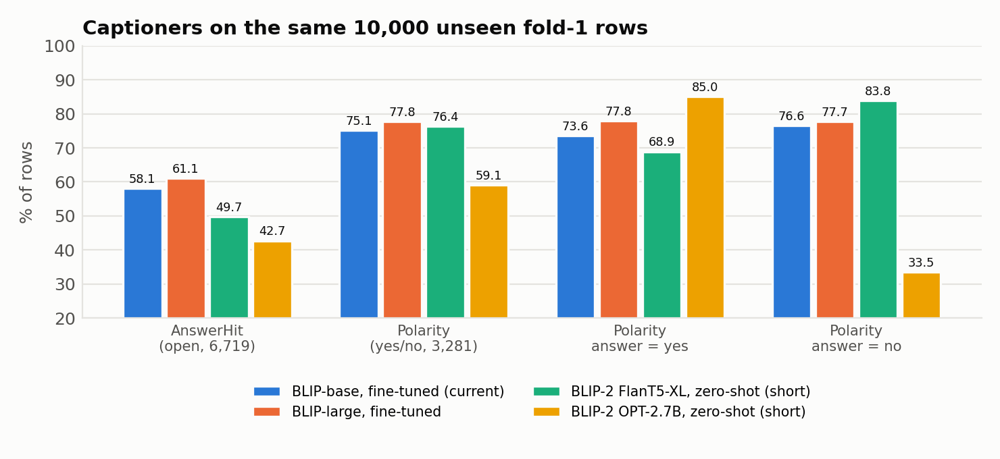
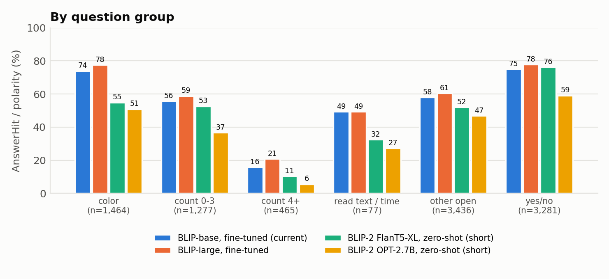
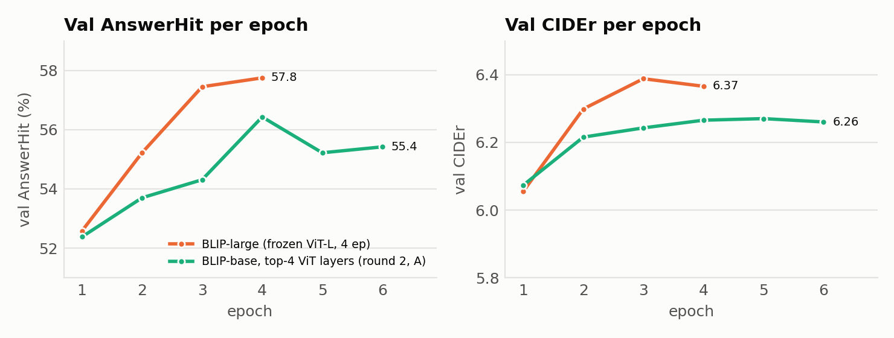

# Stronger captioners: BLIP-base vs BLIP-large vs BLIP-2

After the caption gate (`../CaptionVQA/VQA_GATE_REPORT.md`) the VQA model was shown to use its captions about as well as it can:
the remaining errors come from **wrong captions on hard questions**. The only lever left is **captions that contain the answer
more often**. This round tests whether a stronger pretrained captioner gives that.

All captioners are scored on the **same 10,000 question rows of fold 1**: images the fold-0 captioners never trained on,
which is exactly the situation in the cross-fitted VQA data.

| Captioner (10,000 unseen fold-1 rows) | Fine-tuned on our QD captions? | AnswerHit (open) | Polarity (yes/no) | CIDEr |
|---|---|---:|---:|---:|
| BLIP-base (current captioner) | yes | 58.10 | 75.10 | 6.39 |
| **BLIP-large** | **yes** | **61.05** (+2.95) | **77.75** (+2.65) | **6.53** |
| BLIP-2 FlanT5-XL | no (zero-shot) | 49.69 (−8.41) | 76.41 (+1.31) | 0.51* |
| BLIP-2 OPT-2.7B | no (zero-shot) | 42.74 (−15.36) | 59.13 (−15.97) | 0.60* |

\*BLIP-2 zero-shot gives short answers instead of captions, so CIDEr against our caption references is not comparable.

**Summary**

- **BLIP-large is the first captioner change that improves both measures, and both gains are statistically
  clear:**
  - AnswerHit +2.95 (95% interval +2.0 to +3.9);
  - polarity +2.65 (+1.4 to +4.0);
  - it is better in every question group except reading text (equal);
  - it removes the yes/no imbalance (77.9% right on "yes" answers, 77.7% on "no").
- **It meets the decision rule** set before the experiments (about +3 AnswerHit, no polarity drop). The two BLIP-base attempts of
  round 2 (more epochs, partly trained ViT, answer-weighted loss) stayed at +0.4 or less.
- **BLIP-2 without any fine-tuning** already matches our fine-tuned BLIP-base on yes/no polarity (FlanT5-XL: 76.4).
  - It answers 9.8% of the open questions that BLIP-base gets wrong, so it knows things our captioner doesn't.
  - Its AnswerHit is still 8 points lower, and fine-tuning a 4-billion-parameter model on T4 GPUs would take about a week.
  - **BLIP-2 stays a later option.**
- **Recommendation:** replace BLIP-base by BLIP-large in the pipeline:
  1. train the fold-1 BLIP-large captioner;
  2. re-caption all 658,111 questions, saving the beam scores in the same pass;
  3. retrain the best VQA model (1b-B).
  - Cost: about 20 GPU hours. Expected effect: roughly +1 VQA point.

---

## 1. Why these models, and why BLIP-2 without fine-tuning

### 1.1 The three models

| | BLIP-base (current) | BLIP-large | BLIP-2 (FlanT5-XL / OPT-2.7B) |
|---|---|---|---|
| Image encoder | ViT-B/16, 384 px (86M) | **ViT-L/16**, 384 px (~300M) | **ViT-g/14**, 224 px (~1B), frozen |
| Bridge image → text | cross-attention in every decoder layer | same | **Q-Former**: 32 learned query vectors read the image (~190M) |
| Text generator | BERT-base decoder (~140M) | BERT-base decoder (~140M) | **large language model**: FlanT5-XL (3B, instruction-tuned) or OPT-2.7B |
| Total size | ~225M | ~470M | ~3.9B |
| Pretraining | 129M image–caption pairs, then COCO captions | same | 129M image–caption pairs (no VQA answers); the LLM brings general language knowledge |
| Question-aware? | only after our fine-tuning (question as prompt) | only after our fine-tuning | **yes, out of the box**: it follows a text prompt ("Question: … Short answer:") |
| Fits our pipeline | yes | **yes, same code, only the model name changes** | no, needs new training code (Q-Former / LoRA) |

**Why not other "strong" models?** InstructBLIP and LLaVA-1.5 were trained on VQA v2 itself, and PaliGemma and Qwen-VL on
VQA-style data. Such a captioner has seen VQA answers for our *training* images. Its training captions would be
near-perfect while test captions are not, which is exactly the train/test mismatch that cross-fitting removes, and the
"captions help" result would no longer be clean. BLIP-large and the **pretrained** BLIP-2 checkpoints never saw VQA
answers.

### 1.2 Why BLIP-large was fine-tuned but BLIP-2 was tested without fine-tuning

The goal of this round was a **cheap test before a costly commitment**. For each model we picked the cheapest test that
still answers "is it better than our captioner?":

- **BLIP-large: fine-tuned, because that is the only meaningful test, and it is cheap.**
  - A plain BLIP captioner ignores the question: it describes the image in general. It becomes a *question-dependent*
    captioner only through our fine-tuning with the question as prompt. A zero-shot BLIP-large would say nothing about our task.
  - Fine-tuning reuses our pipeline unchanged (same data, frozen ViT, 4 epochs, batch 48, same learning rate), so only
    the model size changes. Cost: 6.2 h on 2 T4s for one fold.
- **BLIP-2: zero-shot, because fine-tuning is expensive and BLIP-2 can already answer questions.**
  - Fine-tuning a 3.9B model on T4s is only possible with the image encoder and the language model frozen. It takes roughly 8–12 h per fold, plus
    ~10 h to caption all questions and new training code: about a week.
  - BLIP-2 follows a question prompt without any training. So a zero-shot run (~2 h for 10,000 rows × 2 models × 2
    prompts) shows **how much it already knows** about our questions.
  - Rule of thumb: fine-tuning raises a model well above its zero-shot level. If BLIP-2 zero-shot were already close to our fine-tuned BLIP-base, a
    fine-tuned BLIP-2 would very likely beat it. If it were far below, the week would be at risk.
- Two prompts were tried for BLIP-2:
  - `short`: "Question: {q} Short answer:", the VQA prompt from the BLIP-2 paper;
  - `sentence`: "Question: {q} Answer in a full sentence:", closer to our caption style.
  - Greedy decoding, max 24 new tokens.

---

## 2. Results

### 2.1 Overall

| Captioner | AnswerHit | number | other | Polarity | answer = yes | answer = no | "not …" answers | words |
|---|---:|---:|---:|---:|---:|---:|---:|---:|
| BLIP-base, fine-tuned (current) | 58.10 | 44.97 | 62.77 | 75.10 | 73.6 | 76.6 | 51.6% | 5.8 |
| **BLIP-large, fine-tuned** | **61.05** | **48.55** | **65.49** | **77.75** | **77.9** | 77.7 | 50.0% | 5.8 |
| BLIP-2 FlanT5-XL, zero-shot, short | 49.69 | 41.28 | 52.68 | 76.41 | 68.9 | 83.8 | 57.6% | 1.4 |
| BLIP-2 FlanT5-XL, zero-shot, sentence | 49.07 | 39.92 | 52.32 | 76.26 | 70.9 | 81.5 | 55.4% | 1.9 |
| BLIP-2 OPT-2.7B, zero-shot, short | 42.74 | 28.39 | 47.84 | 59.13 | 85.0 | 33.5 | 24.3% | 2.1 |
| BLIP-2 OPT-2.7B, zero-shot, sentence | 42.68 | 27.88 | 47.94 | 60.29 | 79.2 | 41.5 | 31.2% | 2.9 |

Rows: 6,719 open questions (1,761 number, 4,958 other) and 3,281 yes/no (50.2% "no").

**Paired difference to BLIP-base on the same rows** (95% bootstrap interval):

| | AnswerHit | Polarity | Open rows only this model gets | Open rows only BLIP-base gets | Either of the two right |
|---|---|---|---:|---:|---:|
| BLIP-large | **+2.95 [+2.0, +3.9]** | **+2.65 [+1.4, +4.0]** | 9.0% | 6.0% | 67.1% |
| BLIP-2 FlanT5-XL, short | −8.41 [−9.7, −7.2] | +1.31 [−0.5, +3.0] | 9.8% | 18.2% | 67.9% |
| BLIP-2 OPT-2.7B, short | −15.36 [−16.7, −14.1] | −15.97 [−18.0, −13.7] | 7.2% | 22.5% | 65.3% |

- **BLIP-large:** clear gains on both measures. Unlike the round-2 variant B, the polarity gain is balanced ("yes" +4.2,
  "no" +1.1) and the share of negative captions stays at 50%.
- **BLIP-2 FlanT5-XL zero-shot:**
  - **It knows different things.** It gets 9.8% of the open rows that BLIP-base misses, more than BLIP-large does (9.0%).
  - **Weaker overall on open questions.** Part of this is wording: as a zero-shot model it never learned the VQA answer style. "volley ball" vs "volleyball" or "a collar" are correct but
    sometimes miss the exact answer word.
  - **It leans to "no"** (57.6% negative answers).
- **BLIP-2 OPT-2.7B:** clearly weaker. It leans to "yes" and sometimes adds text after the answer (e.g. "No. Long answer: Yes.").

### 2.2 By question group

| Group (n) | BLIP-base | BLIP-large | BLIP-2 FlanT5-XL | BLIP-2 OPT-2.7B |
|---|---:|---:|---:|---:|
| color (1,464) | 74.0 | **77.5** | 54.9 | 51.0 |
| count 0–3 (1,277) | 55.8 | **58.9** | 52.7 | 36.8 |
| count 4+ (465) | 15.9 | **20.9** | 10.5 | 5.6 |
| read text / time (77) | 49.4 | 49.4 | 32.5 | 27.3 |
| other open (3,436) | 58.1 | **60.5** | 52.0 | 46.8 |
| yes/no (3,281) | 75.1 | **77.8** | 76.4 | 59.1 |

BLIP-large improves exactly the **recognition** errors that the earlier error analysis found most often: color +3.5,
small counts +3.1, larger counts +5.0, objects/activities +2.4. Reading text is not helped (and is rare in the QD rows).

**Examples (BLIP-large right, BLIP-base wrong):**

| Question | Answer | BLIP-base | BLIP-large |
|---|---|---|---|
| What color is the window sill? | white | the window sill is brown. | the window sill is white. |
| What is around the cows neck? | collar | a bell is around the cows neck. | a collar is around the cows neck. |
| How many burners are on the stove? | 2 | there is one burner. | there are two burners. |
| What game are the men playing? | volleyball | the men are playing basketball. | the men are playing volleyball. |
| How many toppings are on the pizza? | 3 | there are four toppings. | there are three toppings. |

### 2.3 BLIP-large training

| Epoch | Minutes | Train loss | Val CIDEr | Val AnswerHit |
|---:|---:|---:|---:|---:|
| 1 | 95 | 2.10 | 6.06 | 52.6 |
| 2 | 91 | 1.69 | 6.30 | 55.2 |
| 3 | 101 | 1.61 | **6.39** | 57.5 |
| 4 | 83 | 1.57 | 6.37 | **57.8** |

- Trainable: 142.6M parameters (text decoder; ViT-L frozen).
- Batch 48 per GPU on 2 T4s.
- 6.2 h for 4 epochs.
- `best.pt` = epoch 3 (best val CIDEr, the same rule as for every captioner).
- On validation, BLIP-large is ahead of the best round-2 BLIP-base variant from epoch 2 on, with fewer epochs.

---

## 3. Decision and next steps

**Decision rule** (set before the runs): a candidate replaces BLIP-base only with about +3 AnswerHit on the unseen rows and no polarity drop.

| Candidate | AnswerHit | Polarity | Decision |
|---|---:|---:|---|
| BLIP-base + top-4 ViT layers, 6 epochs (round 2, A) | +0.40 | +0.94 | no |
| BLIP-base + answer-weighted loss (round 2, B) | +0.25 | −2.41 | no |
| BLIP-2 FlanT5-XL, zero-shot | −8.41 | +1.31 | not as is; possible later with fine-tuning |
| **BLIP-large, fine-tuned** | **+2.95** | **+2.65** | **yes** |

**What it could bring for VQA.** From the earlier experiments, about +0.3 VQA points per +1 AnswerHit, plus a small gain from better yes/no
polarity. That suggests **roughly +1 VQA point** for the single model (68.3 → ~69.3) and a little for the ensemble. This is
an estimate: the QD rows are the clearer, answerable questions, and the effect on all VQA questions can be smaller.

**Plan (about 20 GPU hours, 3 Kaggle accounts):**

| # | Notebook | Time | Note |
|---|---|---|---|
| 1 | BLIP-large **fold-1** captioner (`CONFIG=configs/b_blip_fold_large.yaml NAME=large FOLD=1`) | ~6.5 h | completes the cross-fitting pair |
| 2 | **Re-caption all 658,111 questions** with the two BLIP-large fold models, **with beam scores** | ~7–8 h | replaces the BLIP-base beam-score run (C1): one pass gives new captions and captioner confidence |
| 3 | VQA: 1b-B config (caption dropout 0.3) on the new captions, 2 seeds | ~6 h | compare with 68.31 on the same test |
| later | BLIP-2 FlanT5-XL fine-tuning (frozen ViT-g and LLM, Q-Former trained) | ~1 week | only if BLIP-large's VQA gain is real and a further step is needed |

**Limitations to note in the thesis:**
- BLIP-base and BLIP-large were both pretrained on COCO captions (Karpathy split), which include some val2014 images. Those are
  generic captions, not VQA answers, and the same caveat applies to every BLIP model used so far.
- A much stronger captioner also raises the question "why not use it as the VQA model directly?". The thesis studies
  captions as the interface between a captioner and a VQA model, and every comparison keeps the VQA model fixed.

---

### Files

| | |
|---|---|
| Code | `QuestionDependentImageCaptioner/configs/b_blip_fold_large.yaml`, `scripts/kaggle_blip_fold_v2.sh` (`CONFIG`, `NAME`), `scripts/blip2_probe.py`, `scripts/kaggle_blip2_probe.sh`, `scripts/eval_fold_captioner.py` |
| Results | `outputs/round3/model_b/b_blip_fold0_large/` (BLIP-large fold 0), `outputs/round3/blip2_probe/` (4 BLIP-2 runs), `outputs/fold_eval/fold0_current.json` (BLIP-base), `outputs/round3/stronger_captioners.json` |
| Analysis / figures | `scripts/stronger_captioner_analysis.py` → `report_figs_scale/` |
| Kaggle | `mahdirouzmeh/blip2-no-finetune-test`: version 1 = BLIP-2 probe, version 3 = BLIP-large fold 0 |
