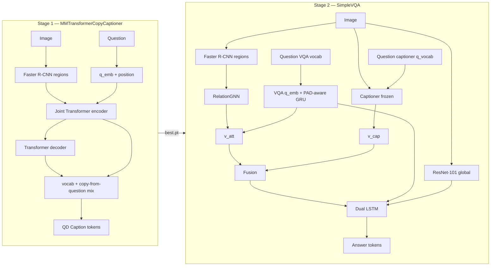
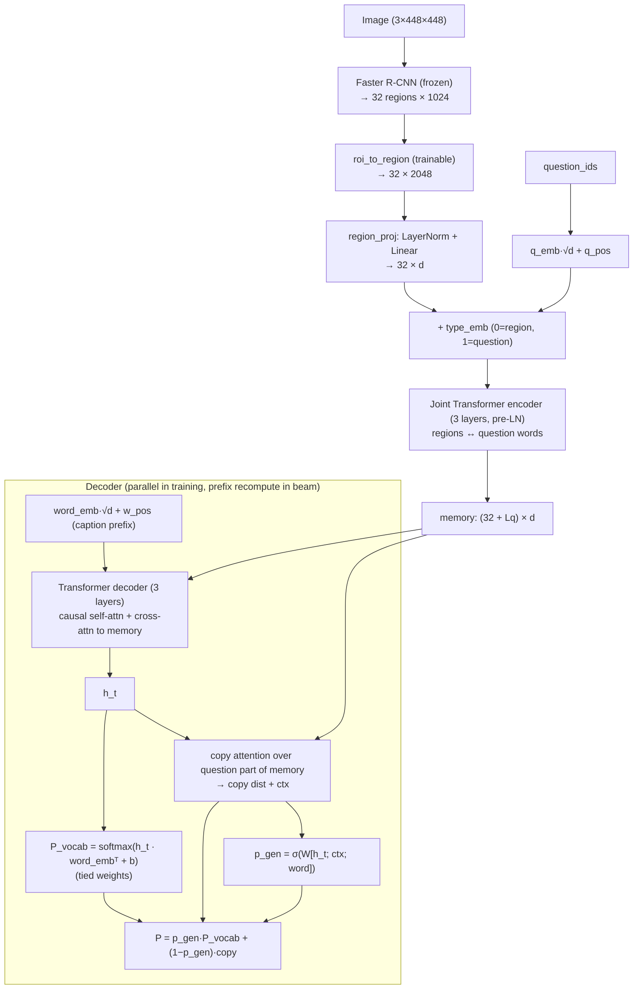
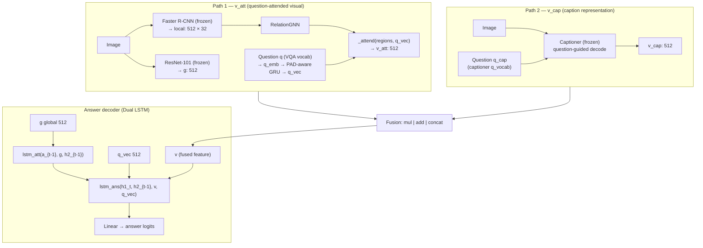

# Architecture — QuestionDependentImageCaptioner & SimpleVQA

<!--
  This document describes the architecture of both models.
  Reference: Sharma & Jalal (2021) — Image captioning improved visual question answering.
  Stage 1 = QD captioner | Stage 2 = VQA with loaded captioner.
-->

## Overview

<!--
  Two-stage pipeline: first train the QD captioner, then VQA with it.
  Stage 1 trains on vqa_v2_question_dependent_captions_*.json.
  Stage 2 trains on VQA v2 and loads the captioner checkpoint.
-->

| Stage | Project | Data | Output |
|-------|---------|------|--------|
| **1** | `QuestionDependentImageCaptioner/` | QD captions `(image, question, caption)` | Question-dependent caption |
| **2** | `SimpleVQA/` | VQA v2 (question + answer) | Answer for (image, question) |



---

## Stage 1 — QuestionDependentImageCaptioner

<!--
  Main model (v2): MMTransformerCopyCaptioner in models/captioner_mmtransformer_copy.py
  Legacy model:    QuestionDependentImageCaptioner (v1) in models/captioner_v1.py
  The class is chosen by `model_class` in the YAML (registry models.build_captioner)
  and saved in the checkpoint config, so eval / benchmark / SimpleVQA rebuild the same class.
  Training: QuestionDependentImageCaptioner/train.py
  Data: vqa_v2_question_dependent_captions_*.json (image, question, caption).
  No RelationGNN in Stage 1. Question is required.
-->

### Goal

Stage 1: learn **(image, question) → question-dependent caption**.

MSCOCO-only (no question) path is removed.

### Why MMTransformerCopyCaptioner

Chosen by the architecture benchmark in [`QuestionDependentImageCaptioner/BENCHMARK.md`](../QuestionDependentImageCaptioner/BENCHMARK.md). All models were trained on 3000 training rows and scored on a test split whose images don't appear in training, with 3 seeds each:

| Model | CIDEr-D | BLEU-4 | Answer-Hit |
|-------|---------|--------|------------|
| v1 `QuestionDependentImageCaptioner` | 1.53 | 0.18 | 0.171 |
| v1 + caption∪question vocab | 1.49 | 0.18 | 0.158 |
| UpDown LSTM + copy | 4.08 | 0.43 | 0.138 |
| **MMTransformerCopyCaptioner** | **4.07** | **0.42** | **0.179** |

Answer-Hit is the share of generated captions that contain the gold answer (yes/no answers excluded). About 69% of caption tokens appear in the question, so **copying from the question** gives the large gain. The vocab change alone does not. B ties the UpDown LSTM on CIDEr-D, is better on Answer-Hit, and trains about 1.7× faster.

### Pipeline (QD, v2)



### Components (v2)

| Layer | File | Trainable? | Input → Output |
|-------|------|------------|----------------|
| `RegionEncoder` | `captioner_v1.py` (shared) | `roi_to_region` only | Image → `(N, 32, 2048)` (raw 1024-D ROI cached) |
| `region_proj` | `captioner_mmtransformer_copy.py` | Yes | `(N, 32, 2048)` → `(N, 32, d)` |
| `q_emb` + `q_pos` + `type_emb` | same | Yes | question ids → `(N, Lq, d)` |
| `encoder` | same | Yes | `[regions; question]` → memory `(N, 32+Lq, d)` |
| `word_emb` + `w_pos` | same | Yes | caption prefix → `(N, T, d)`; also the tied output matrix |
| `decoder` | same | Yes | prefix + memory → `h` `(N, T, d)` |
| `copy_q` / `copy_k` | same | Yes | `h` × question memory → copy attention `(N, T, Lq)` |
| `p_gen` | same | Yes | `[h; ctx; word]` → gate in (0, 1) |
| `copy_map` (buffer) | built from vocabs | – | question-vocab id → caption-vocab id (specials → masked) |

Copying needs every question word in the caption vocab. The configs therefore set `cap_vocab_include_question: true`, so the caption vocab = caption ∪ question tokens from the train split.

### Decode (inference)

| Mode | Function | Description |
|------|----------|-------------|
| Greedy | `_decode_caption()` / `generate_caption(beam_size=1)` | Used for val CIDEr selection and SimpleVQA `caption_repr: text` |
| Beam | `generate_caption()` | Generic `models/beam_utils.beam_search`: beam=5 (benchmark 3), length-norm 0.7, trigram blocking |

### Dimensions (v2 defaults)

| Key | Size | Description |
|-----|------|-------------|
| K (`max_regions`) | 32 | ROIs from Faster R-CNN |
| `region_dim` | 2048 | after `roi_to_region` |
| d (`hidden_dim`) | 512 | Transformer width = `word_emb` dim = `v_cap` dim |
| `num_heads` / `num_layers` / `ff_dim` | 8 / 3 / 1024 | encoder and decoder |
| `dropout` | 0.2 | |
| `max_caption_len` | 20 | + BOS/EOS |
| `max_question_len` | 14 (default) / 20 (smoke) | + BOS/EOS |

### Training (Stage 1 — QD)

```
Input:     (image, question_ids, caption_ids GT)
Loss:      CrossEntropy (label_smoothing 0.1) on caption_ids[:, 1:]
           — the copy model outputs log P, so CE = NLL of the mixed distribution
Mode:      Teacher forcing, parallel (scheduled_sampling_* is ignored; v1 only)
Optimizer: AdamW lr 3e-4, weight_decay 0.01, warmup_steps 400, grad_clip 2.0
           (+ step decay lr_decay_factor / lr_decay_interval)
best.pt:   select_metric: cider → best val CIDEr-D (greedy) ; or `loss`
Splits:    <split>_row_range → image-disjoint train/val/test from one JSON (smoke),
           otherwise max_*_images / max_*_samples
Config:    configs/default.yaml (full), configs/smoke.yaml (3000-row benchmark protocol)
Output:    outputs/*/best.pt  (model + vocab + q_vocab + config incl. model_class;
           frozen detector weights not saved when save_detector_weights: false)
```

**Special tokens:** PAD=0, BOS=1, EOS=2, UNK=3

### Legacy v1 — `QuestionDependentImageCaptioner`

Still in `models/captioner_v1.py`. It's selected by `model_class: QuestionDependentImageCaptioner` and is used automatically for old checkpoints whose config has no `model_class`.

```
qctx = q_gru(q_emb(question))                 # PAD-aware last state
attended = question_attention(regions, qctx)  # one-shot
fused = Linear(concat(qctx, attended))        # FeatureFusion concat
h0, c0 = tanh(W · fused)
z_t = step_attention(regions, h_{t-1})        # per-step refocus (query = h only)
LSTM input = [word; fused; z_t] → classifier(h + ctx_to_logit(z_t))
Train: Adamax + scheduled sampling
```

Benchmark configs for every compared model: `configs/bench_v1.yaml`, `configs/bench_v1_qvocab.yaml`, `configs/bench_transformer_copy.yaml`. The UpDown + copy model lives on branch `feat/qd-captioner-updown-copy`.

---

## Stage 2 — SimpleVQA (VQAModel)

<!--
  VQAModel lives in SimpleVQA/train.py.
  Captioner is loaded from QD Stage 1; default ``captioner_finetune_q: false`` freezes all
  captioner weights (q_emb/q_gru already trained in Stage 1).
  VQA uses two question encodings: q (VQA vocab) and q_cap (captioner q_vocab).
  Two LSTMs for answers: lstm_att + lstm_ans.
-->

### Goal

For each `(image, question)`, produce an **answer**. The captioner helps build `v_cap`.

### Pipeline — two visual paths



### Components — VQAModel

| Module | Trainable? | Input → Output |
|--------|------------|----------------|
| `resnet` + `g_proj` | g_proj only | Image → `g` (512) |
| `detector` + `local_proj` | local_proj only | Image → `(N,32,512)` |
| `q_emb`, `q_gru`, `q_proj` | Yes | VQA `q` ids → PAD-aware GRU → `q_vec` (512) |
| `gnn` (RelationGNN) | Yes | regions → updated regions |
| `_attend` | Yes | regions + q_vec → `v_att` (512) |
| `captioner` | Frozen (default) | image + `q_cap` → `v_cap` |
| `lstm_att`, `lstm_ans`, `out` | Yes | EOS-masked CE loss → answer logits |

<!--
  Important: VQA has TWO question encodings and THREE embedding tables for text!
  1) VQAModel.q_emb + q_gru  → input q (VQA q_vocab from train QIDs)
  2) captioner.q_emb + q_gru → input q_cap (captioner q_vocab from Stage-1 ckpt)
  3) captioner.word_emb      → caption tokens only
  a_vocab is also built from train QIDs only (critical for smoke / capped runs).
-->

### Caption integration

Captioner is loaded from `QuestionDependentImageCaptioner/outputs/*/best.pt` by `load_captioner()`. It goes through the captioner registry (`models.build_captioner`), and the class and dims come from `ckpt['config']`. `captioner_class` in the VQA YAML is only a fallback/check: if it disagrees with the checkpoint, the checkpoint wins and a warning is printed. Old checkpoints without `model_class` load as v1.

| Captioner part | Stage 2 status (default) |
|----------------|--------------------------|
| All captioner weights incl. `q_emb`, `q_gru` | **Frozen** (`captioner_finetune_q: false`) |
| Optional fine-tune | Set `captioner_finetune_q: true` → unfreeze `q_emb`, `q_gru` (v1); `q_emb` only for MMTransformerCopyCaptioner |

**Question conditioning in captioner (QD Stage 1, v2):**

```
memory = Encoder([region_proj(regions); q_emb(q_cap) + pos] + type_emb)   # joint
h_t    = Decoder(caption prefix, memory)                                   # causal
P      = p_gen · softmax(h_t · word_embᵀ) + (1 − p_gen) · copy(q_cap)      # pointer-generator
```

v1 (legacy): `qctx = q_gru(q_emb(q_cap))` → one-shot question attention → concat fusion → LSTM.

### v_cap — two modes (`caption_repr`)

| Mode | Train | Eval | Gradient to q_emb? |
|------|-------|------|---------------------|
| `hidden` | Mean decoder state (v2) / LSTM hidden (v1), EOS-masked | mean word_emb(tokens) | Yes (train) |
| `text` | Greedy tokens → `cap_txt_gru` | same | No (caption decode no_grad) |

<!--
  For question-aware caption training, caption_repr: hidden is preferred.
  hidden mode: grad path answer_loss → v_cap → h → memory → q_emb (v2; v1: h → qctx → q_emb).
-->

### Fusion (`fuse_mode`)

| Mode | Formula | `v` dimension |
|------|---------|---------------|
| `mul` | `v = v_cap ⊙ v_att` | 512 |
| `add` | `v = v_cap + v_att` | 512 |
| `concat` | `v = [v_cap ; v_att]` | 1024 |

### Answer decoder (Dual LSTM)

**Paper Eq. 10 — Attention LSTM:**
```
h1_t = LSTM_att( a_emb(a_{t-1}), g, h2_{t-1} )
```

**Paper Eq. 13 — Answer LSTM:**
```
h2_t = LSTM_ans( h1_t, h2_{t-1}, v, q_vec )
logit_t = Linear(h2_t)
```

**Training / inference details:**
- Decoder steps = tokens until EOS (inclusive); no loss on PAD tail (`answer_step_lengths`)
- Teacher forcing: after EOS, next input is EOS (not PAD)
- Greedy eval: `decode_answer_ids()` stops at EOS for VQA v2 soft accuracy
- `q_vec` is fed directly into `lstm_ans` (not only via `v_att`)

### Dimensions — VQA

| Key | Default | Description |
|-----|---------|-------------|
| `hidden_dim` | 512 | LSTM, projections |
| `word_dim` | 512 | q/a embeddings |
| `question_dim` | 1280 | GRU hidden |
| `max_regions` | 32 | ROI count |
| `max_question_len` | 14 | + BOS/EOS |
| `max_answer_len` | 6 | + BOS/EOS |

### Training (Stage 2)

```
Input:  (image, q, q_cap, answer_ids GT)
        q      = VQA question encoding (q_vocab from train QIDs)
        q_cap  = captioner question encoding (q_vocab from Stage-1 ckpt)
Loss:   CrossEntropy on answer tokens up to EOS (PAD positions masked)
Metric: VQA v2 soft accuracy (greedy decode at validation)
Output: outputs/<run>/best.pt  (VQAModel + q_vocab + a_vocab)
```

`eval.py` loads the same vocabs from checkpoint and passes `q_cap_ids` like training.

---

## Separate vocabularies (important!)

<!--
  Common mistakes:
  - Building a_vocab from full VQA train while using max_train_qids (smoke)
  - Feeding VQA q into captioner instead of q_cap
  - Decoding answers without stopping at EOS
-->

| Embedding / ids | Vocab source | Size (smoke 100 QIDs) | Used in |
|-----------------|--------------|------------------------|---------|
| `captioner.word_emb` | Caption `vocab` in ckpt | ~163 | Caption decode |
| `captioner.q_emb` | `q_vocab` in captioner ckpt | ~140 | `q_cap` → `v_cap` |
| `captioner.copy_map` | `q_vocab` → caption `vocab` | = `q_vocab` | copy target ids (v2) |
| `VQAModel.q_emb` | `q_vocab` in VQA ckpt (train QIDs) | ~28 | `v_att`, answer LSTM |
| `VQAModel.a_emb` | `a_vocab` in VQA ckpt (train QIDs) | ~60 | Answer decode |

Full `default.yaml` run: vocabs cover all train QIDs (thousands of question tokens, ~13k answer types before freq filter).

---

## File map

```
src/
├── architecture/
│   ├── ARCHITECTURE.en.md       English (this file)
│   └── ARCHITECTURE.fa.md       Finglish / Persian-English
├── QuestionDependentImageCaptioner/
│   ├── train.py                 Stage 1 training (registry, splits, val-CIDEr selection)
│   ├── eval.py                  Caption inference / demo (train / val / test split)
│   ├── benchmark.py             Test-split metrics → test_metrics.json
│   ├── decoding.py              Batched split decoding
│   ├── metrics.py               BLEU, CIDEr-D, ROUGE-L, Answer-Hit
│   ├── BENCHMARK.md             Architecture comparison (why v2)
│   ├── models/
│   │   ├── __init__.py          Registry: build_captioner / MODEL_REGISTRY
│   │   ├── captioner_mmtransformer_copy.py  MMTransformerCopyCaptioner (v2 default)
│   │   ├── captioner_v1.py      QuestionDependentImageCaptioner (v1) + RegionEncoder
│   │   ├── beam_utils.py        Generic beam search + pointer-generator mix
│   │   └── base_captioner.py    Interface
│   ├── scripts/                 cache_regions.py, run_bench.sh, bench_compare.py
│   └── configs/                 smoke.yaml, default.yaml, kaggle*.yaml, bench_*.yaml
│
└── SimpleVQA/
    ├── train.py                 Stage 2 training + VQAModel (+ own RelationGNN)
    ├── eval.py                  VQA inference (q_cap, greedy acc, samples)
    └── configs/smoke.yaml       → captioner outputs/smoke/best.pt
```

---

## Workflow — train to eval

```bash
# 1) Stage 1 — QD captioner (MMTransformerCopyCaptioner)
cd QuestionDependentImageCaptioner
python scripts/cache_regions.py --config configs/smoke.yaml   # once (images_from_cache: true)
python train.py --config configs/smoke.yaml
python benchmark.py --config configs/smoke.yaml --ckpt outputs/smoke/best.pt --name smoke

# 2) Stage 2 (captioner_ckpt → outputs/smoke/best.pt in smoke.yaml)
cd ../SimpleVQA
python train.py --config configs/smoke.yaml

# 3) Eval VQA (greedy acc + samples; uses q_cap)
python eval.py --config configs/smoke.yaml --ckpt outputs/smoke/best.pt --split train --samples 20

# 4) Eval QD caption
cd ../QuestionDependentImageCaptioner
python eval.py --config configs/smoke.yaml --ckpt outputs/smoke/best.pt \
  --image-id 25 --split train --question "How many animals are in this photo?"
```

---

## Feature caching (faster training)

<!--
  Region and global features are saved once so each epoch
  does not re-run Faster R-CNN / ResNet.
-->

| Cache | Project | Path pattern | Content |
|-------|---------|--------------|---------|
| Region (captioner) | QuestionDependentImageCaptioner | `{image_id}.pt` | raw ROI 1024-D |
| Region (VQA) | SimpleVQA | `{image_id}_k32_raw1024.pt` | raw ROI 1024-D |
| Global (VQA) | SimpleVQA | `{image_id}.pt` | ResNet 2048-D |

---

## References

- Sharma & Jalal (2021) — *Image captioning improved visual question answering*
- Xu et al. (2015) — Show, Attend and Tell (attention + LSTM init, v1)
- Vaswani et al. (2017) — Attention Is All You Need (Transformer encoder/decoder, v2)
- See et al. (2017) — Get To The Point (pointer-generator copy, v2)
- Anderson et al. (2018) — Bottom-Up and Top-Down Attention (benchmark arch A)
- VQA v2 dataset — Open-ended questions + 10 annotator answers
