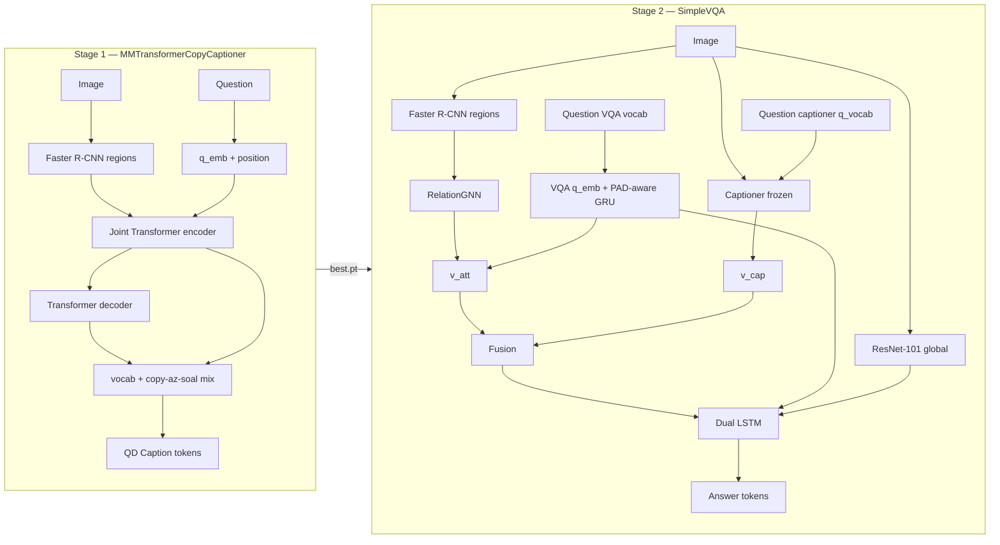
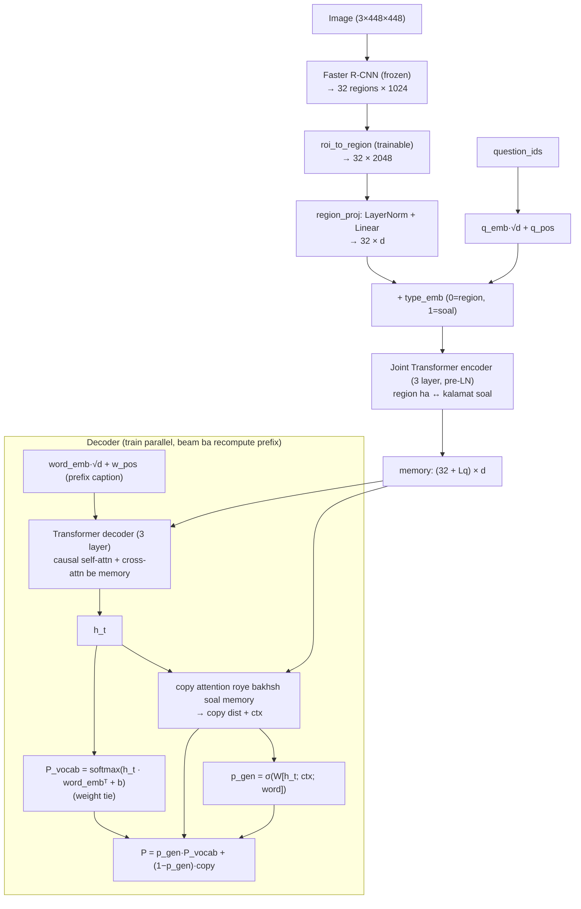
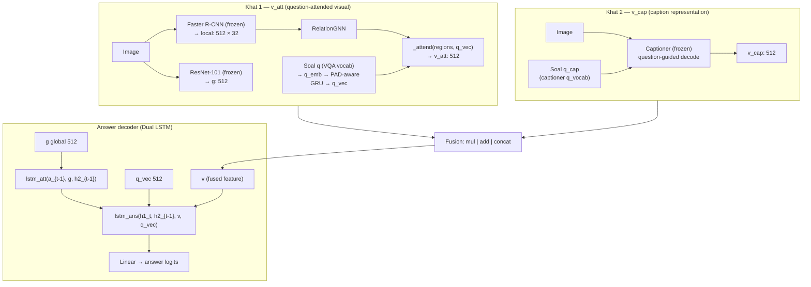

# Architecture — QuestionDependentImageCaptioner & SimpleVQA

<!--
  In file architecture-e do model ro ba Finglish tozih mide.
  Marja: Sharma & Jalal (2021) — Image captioning improved visual question answering.
  Stage 1 = QD captioner | Stage 2 = VQA ba captioner-e load shode.
-->

## Kholase (Overview)

<!--
  Do marhale: Stage 1 QD caption (image+soal→caption), Stage 2 VQA.
-->

| Marhale | Project | Data | Khoroji |
|---------|---------|------|---------|
| **1** | `QuestionDependentImageCaptioner/` | QD captions `(image, question, caption)` | Caption question-dependent |
| **2** | `SimpleVQA/` | VQA v2 (soal + javab) | Javab baraye (tasvir, soal) |



---

## Stage 1 — QuestionDependentImageCaptioner

<!--
  Model asli (v2): MMTransformerCopyCaptioner dar models/captioner_mmtransformer_copy.py
  Model ghadimi:  QuestionDependentImageCaptioner (v1) dar models/captioner_v1.py
  Class ba `model_class` dar YAML entekhab mishe (registry models.build_captioner) va
  toye config checkpoint save mishe → eval / benchmark / SimpleVQA hamoon class ro misazan.
  Data: vqa_v2_question_dependent_captions_*.json.
  RelationGNN dar Stage 1 nist. Soal lazeme.
-->

### Hadaf

Marhale 1 (QD): **(image, question) → question-dependent caption**.
Path MSCOCO-only (bedoon soal) hazf shode.

### Chera MMTransformerCopyCaptioner

Az benchmark architecture ([`QuestionDependentImageCaptioner/BENCHMARK.md`](../QuestionDependentImageCaptioner/BENCHMARK.md)) entekhab shode. Har model roye 3000 row train shode va roye test split (image haye joda az train) ba 3 seed sanjide shode:

| Model | CIDEr-D | BLEU-4 | Answer-Hit |
|-------|---------|--------|------------|
| v1 `QuestionDependentImageCaptioner` | 1.53 | 0.18 | 0.171 |
| v1 + vocab caption∪soal | 1.49 | 0.18 | 0.158 |
| UpDown LSTM + copy | 4.08 | 0.43 | 0.138 |
| **MMTransformerCopyCaptioner** | **4.07** | **0.42** | **0.179** |

Answer-Hit = darsad caption haye tolid shode ke javab dorost (gold answer) ro daran (javab yes/no hesab nemishe). ~69% token haye caption toye soal hastan → **copy az soal** dalil asli jahesh ast; taghir vocab be tanhayi asari nadare. B ba UpDown dar CIDEr-D mosavi ast, Answer-Hit behtari dare va ~1.7× sari tar train mishe.

### Pipeline (QD, v2)



### Component-ha (v2)

| Layer | File | Trainable? | Voroudi → Khorouji |
|-------|------|------------|---------------------|
| `RegionEncoder` | `captioner_v1.py` (moshtarak) | `roi_to_region` only | Image → `(N, 32, 2048)` (raw 1024-D cache) |
| `region_proj` | `captioner_mmtransformer_copy.py` | Yes | `(N, 32, 2048)` → `(N, 32, d)` |
| `q_emb` + `q_pos` + `type_emb` | hamoon | Yes | question ids → `(N, Lq, d)` |
| `encoder` | hamoon | Yes | `[regions; soal]` → memory `(N, 32+Lq, d)` |
| `word_emb` + `w_pos` | hamoon | Yes | prefix caption → `(N, T, d)`; ham output matrix (tie) |
| `decoder` | hamoon | Yes | prefix + memory → `h` `(N, T, d)` |
| `copy_q` / `copy_k` | hamoon | Yes | `h` × memory soal → copy attention `(N, T, Lq)` |
| `p_gen` | hamoon | Yes | `[h; ctx; word]` → gate (0, 1) |
| `copy_map` (buffer) | az vocab ha | – | id q_vocab → id caption vocab (special ha mask) |

Copy niyaz dare har kalame soal toye caption vocab bashe → `cap_vocab_include_question: true` (vocab caption = caption ∪ soal az train split).

### Decode (inference)

| Mode | Function | Tozih |
|------|----------|-------|
| Greedy | `_decode_caption()` / `generate_caption(beam_size=1)` | val CIDEr selection + SimpleVQA `caption_repr: text` |
| Beam | `generate_caption()` | `models/beam_utils.beam_search` generic: beam=5 (benchmark 3), length-norm 0.7, trigram block |

### Abaad (v2 default)

| Key | Size | Tozih |
|-----|------|-------|
| K (`max_regions`) | 32 | ROI az Faster R-CNN |
| `region_dim` | 2048 | baad az `roi_to_region` |
| d (`hidden_dim`) | 512 | width Transformer = dim `word_emb` = dim `v_cap` |
| `num_heads` / `num_layers` / `ff_dim` | 8 / 3 / 1024 | encoder va decoder |
| `dropout` | 0.2 | |
| `max_caption_len` | 20 | + BOS/EOS |
| `max_question_len` | 14 (default) / 20 (smoke) | + BOS/EOS |

### Train (Stage 1 — QD)

```
Input:     (image, question_ids, caption_ids GT)
Loss:      CrossEntropy (label_smoothing 0.1) roye caption_ids[:, 1:]
           — copy model log P mide → CE = NLL distribution mix
Mode:      Teacher forcing parallel (scheduled_sampling_* ignore; faghat v1)
Optimizer: AdamW lr 3e-4, weight_decay 0.01, warmup_steps 400, grad_clip 2.0
           (+ step decay lr_decay_factor / lr_decay_interval)
best.pt:   select_metric: cider → behtarin val CIDEr-D (greedy) ; ya `loss`
Split:     <split>_row_range → train/val/test image-disjoint az yek JSON (smoke),
           vagarna max_*_images / max_*_samples
Config:    configs/default.yaml (kamel), configs/smoke.yaml (protocol benchmark 3000 row)
Output:    outputs/*/best.pt  (model + vocab + q_vocab + config ba model_class;
           weight detector freeze ba save_detector_weights: false save nemishe)
```

**Special tokens:** PAD=0, BOS=1, EOS=2, UNK=3

### v1 ghadimi — `QuestionDependentImageCaptioner`

Hanuz dar `models/captioner_v1.py` hast. Ba `model_class: QuestionDependentImageCaptioner` entekhab mishe, va baraye checkpoint haye ghadimi ke config-eshoon `model_class` nadare khodkar estefade mishe.

```
qctx = q_gru(q_emb(question))                 # PAD-aware last state
attended = question_attention(regions, qctx)  # yek bar
fused = Linear(concat(qctx, attended))        # FeatureFusion concat
h0, c0 = tanh(W · fused)
z_t = step_attention(regions, h_{t-1})        # per-step refocus (query faghat h)
LSTM input = [word; fused; z_t] → classifier(h + ctx_to_logit(z_t))
Train: Adamax + scheduled sampling
```

Config haye benchmark baraye har model moghayese shode: `configs/bench_v1.yaml`, `configs/bench_v1_qvocab.yaml`, `configs/bench_transformer_copy.yaml`. Model UpDown + copy roye branch `feat/qd-captioner-updown-copy` hast.

---

## Stage 2 — SimpleVQA (VQAModel)

<!--
  VQAModel dar SimpleVQA/train.py hast.
  Captioner az QD Stage 1 load mishe; default ``captioner_finetune_q: false`` = freeze hame
  (q_emb/q_gru ghablan dar Stage 1 train shodan).
  VQA do encoding soal dare: q (VQA vocab) va q_cap (captioner q_vocab).
  Do LSTM baraye javab: lstm_att + lstm_ans.
-->

### Hadaf

Baraye har `(image, question)` yek **javab** tolid kon. Captioner komak mikone ta `v_cap` besazim.

### Pipeline — do khat visual



### Component-ha — VQAModel

| Module | Trainable? | Voroudi → Khorouji |
|--------|------------|---------------------|
| `resnet` + `g_proj` | g_proj only | Image → `g` (512) |
| `detector` + `local_proj` | local_proj only | Image → `(N,32,512)` |
| `q_emb`, `q_gru`, `q_proj` | Yes | VQA `q` → GRU PAD-aware → `q_vec` (512) |
| `gnn` (RelationGNN) | Yes | regions → updated regions |
| `_attend` | Yes | regions + q_vec → `v_att` (512) |
| `captioner` | Frozen (default) | image + `q_cap` → `v_cap` |
| `lstm_att`, `lstm_ans`, `out` | Yes | CE ba EOS-mask → answer logits |

<!--
  Mohem: VQA do encoding soal + se ta embedding matni dare!
  1) VQAModel.q_emb + q_gru  → voroudi q (VQA q_vocab az train QIDs)
  2) captioner.q_emb + q_gru → voroudi q_cap (captioner q_vocab az Stage-1 ckpt)
  3) captioner.word_emb      → faghat token haye caption
  a_vocab ham faghat az train QIDs sakhte mishe (baraye smoke/cap zaruri).
-->

### Caption integration

Captioner az `QuestionDependentImageCaptioner/outputs/*/best.pt` ba `load_captioner()` load mishe. Az registry captioner (`models.build_captioner`) estefade mikone; class va abaad az `ckpt['config']` khoonde mishan. `captioner_class` dar YAML-e VQA faghat fallback/check ast: age ba checkpoint fargh dashte bashe, checkpoint barande ast va warning chap mishe. Checkpoint haye ghadimi bedoon `model_class` → v1.

| Captioner part | Stage 2 (default) |
|----------------|-------------------|
| Hame weight ha incl. `q_emb`, `q_gru` | **Frozen** (`captioner_finetune_q: false`) |
| Fine-tune ixtiyari | `captioner_finetune_q: true` → unfreeze `q_emb`, `q_gru` (v1); MMTransformerCopyCaptioner faghat `q_emb` |

**Question conditioning dar captioner (QD Stage 1, v2):**

```
memory = Encoder([region_proj(regions); q_emb(q_cap) + pos] + type_emb)   # joint
h_t    = Decoder(prefix caption, memory)                                   # causal
P      = p_gen · softmax(h_t · word_embᵀ) + (1 − p_gen) · copy(q_cap)      # pointer-generator
```

v1 (ghadimi): `qctx = q_gru(q_emb(q_cap))` → question attention yek bar → concat fusion → LSTM.

### v_cap — do halat (`caption_repr`)

| Mode | Train | Eval | Gradient be q_emb? |
|------|-------|------|---------------------|
| `hidden` | Mean decoder state (v2) / LSTM hidden (v1), EOS-masked | mean word_emb(tokens) | Yes (train) |
| `text` | Greedy tokens → `cap_txt_gru` | same | No (caption decode no_grad) |

<!--
  Baraye question-aware caption train, caption_repr: hidden behtar ast.
  hidden mode: grad az answer_loss → v_cap → h → memory → q_emb (v2; v1: h → qctx → q_emb).
-->

### Fusion (`fuse_mode`)

| Mode | Formula | `v` dimension |
|------|---------|---------------|
| `mul` | `v = v_cap ⊙ v_att` | 512 |
| `add` | `v = v_cap + v_att` | 512 |
| `concat` | `v = [v_cap ; v_att]` | 1024 |

### Answer decoder (Dual LSTM)

**Paper Eq. 10 — Attention LSTM:**
```
h1_t = LSTM_att( a_emb(a_{t-1}), g, h2_{t-1} )
```

**Paper Eq. 13 — Answer LSTM:**
```
h2_t = LSTM_ans( h1_t, h2_{t-1}, v, q_vec )
logit_t = Linear(h2_t)
```

**Joziyat train / inference:**
- Decoder steps = token ha ta EOS (shamel); loss roye PAD tail nist (`answer_step_lengths`)
- Teacher forcing: baad EOS, voroudi badi EOS (na PAD)
- Greedy eval: `decode_answer_ids()` dar EOS stop mikone
- `q_vec` mostaghim vared `lstm_ans` mishe (na faghat az tarigh `v_att`)

### Abaad — VQA

| Key | Default | Tozih |
|-----|---------|-------|
| `hidden_dim` | 512 | LSTM, projections |
| `word_dim` | 512 | q/a embeddings |
| `question_dim` | 1280 | GRU hidden |
| `max_regions` | 32 | ROI count |
| `max_question_len` | 14 | + BOS/EOS |
| `max_answer_len` | 6 | + BOS/EOS |

### Train (Stage 2)

```
Input:  (image, q, q_cap, answer_ids GT)
        q      = encoding soal VQA (q_vocab az train QIDs)
        q_cap  = encoding soal captioner (q_vocab az Stage-1 ckpt)
Loss:   CrossEntropy ta EOS (PAD mask shode)
Metric: VQA v2 soft accuracy (greedy dar validation)
Output: outputs/<run>/best.pt  (VQAModel + q_vocab + a_vocab)
```

`eval.py` hamun vocab ha va `q_cap_ids` ro mesl train estefade mikone.

---

## Do Vocabulary joda (mohem!)

<!--
  Ehtemal shtebah:
  - a_vocab az kol train VQA ba max_train_qids (smoke)
  - VQA q be captioner dadan be jaye q_cap
  - decode javab bedoon stop dar EOS
-->

| Embedding / ids | Manba vocab | Size (smoke 100 QID) | Koja |
|-----------------|-------------|----------------------|------|
| `captioner.word_emb` | `vocab` dar ckpt caption | ~163 | decode caption |
| `captioner.q_emb` | `q_vocab` dar ckpt captioner | ~140 | `q_cap` → `v_cap` |
| `captioner.copy_map` | `q_vocab` → caption `vocab` | = `q_vocab` | id hadaf copy (v2) |
| `VQAModel.q_emb` | `q_vocab` dar ckpt VQA (train QIDs) | ~28 | `v_att`, answer LSTM |
| `VQAModel.a_emb` | `a_vocab` dar ckpt VQA (train QIDs) | ~60 | decode javab |

Run `default.yaml`: vocab ha roye hame train QIDs (hezar ha soal, ~13k javab ghabl az freq filter).

---

## File map

```
src/
├── architecture/
│   ├── ARCHITECTURE.en.md       English
│   └── ARCHITECTURE.fa.md       Finglish (in file)
├── QuestionDependentImageCaptioner/
│   ├── train.py                 Stage 1 training (registry, split ha, val-CIDEr selection)
│   ├── eval.py                  Caption inference / demo (split train / val / test)
│   ├── benchmark.py             Metric haye test split → test_metrics.json
│   ├── decoding.py              Decode batch be batch yek split
│   ├── metrics.py               BLEU, CIDEr-D, ROUGE-L, Answer-Hit
│   ├── BENCHMARK.md             Moghayese architecture (chera v2)
│   ├── models/
│   │   ├── __init__.py          Registry: build_captioner / MODEL_REGISTRY
│   │   ├── captioner_mmtransformer_copy.py  MMTransformerCopyCaptioner (v2 default)
│   │   ├── captioner_v1.py      QuestionDependentImageCaptioner (v1) + RegionEncoder
│   │   ├── beam_utils.py        Beam search generic + mix pointer-generator
│   │   └── base_captioner.py    Interface
│   ├── scripts/                 cache_regions.py, run_bench.sh, bench_compare.py
│   └── configs/                 smoke.yaml, default.yaml, kaggle*.yaml, bench_*.yaml
│
└── SimpleVQA/
    ├── train.py                 Stage 2 training + VQAModel (+ RelationGNN khodesh)
    ├── eval.py                  VQA inference (q_cap, greedy acc, samples)
    └── configs/smoke.yaml       → captioner outputs/smoke/best.pt
```

---

## Workflow — az train ta eval

```bash
# 1) Stage 1 — QD captioner (MMTransformerCopyCaptioner)
cd QuestionDependentImageCaptioner
python scripts/cache_regions.py --config configs/smoke.yaml   # yek bar (images_from_cache: true)
python train.py --config configs/smoke.yaml
python benchmark.py --config configs/smoke.yaml --ckpt outputs/smoke/best.pt --name smoke

# 2) Stage 2 (captioner_ckpt → outputs/smoke/best.pt dar smoke.yaml)
cd ../SimpleVQA
python train.py --config configs/smoke.yaml

# 3) Eval VQA (greedy acc + samples; ba q_cap)
python eval.py --config configs/smoke.yaml --ckpt outputs/smoke/best.pt --split train --samples 20

# 4) Eval caption QD
cd ../QuestionDependentImageCaptioner
python eval.py --config configs/smoke.yaml --ckpt outputs/smoke/best.pt \
  --image-id 25 --split train --question "How many animals are in this photo?"
```

---

## Cache (sari tar shodan train)

<!--
  Region va global feature ro 1 bar save mikonim ta har epoch
  Faster R-CNN / ResNet dobare run nashe.
-->

| Cache | Project | Path pattern | Content |
|-------|---------|--------------|---------|
| Region (captioner) | QuestionDependentImageCaptioner | `{image_id}.pt` | raw ROI 1024-D |
| Region (VQA) | SimpleVQA | `{image_id}_k32_raw1024.pt` | raw ROI 1024-D |
| Global (VQA) | SimpleVQA | `{image_id}.pt` | ResNet 2048-D |

---

## References

- Sharma & Jalal (2021) — *Image captioning improved visual question answering*
- Xu et al. (2015) — Show, Attend and Tell (attention + LSTM init, v1)
- Vaswani et al. (2017) — Attention Is All You Need (Transformer encoder/decoder, v2)
- See et al. (2017) — Get To The Point (copy pointer-generator, v2)
- Anderson et al. (2018) — Bottom-Up and Top-Down Attention (benchmark arch A)
- VQA v2 dataset — Open-ended questions + 10 annotator answers
