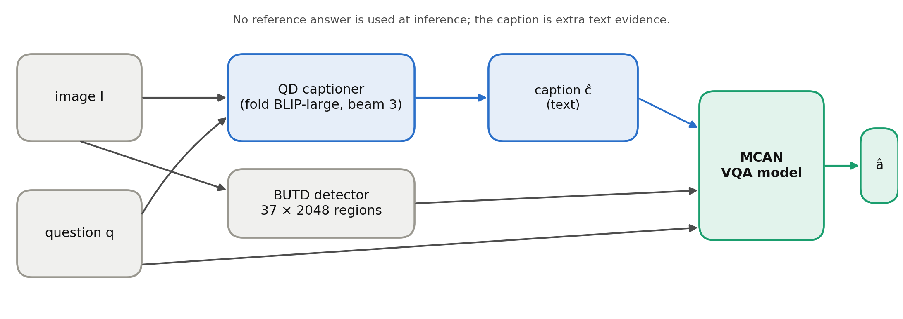
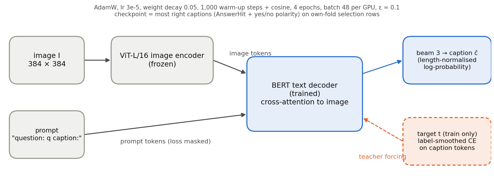
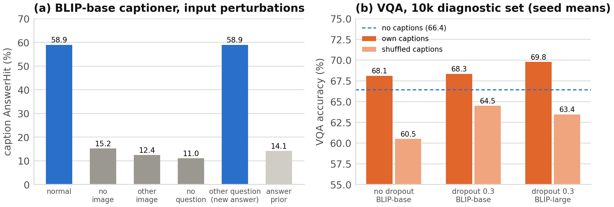

University of Tabriz, Tabriz, Iran | [Department and corresponding author email to be confirmed]

# Abstract

Visual question answering (VQA) requires an answer grounded in the image and conditioned on the question. Generic image representations may omit or obscure evidence specific to the question. We investigate a two-stage framework in which a question-conditioned image caption serves as an auxiliary semantic sequence for a VQA model. A synthetic corpus of 277,318 question-dependent caption records, derived from VQA v2 training annotations and screened with local language models, is used to fine-tune a pretrained BLIP-Large captioner. To prevent target-answer leakage into downstream training, captioners are trained on two image-disjoint folds and caption only the opposite fold; validation and test captions are generated from image and question alone. Caption tokens are fused with region features in an MCAN co-attention network, and caption dropout reduces dependence on inaccurate descriptions. On the official VQA v2 test-standard, two-seed ensembles with and without captions obtain 73.16% and 69.56%, an improvement of 3.60 percentage points; on test-dev the improvement is 3.59 points for the ensembles and 3.82 points for the mean of the single models (72.13% vs. 68.31%). On an internal development set, replacing BLIP-base with BLIP-Large improves VQA accuracy by 1.45 points (95% image-clustered bootstrap interval 0.94 to 1.96). Analyses of caption perturbations and an auxiliary reliability gate identify both benefits and limitations of caption-based evidence. The findings support question-dependent textual evidence as a complementary input to a region-based VQA model; they do not establish state-of-the-art performance or superiority over generic captions, for which a matched control is reported separately (Section 6.5).

Keywords: visual question answering; question-dependent image captioning; BLIP; cross-fitting; multimodal fusion; caption dropout; VQA v2.

# 1. Introduction

Visual question answering is a multimodal task in which the system must infer an answer to a natural-language question about an image. The VQA v2 benchmark was designed to reduce reliance on language priors through complementary image–question examples [1]. Object-region attention [2] and deep modular co-attention [3] provide effective mechanisms for aligning question tokens with visual features. Nevertheless, the answer-relevant detail may be difficult to extract from region embeddings alone. A natural-language caption offers a potentially complementary semantic representation of objects, attributes, actions and relations.

Previous caption-enhanced VQA studies have explored the connection between captioning and answering [4,5]. A caption that is independent of the question, however, need not describe the detail that the answer requires. This motivates conditioning generation on the question and using its output as auxiliary evidence rather than as a replacement for image features. When reference answers are used to construct synthetic caption targets, an additional methodological concern arises: captions generated for downstream training examples may encode memorised answer supervision if the captioner has already been trained on those images.

This study investigates three questions: (i) whether question-conditioned captions improve a controlled image–question VQA baseline, (ii) whether improvements in caption answer preservation translate into VQA improvements, and (iii) how wrong captions influence the downstream model. The work uses a large synthetic training corpus, image-disjoint cross-fitting, sequence-level caption fusion and controlled comparisons on the official VQA v2 benchmark. The main contribution is empirical and methodological rather than a new pretrained vision-language architecture.

# 2. Related work

VQA systems have evolved from attention over detected objects [2] to deeper networks that jointly model language and visual interactions. MCAN [3] uses cascaded self-attention and guided-attention modules. Sharma and Jalal [4] study caption-based transfer to VQA through visual and caption-derived representations. Zhou et al. [5] propose IC-VQA, which generates question-specific captions using attention and a Transformer and incorporates those captions into a VQA framework. Question-driven caption prompting has also been studied by Özdemir and Akagündüz [6]. These studies motivate an explicit evaluation of the contribution of question-conditioned textual evidence on a fixed downstream backbone.

Pretrained vision-language systems offer strong starting points for caption generation. BLIP [7] supports image-conditioned language generation, and BLIP-2 [8] connects frozen vision encoders and large language models through a learned query module. In this work, BLIP is adapted to question-dependent captioning with answer-derived synthetic targets. BLIP-2 is investigated only in a zero-shot screening experiment; it is not treated as a fair fine-tuned architecture comparison.

# 3. Synthetic question-dependent caption supervision

The supervision pipeline first converts reference answers into question-specific textual targets and then filters the resulting corpus. The following subsections define the target construction, document its quality-control stages, and describe the image-disjoint protocol used to generate downstream captions.

## 3.1. Task and target construction

Let $I$ denote an image, $q$ a question, $a$ the majority human answer and $t$ a synthetic target caption. The target-generation process maps $(q, a)$ to a short declarative statement $t$ intended to preserve the answer and the question-specific proposition. For example, "What color is the train?" with answer "blue" yields "The train is blue." The target is not an independently human-written caption, and it is never supplied to the VQA model. The captioner instead learns $p(t \mid I, q)$ and generates a new description from image and question only.

Let the answer annotation set for image–question pair $i$ be $\mathcal{A}_i$ and let $G$ denote the rule/local-language-model transformation:

$$a_i^{*} = \operatorname{mode}(\mathcal{A}_i), \qquad t_i = G(q_i, a_i^{*}) \qquad (1)$$

Rules cover four question families (what colour, how many, what is … doing, who; 67,259 records); the remaining 216,448 records are written by a local language model. Question classification excludes questions judged not directly answerable from the image (opinion, external knowledge) and OCR-dependent questions from the caption-supervision subset. The filtering applies to captioner supervision only: the VQA experiments use the complete standard train2014 and val2014 question sets.

## 3.2. Corpus construction and quality control

All language-model steps ran locally with Ollama on 4-bit quantised Qwen2.5 instruction models [11]. Question classification and caption generation used `qwen2.5:3b-instruct-q4_K_M` (classifier prompt v20, generation prompt v10, fast validator v11, language-model validator v10). The first pass produced 406,315 caption records from the 443,757 train2014 questions (Table 1). A parsing failure in that run had let undecided questions pass as visual, so all 406,315 questions were re-classified with the same 3B model rather than regenerating every caption; 283,707 records remained.

Each retained caption was then judged by the larger `qwen2.5:7b-instruct-q4_K_M` (judge prompt j2) for a missing or contradicted answer, changed meaning, added unsupported facts or unrelated content. Captions judged WRONG were regenerated (prompt r2 with generation prompt v10, temperature 0.3, at most two rounds) and judged again. A record keeps the verdict `ok` only if the 7B judge accepts it; records whose only problem is grammar receive the separate verdict GRAMMAR_ISSUE_ONLY. The captioner is trained on the `ok` records only. These verdicts are automated quality-control labels, not human-verified ground truth: the 1,677 residual WRONG labels are 0.59% of the screened corpus, not an independently measured error rate.

A separate heuristic flag ("suspicious": extra words not supported by question and answer, or a yes/no polarity flip) marks 29,844 of the `ok` records. These records passed the 7B judge and were kept.

$$\mathcal{D}_{QD} = \{(I_i, q_i, t_i) : d_i = 1,\ u_i = \texttt{ok}\} \qquad (2)$$

where $d_i$ is the visual-question decision and $u_i$ the final judge verdict.

| Stage | Model / version | Records |
|---|---|--:|
| train2014 questions | — | 443,757 |
| Excluded in the first pass: not visual (blacklist) 21,272; OCR 15,824; duplicates 88; empty 8; failed validation 250 | 3B | — |
| Caption records after the first pass | 3B, prompts v20 / v10 | 406,315 |
| Re-classified as not directly visual (opinion 48,468; knowledge 62,631; OCR 11,509) | 3B, v20 | −122,608 |
| Retained after re-classification | | 283,707 |
| Initial judge verdicts: ok / WRONG / GRAMMAR_ISSUE_ONLY | 7B, j2 | 250,987 / 28,153 / 4,567 |
| WRONG regenerated: repaired / still WRONG | 7B, r2 | 26,476 / 1,677 |
| Final verdicts: ok / GRAMMAR_ISSUE_ONLY / WRONG | | 277,318 / 4,712 / 1,677 |
| **Captioner training corpus (verdict ok)** | | **277,318 records, 79,568 images** |

Table: **Table 1. Corpus construction (from the provenance block of the released corpus file).** Initial WRONG reasons: meaning changed 13,577; answer missing 7,376; answer contradicted 3,156; unrelated 2,212; added facts 1,832. The increase of GRAMMAR_ISSUE_ONLY from 4,567 to 4,712 comes from regenerated captions.

{width=6.6in}

## 3.3. Image-disjoint cross-fitting

The caption corpus is derived exclusively from train2014 annotations. Because a target depends on the reference answer, captioning a downstream training image with a captioner trained on that image would risk leaking memorised answers. The 82,783 train2014 images are therefore split at random (seed 0) into two disjoint folds $F_0$ (41,391 images) and $F_1$ (41,392 images). Captioner $g_0$ is fine-tuned only on corpus records of $F_0$ images and $g_1$ only on $F_1$ (Table 2). Each captioner's checkpoint is selected on the last ~1,500 records of its own fold, split at an image boundary, so selection never uses the other fold. An image in $F_0$ is captioned by $g_1$ and vice versa. For val2014 the same file assigns each image to one captioner (20,251 / 20,253 images); for test2015 the captioner is $g_{\,\mathrm{image\_id} \bmod 2}$ (40,931 / 40,503 images). Neither captioner has seen a val2014 or test2015 image, and no reference answer is passed to caption generation.

$$F_0 \cap F_1 = \varnothing, \qquad \mathcal{D}_k = \{(I_i, q_i, t_i) \in \mathcal{D}_{QD} : I_i \in F_k\} \qquad (3)$$

$$\hat{c}_i = g_{1 - f(I_i)}\big(I_i, q_i;\ \theta_{1 - f(I_i)}\big) \quad \text{for train2014 images} \qquad (4)$$

| Captioner | Training images (fold) | Corpus records | Training / selection records | Captions written for |
|---|---|--:|--:|---|
| $g_0$ | $F_0$: 39,750 with records | 138,557 | 137,069 / 1,488 | $F_1$ train images; half of val2014; test2015 with even image_id |
| $g_1$ | $F_1$: 39,818 with records | 138,761 | 137,261 / 1,500 | $F_0$ train images; half of val2014; test2015 with odd image_id |

Table: **Table 2. Caption generation protocol.**

The protocol was verified from the released manifests (`CaptionVQA/scripts/paper_evidence.py`):

- training and selection records of each captioner share no image and contain no image of the other fold;
- of the 658,111 train2014 + val2014 questions, 0 are captioned by a captioner trained on their image;
- no val2014 or test2015 image (81,434 test images) occurs in the caption corpus.

This construction removes image-level target leakage from the task-specific fine-tuning. It does not establish the absence of all overlap with external pretraining corpora (Section 7).

{width=6.6in}

# 4. Two-stage VQA framework

The system separates text generation from answer prediction (Fig. 3): the captioner receives the image and the question, and the VQA model receives the original modalities and the generated sequence.

{width=6.6in}

## 4.1. Question-conditioned caption generation

The captioner is initialised from `Salesforce/blip-image-captioning-large`, a BLIP checkpoint with a ViT-L/16 image encoder at 384 × 384 pixels. The image encoder is frozen and the BERT-based text decoder is fine-tuned with the question as a prompt, `"question: {q} caption:"` (prompt and caption each at most 32 tokens). For a target token sequence $t = (t_1, \dots, t_m)$ the conditional probability factors autoregressively:

$$p_\theta(t \mid I, q) = \prod_{j=1}^{m} p_\theta(t_j \mid I, q, t_{1:j-1}) \qquad (5)$$

The loss is label-smoothed cross-entropy over the caption positions only; prompt and padding positions are masked (label −100). With vocabulary size $K$, smoothing $\varepsilon = 0.1$ and $\mathcal{M}$ the set of unmasked caption positions in a batch, the loss is the mean over those positions:

$$\tilde{y}_{j,k} = (1-\varepsilon)\,\mathbf{1}_{\{k = t_j\}} + \varepsilon / K \qquad (6)$$

$$\mathcal{L}_{cap} = -\frac{1}{|\mathcal{M}|} \sum_{j \in \mathcal{M}} \sum_{k=1}^{K} \tilde{y}_{j,k} \log p_\theta(k \mid I, q, t_{1:j-1}) \qquad (7)$$

Each fold is trained for four epochs with AdamW (learning rate 3 × 10⁻⁵, weight decay 0.05, 1,000 warm-up steps then cosine decay, gradient clipping 1.0, mixed precision), batch size 48 per GPU on two T4 GPUs. The checkpoint is the epoch with the most correct captions on the own-fold selection records: AnswerHit on open questions and polarity agreement on yes/no questions, weighted by their counts (Section 5.1), rather than CIDEr. Captions are generated with beam size 3; the returned beam maximises the length-normalised log-probability (length penalty 1):

$$\hat{c} = \arg\max_{c \in \mathcal{B}_3(I,q)} S_\theta(c), \qquad S_\theta(c) = \frac{1}{|c|} \sum_{j=1}^{|c|} \log p_\theta(c_j \mid I, q, c_{1:j-1}) \qquad (8)$$

{width=6.6in}

## 4.2. Sequence-level caption integration

The VQA backbone is MCAN-small [3]: six question-encoder layers and six multimodal decoder layers, hidden size $d = 512$, eight heads, feed-forward size 2048, dropout 0.1. The image stream consists of 37 tokens of dimension 2048: 36 bottom-up region features from a Faster R-CNN detector trained on Visual Genome [2,12] plus their mean. Question and caption words are 300-dimensional GloVe 840B vectors [9]; the question (at most 14 tokens) and the caption (at most 24 tokens) have separate LSTM encoders. Region and caption tokens each receive a learned type embedding, and the caption tokens are appended to the projected region tokens.

$$R \in \mathbb{R}^{37 \times 2048}, \quad V = R W_v + b_v + e_{reg} \in \mathbb{R}^{37 \times d} \qquad (9)$$

$$Q = \mathrm{Enc}_q(q), \quad C = \mathrm{Enc}_c(\hat{c}) + e_{cap}, \quad X^{(0)} = [V; C] \qquad (10)$$

Attention is the scaled dot-product primitive with an additive mask $M$ that removes padded positions ($d_h = 64$ per head):

$$\mathrm{Att}(U, K_a, V_a) = \mathrm{softmax}\!\left(\frac{U K_a^{\top}}{\sqrt{d_h}} + M\right) V_a \qquad (11)$$

Each decoder layer applies, with residual connections and post-layer normalisation, self-attention over the fused stream, guided attention from the fused stream (queries) to the encoded question (keys and values), and a feed-forward block:

$$\begin{aligned} X' &= \mathrm{LN}\big(X^{(l)} + \mathrm{MHA}(X^{(l)}, X^{(l)}, X^{(l)})\big) \\ X'' &= \mathrm{LN}\big(X' + \mathrm{MHA}(X', Q, Q)\big) \\ X^{(l+1)} &= \mathrm{LN}\big(X'' + \mathrm{FFN}(X'')\big) \end{aligned} \qquad (12)$$

Caption words therefore remain individual tokens: every region can attend to every caption word. The output representation is $h = \mathrm{LN}(\mathrm{AttFlat}(Q) + \mathrm{AttFlat}(X^{(6)}))$, where AttFlat is MCAN's attention pooling to a 1,024-dimensional vector; padded tokens are masked in all attention and pooling steps.

{width=6.6in}

## 4.3. Caption dropout and answer prediction

During training, the whole caption of a question is replaced by padding with probability $p_c = 0.3$, independently per question, so the decoder sees only the regions for that question. This keeps a useful image–question path when the caption is missing or wrong. At evaluation captions are always supplied.

$$m_i \sim \mathrm{Bernoulli}(1 - p_c), \quad p_c = 0.3, \qquad m_i^{eval} = 1 \qquad (13)$$

$$X_i^{(0)} = \begin{cases} [V_i; C_i], & m_i = 1 \\ V_i, & m_i = 0 \end{cases} \qquad (14)$$

The classifier covers the answers that are the majority answer of at least nine training questions: 3,091 answers in the development runs and 3,148 for the final full-data training (identical lists for the caption and baseline models). Each answer receives an independent sigmoid score:

$$z = W_a h + b_a, \qquad s_k = \sigma(z_k) \qquad (15)$$

The soft target $y_{ik}$ of answer $k$ is its VQA accuracy against the ten human answers (Eq. 18). The loss is binary cross-entropy (BCE), the standard VQA loss that treats each answer as an independent yes/no decision; it is summed over the answers and averaged over the $B$ questions of a batch:

$$\mathcal{L}_{VQA} = -\frac{1}{B} \sum_{i=1}^{B} \sum_{k=1}^{|\mathcal{A}|} \big[\, y_{ik} \log s_{ik} + (1 - y_{ik}) \log(1 - s_{ik}) \,\big] \qquad (16)$$

The reported ensembles average the sigmoid scores of the two seeds, $r \in \{0, 1\}$, and predict the answer with the highest mean:

$$\bar{s}_k = \frac{1}{2} \sum_{r=1}^{2} s_k^{(r)}, \qquad \hat{a} = \arg\max_k \bar{s}_k \qquad (17)$$

An auxiliary reliability gate was investigated during development (Section 6.4) but is not part of the final model.

# 5. Experimental protocol

**Development.** All design choices were made on internal splits of VQA v2 with disjoint images (Table 3): a training set of 643,110 questions (all train2014 questions plus val2014 questions on images outside the evaluation sets), a 5,000-question validation set for epoch selection, and a 10,001-question development set. The development set was used repeatedly for analysis and model selection and is therefore not an independent test set.

| Split | Questions | Images | Use |
|---|--:|--:|---|
| Development training | 643,110 | 120,508 | training, answer vocabulary |
| Validation | 5,000 | 879 | epoch selection |
| Development set (val2014) | 10,001 | 1,900 | analysis and model selection |
| Final training (all train2014 + val2014) | 658,111 | 123,287 | final models only |
| test2015 (test-dev + test-standard) | 447,793 | 81,434 | official server |

Table: **Table 3. Data splits.** The three development splits share no image.

**Final evaluation.** The final models are trained on all 658,111 train2014 and val2014 questions for a fixed 10 epochs (the best validation epoch of every earlier MCAN run; no held-out data remain) with seeds 0 and 1, and evaluated on the official EvalAI server. No test2015 annotation is used anywhere. The caption-enabled and caption-free models differ only in the caption branch.

| Component | Setting |
|---|---|
| Captioner | BLIP-Large, frozen ViT-L/16, 384 px; 4 epochs; beam 3 |
| Caption training | two image-disjoint folds; AdamW, lr 3e-5, weight decay 0.05, warm-up 1,000 + cosine; batch 48 per GPU; ε = 0.1 |
| Caption checkpoint | most correct captions (AnswerHit + polarity) on own-fold selection records |
| VQA backbone | MCAN-small: 6 encoder + 6 decoder layers, d = 512, 8 heads, FFN 2048, dropout 0.1 |
| Visual features | 36 BUTD regions + mean token, 37 × 2048 |
| Language features | GloVe 840B, 300-d; question ≤ 14, caption ≤ 24 tokens; separate LSTMs |
| VQA optimisation | Adam (β = 0.9, 0.98, ε = 1e-9), lr 1e-4, 2 warm-up epochs, × 0.2 at epochs 10 and 12, batch 64, gradient clip 5 |
| Regularisation | caption dropout 0.3; no reliability gate |
| Final data / outputs | 658,111 questions, 10 epochs; 3,148 answers; seeds 0 and 1; ensemble = mean sigmoid score |
| Parameters | 58.77 M with captions, 56.46 M without |

Table: **Table 4. Final configuration** (`CaptionVQA/configs/blip_final.yaml`, `QuestionDependentImageCaptioner/configs/b_blip_fold_large.yaml`).

## 5.1. Metrics

VQA results use the official consensus accuracy, overall and by answer type (yes/no, number, other). For ten reference answers, a prediction is scored against each subset of nine annotators and the scores are averaged, after the official answer normalisation (lower case; punctuation removed; number words up to ten written as digits; articles a, an, the removed; contractions restored):

$$v_i = \frac{1}{10} \sum_{j=1}^{10} \min\!\left(1, \frac{\sum_{\ell \neq j} \mathbf{1}_{\{\hat{a}_i = a_{i\ell}\}}}{3}\right) \qquad (18)$$

$$\mathrm{Acc}_{VQA} = \frac{100}{N} \sum_{i=1}^{N} v_i \qquad (19)$$

Captions are assessed with BLEU-4, CIDEr [10], answer preservation for open questions (AnswerHit) and polarity agreement for yes/no questions. $H(c, a^{*}) = 1$ if every token of the normalised majority answer occurs in the caption (number words are mapped to digits, and the answer "0" also matches "no", "none" or "zero"); yes/no answers are excluded from AnswerHit. $P(c)$ is "no" if the caption contains a negation (not, no, none, nobody, nothing, never, neither, nor, cannot, nowhere, or a word ending in "n't") and "yes" otherwise.

$$\mathrm{AnswerHit} = \frac{100}{|\mathcal{O}|} \sum_{i \in \mathcal{O}} H(\hat{c}_i, a_i^{*}) \qquad (20)$$

$$\mathrm{PolarityAcc} = \frac{100}{|\mathcal{Y}|} \sum_{i \in \mathcal{Y}} \mathbf{1}_{\{P(\hat{c}_i) = a_i^{*}\}} \qquad (21)$$

$\mathcal{O}$ and $\mathcal{Y}$ contain the open and yes/no questions. Both are lexical diagnostics: synonyms and other valid human answers are missed. They are not substitutes for VQA accuracy.

## 5.2. Statistical procedure

Differences on the development set are paired (same questions, both models). Their 95% intervals are percentile bootstrap intervals with 5,000 resamples, resampling **images** with replacement (all questions of an image together; 1,900 clusters), since questions on the same image are correlated. Question-level intervals are given for comparison. Single-model results are means of two seeds; ensembles average the two seeds' scores (Eq. 17).

# 6. Results

## 6.1. Official VQA v2 evaluation

Table 5 reports the official EvalAI results. The ensembles were submitted to test-standard once each (captions 24 November 2026, baseline 25 November 2026); the four single models were submitted to test-dev only. With the same training data and ensemble size, adding question-dependent captions raises test-standard accuracy from 69.56% to 73.16% (+3.60). On test-dev the gain is +3.59 for the ensembles and +3.82 for the single models. The gains occur in all three answer types and are largest for number and other questions.

| Model | Phase | Overall | Yes/no | Number | Other |
|---|---|--:|--:|--:|--:|
| MCAN, seed 0 / seed 1 | test-dev | 68.30 / 68.31 | 85.13 / 85.19 | 48.43 / 49.10 | 58.45 / 58.26 |
| + QD captions, seed 0 / seed 1 | test-dev | 72.13 / 72.13 | 87.68 / 87.62 | 52.99 / 53.43 | 63.21 / 63.15 |
| Difference, single-seed means | test-dev | +3.82 | +2.49 | +4.45 | +4.83 |
| MCAN, 2-seed ensemble | test-dev | 69.28 | 85.94 | 49.99 | 59.43 |
| + QD captions, 2-seed ensemble | test-dev | 72.87 | 88.35 | 53.86 | 63.99 |
| Difference, ensembles | test-dev | +3.59 | +2.41 | +3.87 | +4.56 |
| MCAN, 2-seed ensemble | test-standard | 69.56 | 86.14 | 49.81 | 59.65 |
| **+ QD captions, 2-seed ensemble** | test-standard | **73.16** | **88.33** | **54.41** | **64.25** |
| Difference, ensembles | test-standard | +3.60 | +2.19 | +4.60 | +4.60 |

Table: **Table 5. Official VQA v2 results (%).** Single-seed standard deviations on test-dev are below 0.02 points overall (two seeds).

The baseline is already a comparatively strong MCAN model, and the two seeds of each model agree within 0.01 points on test-dev; ensembling adds 0.74 (captions) and 0.97 points (baseline). Test-dev and test-standard are phases of the same server evaluation and should not be read as independent replications.

Before submission, the development set predicted about 70.5 and 67.4 for the two ensembles. Both official scores are about 2.5 points higher, while the caption gain stayed similar (+3.00 on the development set, +3.60 on test-standard). The shift is not a property of the captions alone: the final models were trained on 15,001 additional questions (the former validation and development sets), with a larger answer vocabulary (3,148 instead of 3,091 answers), and the development set is a different, smaller question sample.

![**Fig. 6.** Official results. (a) Test-standard accuracy by answer type, with the value reported by Sharma and Jalal [4]. (b) Caption gain over the matched baseline: test-dev single models (mean of two seeds), test-dev ensembles and test-standard ensembles.](figures/fig6_official.png){width=6.6in}

## 6.2. Comparison with previously reported caption-based VQA

Table 6 places the official results among published caption-based systems. The comparison is descriptive rather than a matched ablation, because training data, visual features, pretraining and ensembling differ.

| Method | Overall | Yes/no | Number | Other |
|---|--:|--:|--:|--:|
| Sharma & Jalal [4], Baseline + Att | 63.32 | 79.21 | 44.06 | 56.29 |
| Sharma & Jalal [4], Baseline + Att + Cap | 70.67 | 86.63 | 48.23 | 59.98 |
| Zhou et al. [5], IC-VQA* | 70.85 | 87.20 | 46.83 | 61.98 |
| MCAN baseline (ours), 2-seed ensemble | 69.56 | 86.14 | 49.81 | 59.65 |
| MCAN + QD captions (ours), single models (test-dev mean) | 72.13 | 87.65 | 53.21 | 63.18 |
| **MCAN + QD captions (ours), 2-seed ensemble** | **73.16** | **88.33** | **54.41** | **64.25** |

Table: **Table 6. Previously reported VQA v2 results and ours (%, test-standard unless noted).** Sharma & Jalal values are from Table 6 of the original article [4]. *Zhou et al. report VQA2.0 results in their Table 3; an identical test-standard protocol is not stated.

The caption ensemble exceeds the 70.67% of Sharma and Jalal by 2.49 points, and the single caption models (test-dev) by 1.46 points. It is also numerically above the IC-VQA score [5], whose evaluation protocol would need verification before a direct ranking. These cross-paper comparisons are contextual: differences in visual encoders, training data, downstream architecture, pretraining and ensemble size prevent attributing the whole advantage to the caption method. The controlled internal gain of 3.60 points is the primary evidence.

## 6.3. Development ablations and captioner selection

Table 7 lists the development experiments on the 10,001-question development set. Training data and configurations differ between rows, so comparisons across rows are descriptive; within a row, the caption and baseline models are matched.

| Condition | No caption | With caption | Gain (95% CI, image-clustered) |
|---|--:|--:|--:|
| UpDn, all train2014 (BLIP-base captions) | 60.03 | 66.08 | +6.05 |
| MCAN, GloVe 6B, batch 128 (BLIP-base) | 65.74 | 67.80 | +2.06 |
| MCAN, GloVe 840B, batch 64 (BLIP-base) | 66.39 | 68.08 | +1.69 |
| Same + caption dropout 0.3 | 66.39 | 68.31 | +1.92 (+1.42, +2.42) |
| Same + caption dropout, BLIP-Large | 66.39 | 69.76 | +3.37 (+2.83, +3.92) |
| Same, 2-seed ensembles | 67.27 | 70.27 | +3.00 (+2.35, +3.65) |

Table: **Table 7. Development experiments: overall VQA accuracy (%) on the development set.** Single-model values are means of two or three seeds. The UpDn row trains on all train2014 questions; the MCAN rows train on 643,110 train2014 + val2014 questions. Intervals are computed for the three final rows, whose per-question predictions are archived.

| Contrast (seed means) | Overall | Yes/no | Number | Other |
|---|--:|--:|--:|--:|
| BLIP-Large captions − no captions | +3.37 (+2.83, +3.92) | +2.44 (+1.60, +3.30) | +3.01 (+1.27, +4.82) | +4.17 (+3.39, +4.92) |
| BLIP-Large − BLIP-base captions | +1.45 (+0.94, +1.96) | +1.08 (+0.33, +1.82) | +0.33 (−1.30, +1.97) | +2.03 (+1.36, +2.70) |

Table: **Table 8. Paired differences on the development set (pp, 95% image-clustered bootstrap intervals).** Image-clustered intervals are at most 0.10 points wider than question-level intervals overall and up to 0.35 points for number questions (`manuscript/evidence/paper_evidence.md`).

The first captioner comparison found that a fine-tuned BLIP-base model outperformed two region-based Transformer captioners: AnswerHit 58.9% versus 46.3% and 46.5%, and yes/no polarity 76.4% versus 59.2% and 60.1%. BLIP-base AnswerHit fell to 15.2% without the image and 12.4% with another image (a no-model answer prior reaches 14.1%), and replacing the question on a fixed image made the captions follow the new question (Fig. 8a). These perturbations show dependence on both inputs, but do not establish perfect visual grounding.

| Captioner | Open AnswerHit | Yes/no polarity | CIDEr |
|---|--:|--:|--:|
| BLIP-base, fine-tuned | 58.10 | 75.10 | 6.39 |
| BLIP-Large, fine-tuned | 61.05 | 77.75 | 6.53 |
| BLIP-2 FlanT5-XL, zero-shot | 49.69 | 76.41 | 0.51* |
| BLIP-2 OPT-2.7B, zero-shot | 42.74 | 59.13 | 0.60* |

Table: **Table 9. Captioner scaling on 10,000 corpus records of the other fold (%, CIDEr absolute).** *Zero-shot BLIP-2 mostly returns short answers rather than captions. The BLIP-Large values belong to the screening checkpoint; the final fold models use the answer-based checkpoint criterion.

The paired BLIP-Large gain in the screening experiment was +2.95 AnswerHit (95% bootstrap interval +2.0 to +3.9) and +2.65 polarity (+1.4 to +4.0). In the VQA experiment, moving from the BLIP-base pipeline to BLIP-Large with the answer-based checkpoint criterion raised accuracy by 1.45 points (Table 8). This is a caption-pipeline comparison, not a pure model-size ablation.

## 6.4. Robustness and error analysis

Caption dropout changed development accuracy only slightly (68.08% to 68.31%) but made the model much more robust to shuffled captions (60.48% to 64.48%; Fig. 8b). An auxiliary sample-dependent reliability gate was evaluated with reliability supervision (G1) and with the VQA loss alone (G2). G1 separated right from wrong captions with AUC 0.815, yet G1 and G2 reached 68.13% and 68.53%, compared with 68.31% without a gate; in G2 the gate saturated near one. Where the gate trusted a caption least, the caption-free model was usually wrong as well, so suppressing captions did not recover correct answers. The final system omits the gate.

| Caption correctness, BLIP-base → BLIP-Large | Questions | No captions | BLIP-base captions | BLIP-Large captions |
|---|--:|--:|--:|--:|
| Wrong → right | 939 | 64.5 | 59.2 | 77.3 |
| Right → wrong | 597 | 66.7 | 73.4 | 59.2 |
| Right → right | 4,956 | 84.4 | 89.6 | 91.4 |
| Wrong → wrong | 3,508 | 41.5 | 39.8 | 39.0 |

Table: **Table 10. Development VQA accuracy (%) by change in caption correctness.** The groups cover 10,000 of the 10,001 questions: for one question ("What letter is in red on the communist sign?", all ten answers "a") the majority answer is empty after the official normalisation, which removes articles, so its caption cannot be labelled right or wrong.

For a group $g$ with $n_g$ questions and accuracy $A_g$, its contribution to the change in overall accuracy is

$$\Delta_g = \frac{n_g}{N}\left(A_g^{large} - A_g^{base}\right), \qquad \Delta_{overall} \approx \sum_g \Delta_g \qquad (22)$$

{width=6.6in}

The transition analysis shows an association between answer preservation and downstream accuracy: the caption model gains strongly where captions become correct (+18.1 points) and loses where they become wrong (−14.2 points). Since the VQA models are trained separately, this is not an isolated causal intervention on caption content; a test-time caption swap within a fixed model would isolate it.

BLIP-Large captions also increase reliance on the text: shuffled captions give 63.44%, compared with 64.48% for the BLIP-base variant. Counting four or more objects remains difficult, and a caption with the wrong yes/no polarity can mislead the model. Captions are useful but fallible evidence, not verified explanations.

{width=6.6in}

## 6.5. Controls: generic captions and caption capacity

The gain in Table 5 shows that the chosen question-dependent captions improve the no-caption baseline. It does not show that conditioning on the question is what helps, nor that the extra parameters are irrelevant. Two matched controls address this on the development protocol (643,110 training questions, development set, same MCAN, caption dropout 0.3, two seeds):

- **Generic captions:** BLIP-Large fine-tuned on generic COCO captions [13] with the same cross-fitted folds, schedule and checkpoint protocol, producing one question-independent caption per image.
- **Null caption (capacity control):** the caption branch is kept but every question receives the same fixed caption, so the model has the same active parameters without caption content.

| Captions given to MCAN | Development set | Yes/no | Number | Other | Δ vs. no captions (95% CI) |
|---|--:|--:|--:|--:|--:|
| None (baseline) | 66.39 | | | | — |
| Null caption, same parameters | [pending] | | | | [pending] |
| Generic BLIP-Large (COCO captions) | [pending] | | | | [pending] |
| Question-dependent BLIP-Large (ours) | 69.76 | 85.99 | 51.55 | 62.52 | +3.37 (+2.83, +3.92) |

Table: **Table 11. Matched caption controls (development set, seed means, %).** [To be completed when the control runs finish; no test-standard submission is planned for the controls.]

# 7. Discussion and limitations

The improvement supports a modular approach in which language-form visual evidence complements region-based fusion. The consistent internal gains, image-disjoint caption generation, verified manifests and official server evaluation strengthen this evidence. Until the controls in Table 11 are complete, the claim is limited to the question-dependent captions improving the no-caption baseline, not to question conditioning being superior to generic captions.

The synthetic corpus is not a manually annotated reference dataset. Its quality labels come from 3B and 7B language models that can miss semantic errors or reject correct statements; a small blinded human audit of a random sample would estimate the true error rate. AnswerHit is lexical and the polarity diagnostic depends on negation patterns. The official results are based on two seeds per model; the single-seed spread on test-dev is small but two seeds do not give a reliable variance estimate. The development set was used repeatedly and does not demonstrate independent generalisation; the official benchmark provides the external evaluation. Large counts, text reading and contradictory captions remain weaknesses.

BLIP and the region detector use external pretrained checkpoints. The BLIP captioning checkpoint was fine-tuned on COCO captions, which include val2014 images, and the detector was trained on Visual Genome, which overlaps with COCO images. Cross-fitting controls the task-specific answer-derived supervision, not every overlap in external pretraining. The two-stage system also costs more at inference: one caption generation (beam 3) per question before the VQA model, and the official results use two VQA models.

# 8. Conclusion

This study investigated question-dependent captions as supplementary evidence for visual question answering. Synthetic caption supervision screened by local language models, image-disjoint cross-fitting, a fine-tuned BLIP-Large captioner, sequence-level integration into MCAN and caption dropout constitute the framework. On the official VQA v2 test-standard, the two-seed caption-enabled ensemble reaches 73.16% against 69.56% for the matched no-caption ensemble, and the single models gain 3.82 points on test-dev. Together with the captioner and perturbation experiments, this supports the utility of generated question-conditioned text as evidence for VQA. The matched generic-caption and null-caption controls will establish how much of the gain is due to question conditioning.

# Declarations and availability

Author contributions: [To be agreed and completed by the authors.] Funding: [To be confirmed.] Competing interests: [To be confirmed.] Data and code availability: VQA v2 is publicly available under its terms. The synthetic corpus with its provenance block, the fold manifest, configurations, training code, result files and the scripts behind every table and figure are kept in the project repository [URL to be added when public]. AI-assisted steps: the caption corpus was generated and screened with local Qwen2.5 models (Section 3.2); the authors remain responsible for its correctness.

# References

[1] Goyal, Y., Khot, T., Summers-Stay, D., Batra, D., and Parikh, D. Making the V in VQA matter: Elevating the role of image understanding in visual question answering. CVPR, 6904–6913 (2017). https://doi.org/10.1109/CVPR.2017.670

[2] Anderson, P., He, X., Buehler, C., Teney, D., Johnson, M., Gould, S., and Zhang, L. Bottom-up and top-down attention for image captioning and visual question answering. CVPR, 6077–6086 (2018).

[3] Yu, Z., Yu, J., Cui, Y., Tao, D., and Tian, Q. Deep modular co-attention networks for visual question answering. CVPR, 6281–6290 (2019). https://doi.org/10.1109/CVPR.2019.00644

[4] Sharma, H., and Jalal, A. S. Image captioning improved visual question answering. Multimedia Tools and Applications 81, 34775–34796 (2022; online 2021). https://doi.org/10.1007/s11042-021-11276-2

[5] Zhou, K., Liu, Q., and Zhao, D. A visual question answering model based on image captioning. Multimedia Systems 30, 360 (2024). https://doi.org/10.1007/s00530-024-01573-9

[6] Özdemir, Ö., and Akagündüz, E. Enhancing visual question answering through question-driven image captions as prompts. CVPR Workshops, 1562–1571 (2024).

[7] Li, J., Li, D., Xiong, C., and Hoi, S. BLIP: Bootstrapping language-image pre-training for unified vision-language understanding and generation. ICML, PMLR 162, 12888–12900 (2022).

[8] Li, J., Li, D., Savarese, S., and Hoi, S. BLIP-2: Bootstrapping language-image pre-training with frozen image encoders and large language models. ICML, PMLR 202, 19730–19742 (2023).

[9] Pennington, J., Socher, R., and Manning, C. D. GloVe: Global vectors for word representation. EMNLP, 1532–1543 (2014).

[10] Vedantam, R., Zitnick, C. L., and Parikh, D. CIDEr: Consensus-based image description evaluation. CVPR, 4566–4575 (2015).

[11] Qwen Team. Qwen2.5 technical report. arXiv:2412.15115 (2024).

[12] Krishna, R., Zhu, Y., Groth, O., Johnson, J., Hata, K., Kravitz, J., Chen, S., Kalantidis, Y., Li, L.-J., Shamma, D. A., Bernstein, M. S., and Fei-Fei, L. Visual Genome: Connecting language and vision using crowdsourced dense image annotations. International Journal of Computer Vision 123, 32–73 (2017).

[13] Chen, X., Fang, H., Lin, T.-Y., Vedantam, R., Gupta, S., Dollár, P., and Zitnick, C. L. Microsoft COCO Captions: Data collection and evaluation server. arXiv:1504.00325 (2015).

# Author checklist — status for version 1 (remove before submission)

Resolved in this version (evidence: `manuscript/VERIFICATION.md`, `manuscript/evidence/paper_evidence.md`):

- Ensemble = mean of the two seeds' sigmoid scores (Eq. 17); answer lists identical between the final models (3,148).
- Cross-fitting: fold disjointness, selection data inside the own fold, 0 questions captioned by a model trained on their image, no val2014/test2015 image in the corpus, answer vocabulary rebuilt from training questions only.
- Corpus counts reconciled exactly from the corpus provenance block; Qwen model IDs and prompt versions stated; GRAMMAR_ISSUE_ONLY and WRONG records are not used; suspicious-flag overlap reported.
- Single-seed test-dev results added (Table 5).
- Sharma & Jalal values confirmed from the original Table 6.
- 10,000 vs. 10,001 explained (Table 10).
- Image-clustered bootstrap intervals (Tables 7–8); loss masking, label smoothing, beam score, decoder order, BCE normalisation and ensemble domain checked against the code.

Still open:

- Archive the dated EvalAI screenshots and leaderboard observation with the result files.
- Full prompt texts of the 7B judge (j2) and regeneration (r2) steps: the code of this step is not yet in the repository.
- Small blinded human audit of a random corpus sample.
- Generic-caption and null-caption controls (Table 11), after supervisor approval.
- Final author list, affiliations, repository URL.
