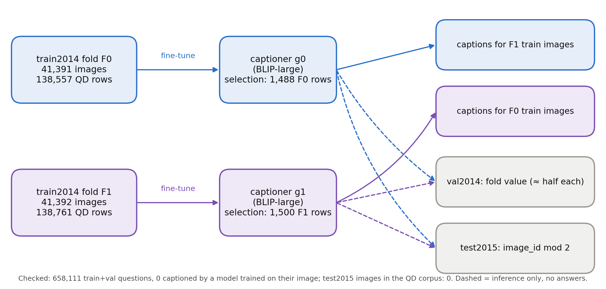
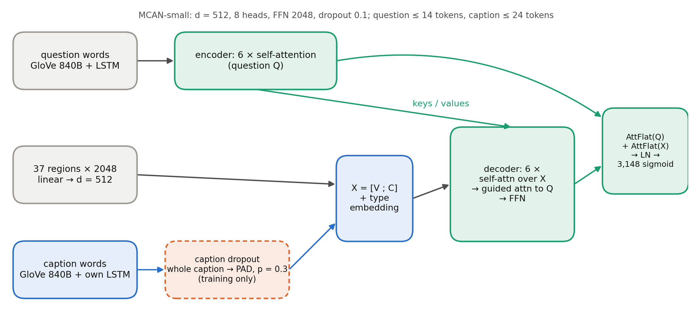
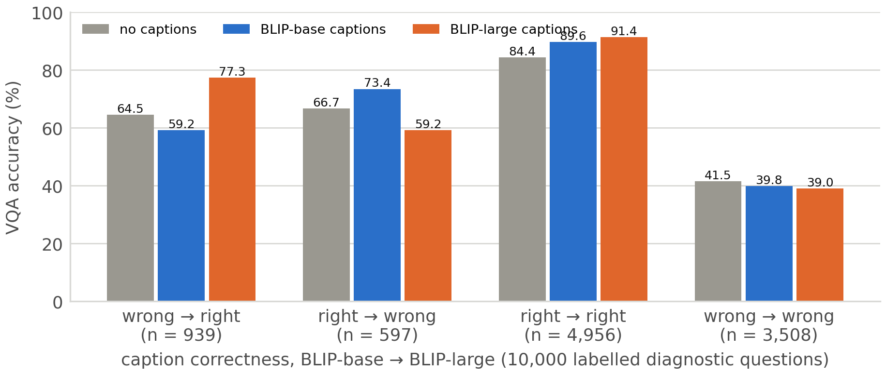

University of Tabriz, Tabriz, Iran | [Department and corresponding author email to be confirmed]

# Abstract

Visual question answering (VQA) requires an answer grounded in the image and conditioned on the question. A generic image caption may omit exactly the detail that a question asks about. We study **question-dependent image captioning**, the task of describing an image with respect to a given question, and its use as evidence for VQA. Our contributions are threefold. (i) We build a new **question-dependent caption dataset** of 277,318 image–question–caption triples from VQA v2 training annotations, which defines the question-dependent captioning task: questions are classified as directly visual or not, captions are generated from question and answer with rules and a local language model, validated automatically, and revalidated and repaired with a larger language model. (ii) We design a **question-dependent image captioner** by fine-tuning BLIP-Large with the question as prompt; two captioners trained on image-disjoint folds ensure that no caption used to train the VQA model comes from a captioner that saw the image. (iii) We design a **question-dependent-caption-improved VQA model** that fuses the caption tokens with image region features in an MCAN co-attention network, with caption dropout against wrong captions. On the official VQA v2 test-standard, two-seed ensembles with and without captions reach 73.16% and 69.56%, an improvement of 3.60 percentage points; on test-dev the improvement is 3.59 points for the ensembles and 3.83 points for the single models (72.13% vs. 68.31%). In a matched control on test-dev, generic captions from the same BLIP-Large checkpoint, without question and without our fine-tuning, reach 70.09% (ensemble): only 0.81 points above the baseline and 2.78 points below the question-dependent captions. Perturbation analyses and real examples show that wrong captions can still mislead the model. The results do not establish state-of-the-art performance.

Keywords: Visual question answering; Image captioning; Image captioning improved visual question answering; Question-dependent image captioning.

# 1. Introduction

Visual question answering is a multimodal task in which the system must infer an answer to a natural-language question about an image. The VQA v2 benchmark was designed to reduce reliance on language priors through complementary image–question examples [1]. Object-region attention [2] and deep modular co-attention [3] provide effective mechanisms for aligning question tokens with visual features. Nevertheless, the answer-relevant detail may be difficult to extract from region embeddings alone. A natural-language caption offers a potentially complementary semantic representation of objects, attributes, actions and relations.

Previous caption-enhanced VQA studies have explored the connection between captioning and answering [4,5]. A caption that is independent of the question, however, need not describe the detail that the answer requires. This motivates conditioning generation on the question and using its output as auxiliary evidence rather than as a replacement for image features. When reference answers are used to construct synthetic caption targets, an additional methodological concern arises: captions generated for downstream training examples may encode memorised answer supervision if the captioner has already been trained on those images.

This study investigates three questions: (i) whether question-conditioned captions improve a controlled image–question VQA baseline, (ii) whether improvements in caption answer preservation translate into VQA improvements, and (iii) how wrong captions influence the downstream model. Our contributions are:

1. **A question-dependent caption dataset and task.** We introduce question-dependent image captioning as a task and build a dataset of 277,318 image–question–caption triples from VQA v2 with a four-step pipeline: question classification, caption generation, automatic validation, and revalidation with a larger language model (Section 3).
2. **A question-dependent image captioner.** We fine-tune BLIP-Large with the question as prompt and train two captioners on image-disjoint folds (cross-fitting), so that captions for VQA training never come from a captioner that saw the image (Sections 3.3 and 4.1).
3. **A question-dependent-caption-improved VQA model.** Caption tokens are fused with region features in MCAN, with caption dropout for robustness; on the official VQA v2 test-standard the captions add 3.60 points to an identical model without captions (Sections 4.2–6).

The contribution is empirical and methodological rather than a new pretrained vision-language architecture.

# 2. Related work

VQA systems have evolved from attention over detected objects [2] to deeper networks that jointly model language and visual interactions. MCAN [3] uses cascaded self-attention and guided-attention modules. Sharma and Jalal [4] study caption-based transfer to VQA through visual and caption-derived representations. Zhou et al. [5] propose IC-VQA, which generates question-specific captions using attention and a Transformer and incorporates those captions into a VQA framework. Question-driven caption prompting has also been studied by Özdemir and Akagündüz [6]. These studies motivate an explicit evaluation of the contribution of question-conditioned textual evidence on a fixed downstream backbone.

Pretrained vision-language systems offer strong starting points for caption generation. BLIP [7] supports image-conditioned language generation, and BLIP-2 [8] connects frozen vision encoders and large language models through a learned query module. In this work, BLIP is adapted to question-dependent captioning with answer-derived synthetic targets. BLIP-2 is investigated only in a zero-shot screening experiment; it is not treated as a fair fine-tuned architecture comparison.

# 3. Question-dependent caption dataset

We define **question-dependent image captioning** as the task of generating, from an image $I$ and a question $q$ about it, one declarative sentence that states what the image shows about $q$. No such dataset exists for VQA v2, so we build one from its training annotations: each target caption is written from the question and its human answer, and the captioner later learns to produce it from the image and the question alone.

## 3.1. Task and target construction

Let $a$ denote the majority human answer and $t$ the target caption. The construction maps $(q, a)$ to a short declarative statement that keeps the question's subject and relation and states the answer. For example, "What color is the train?" with answer "blue" yields "The train is blue."; "Is the man wearing a hat?" with answer "no" yields "The man is not wearing a hat." The target is not an independently human-written caption, and it is never supplied to the VQA model. The captioner instead learns $p(t \mid I, q)$ and generates a new description from image and question only.

Let the ten annotated answers of image–question pair $i$ be $\mathcal{A}_i$ and let $G$ denote the rule/language-model transformation:

$$a_i^{*} = \operatorname{mode}(\mathcal{A}_i), \qquad t_i = G(q_i, a_i^{*}) \qquad (1)$$

The mode is taken over the ten answers after lower-casing and trimming; if two answers are equally frequent, the one given first in the annotation order is used.

## 3.2. Dataset generation pipeline

The pipeline has four steps (Fig. 1, Table 1). All language-model steps run locally with Ollama on 4-bit quantised Qwen2.5 instruction models [11]: `qwen2.5:3b-instruct-q4_K_M` for steps 1–3 and the larger `qwen2.5:7b-instruct-q4_K_M` for step 4, on two T4 GPUs with one model server per GPU. The language models see only text (question and answers), never the image. Before step 1, OCR-dependent questions are removed with a keyword filter (15,824; e.g. questions about written text, brands, numbers on signs or the time on a clock) and repeated image–question–answer triples are removed (88).

**Step 1: question classification.** A caption can only be learned from the image if the answer is visible. The 3B model therefore labels each question as directly visual or as not directly visual, with three reasons: the answer needs reading text (OCR), external knowledge (e.g. "What sport is this team famous for?"), or an opinion (e.g. "Is this a nice room?"). A list of non-visual markers removes obvious cases (21,272), and the model labels every remaining question with a few-shot prompt (version v20). The 143,880 questions that are not directly visual are excluded from caption supervision; they remain in the VQA training data.

**Step 2: caption generation.** For each remaining question the majority answer $a^{*}$ is taken from the ten human answers. Four frequent question families with a fixed answer form are written with high-precision templates (67,259 captions): "what color is …", "how many …", "what is … doing", and "who …". Every other pair (216,448) is written by the 3B model, five pairs per request, with a system prompt (version v10) that asks for one natural declarative sentence that contains the answer, keeps the subject and relation of the question, adds no fact that is not in the question or the answer, affirms the statement for "yes" and negates it for "no", with few-shot examples.

**Step 3: automatic validation.** Every caption, from a template or from the model, passes a rule-based validator (fast validator v11). It rejects a caption that is empty, contains brackets, quotes or a question mark, has fewer than 3 or more than 30 words, repeats the question, has the wrong yes/no polarity, contradicts a quantifier of the question ("all", "both"), or contains words of another pair from the same request; a low word overlap with the question is only flagged. Every caption without a hard error is then judged by the 3B model as a validator (version v10, ten captions per request): it passes when it is grammatical, expresses the answer and adds no facts. A rejected caption is regenerated up to two times, first together with its request and then on its own; 250 captions that still failed and 8 empty results were dropped, leaving 283,707 captions. Captions the 3B validator found doubtful were kept and marked for step 4.

**Step 4: revalidation with a larger model.** Because a 3B model is a weak judge (used as a judge on a hand-labelled set of 298 captions, it found 85% of the wrong captions but only 56% of the captions it called wrong were wrong), all 283,707 captions are judged again by the 7B model (judge prompt j2, ten per request, temperature 0, JSON-schema output). The verdict is `ok`, `GRAMMAR_ISSUE_ONLY` (correct meaning, imperfect grammar) or `WRONG`, with a reason: answer missing, answer contradicted, meaning changed, unrelated, or added facts. The judge prompt was calibrated on the same 298 hand-labelled captions before the full run (first version: 84.4% precision and 76.5% recall for wrong captions; the prompt was then revised to j2). Each WRONG caption is regenerated by the 7B model (five per request, temperature 0.3, with the judge's reason as a hint), checked with the step-3 rules and judged again, for at most two rounds. Finally, a rule-based check without a language model marks captions that contain a content word or number found in neither the question nor the answer, or whose polarity looks flipped ("suspicious"); it does not change any verdict.

The captioner is trained only on the 277,318 `ok` captions (79,568 images). The 4,712 `GRAMMAR_ISSUE_ONLY` and the 1,677 remaining `WRONG` captions are not used. The 1,677 residual WRONG labels are 0.59% of the judged captions; these are automated verdicts, not a human-measured error rate. Of the `ok` captions, 29,844 carry the "suspicious" mark; the 7B judge accepted them and they are used.

$$\mathcal{D}_{QD} = \{(I_i, q_i, t_i) : d_i = 1,\ u_i = \texttt{ok}\} \qquad (2)$$

where $d_i = 1$ if record $i$ passed all filters (not OCR-dependent, not a repeated triple, directly visual in step 1, and a valid caption after step 3) and $u_i \in \{\texttt{ok}, \texttt{GRAMMAR\_ISSUE\_ONLY}, \texttt{WRONG}\}$ is the final step-4 verdict; only $u_i = \texttt{ok}$ is accepted.

| Step | Model / version | Records |
|---|---|--:|
| VQA v2 train2014 questions | — | 443,757 |
| OCR keyword filter (−15,824) and repeated triples (−88) | rules | 427,845 |
| 1. Classification: not directly visual (OCR, knowledge, opinion) removed (−143,880) | 3B, v20 | 283,965 |
| 2. Caption generation: templates / language model | rules; 3B, v10 | 67,259 / 216,448 |
| 3. Validation and regeneration: failed (−250), empty (−8) | rules + 3B, v11 / v10 | 283,707 |
| 4. 7B judge: ok / WRONG / GRAMMAR_ISSUE_ONLY | 7B, j2 | 250,987 / 28,153 / 4,567 |
| 4. Regeneration of WRONG (≤ 2 rounds): repaired / still WRONG | 7B | 26,476 / 1,677 |
| Final verdicts: ok / GRAMMAR_ISSUE_ONLY / WRONG | | 277,318 / 4,712 / 1,677 |
| **Captioner training data (verdict ok)** | | **277,318 captions, 79,568 images** |

Table: **Table 1. Dataset generation (counts from the provenance block of the released dataset file).** Reasons of the initial WRONG verdicts: meaning changed 13,577; answer missing 7,376; answer contradicted 3,156; unrelated 2,212; added facts 1,832. GRAMMAR_ISSUE_ONLY grows from 4,567 to 4,712 through regenerated captions.

{width=6.6in}

**Human review.** The verdicts above are model judgements; the 298 hand-labelled captions were used to tune the judge prompt and are not an independent test. We therefore review a new, blinded sample: 300 captions drawn at random from the 247,474 `ok` captions without the "suspicious" mark and 200 from the 29,844 with it (seed 20261128, drawn before any review). The two groups are shuffled together and the reviewer sees neither the group nor any model verdict. For each caption the reviewer judges five aspects with the image at hand: (1) the reference answer is stated correctly, (2) the subject and relation of the question are kept, (3) no fact is added, (4) the sentence is grammatical, and (5) the question is answerable from the image. A caption is counted as correct when (1)–(3) hold. A second reviewer independently labels the first 100 items, and disagreements are resolved by discussion. Rates are reported with 95% Wilson intervals per group, and the error rate of the whole training set is estimated with the population weights,

$$\hat{e} = \frac{247{,}474}{277{,}318}\,\hat{e}_{0} + \frac{29{,}844}{277{,}318}\,\hat{e}_{1} \qquad (2a)$$

where $\hat{e}_0$ and $\hat{e}_1$ are the error rates of the unflagged and flagged samples (Table 1b). The review measures the remaining noise; it is not used to change the dataset or retrain any model.

| Criterion | Unflagged (n = 300) | Flagged (n = 200) | Weighted training set |
|---|--:|--:|--:|
| (1) answer stated correctly | [pending] | [pending] | [pending] |
| (2) subject and relation kept | [pending] | [pending] | [pending] |
| (3) no added fact | [pending] | [pending] | [pending] |
| (4) grammatical | [pending] | [pending] | [pending] |
| (5) visually answerable | [pending] | [pending] | [pending] |
| **Correct caption, (1) ∧ (2) ∧ (3)** | [pending] | [pending] | [pending] |
| Inter-reviewer agreement on 100 items (Cohen's κ, correct) | | | [pending] |

Table: **Table 1b. Blinded human review of the training captions (%, 95% Wilson intervals).** [To be completed.]

## 3.3. Image-disjoint cross-fitting

The caption corpus is derived exclusively from train2014 annotations. Because a target depends on the reference answer, captioning a downstream training image with a captioner trained on that image would risk leaking memorised answers. The 82,783 train2014 images are therefore split at random (seed 0) into two disjoint folds $F_0$ (41,391 images) and $F_1$ (41,392 images). Captioner $g_0$ is fine-tuned only on corpus records of $F_0$ images and $g_1$ only on $F_1$ (Table 2). Each captioner's checkpoint is selected on the last ~1,500 records of its own fold, split at an image boundary, so selection never uses the other fold. An image in $F_0$ is captioned by $g_1$ and vice versa. For val2014 the same file assigns each image to one captioner (20,251 / 20,253 images); for test2015 the captioner is $g_{\,\mathrm{image\_id} \bmod 2}$ (40,931 / 40,503 images). Neither captioner has seen a val2014 or test2015 image, and no reference answer is passed to caption generation.

$$F_0 \cap F_1 = \varnothing, \qquad \mathcal{D}_k = \{(I_i, q_i, t_i) \in \mathcal{D}_{QD} : I_i \in F_k\} \qquad (3)$$

Let $f(I) \in \{0, 1\}$ be the fold of a train2014 image and $F_{eval}$ the val2014 and test2015 images, on which neither captioner was trained. The caption of question $i$ is

$$\hat{c}_i = \begin{cases} g_1(I_i, q_i), & I_i \in F_0 \\ g_0(I_i, q_i), & I_i \in F_1 \\ g_{\pi(I_i)}(I_i, q_i), & I_i \in F_{eval} \end{cases} \qquad \pi(I) = \begin{cases} \text{manifest value of } I, & I \in \text{val2014} \\ \mathrm{image\_id}(I) \bmod 2, & I \in \text{test2015} \end{cases} \qquad (4)$$

so a train2014 image is always captioned by the model of the other fold. The function $\pi$ is fixed before captioning: val2014 images take the random split stored in the fold manifest (seed 0, 20,251 / 20,253 images), and test2015 images, which are not in the manifest, use the parity of their image id (40,931 / 40,503 images).

| Captioner | Training images (fold) | Corpus records | Training / selection records | Captions written for |
|---|---|--:|--:|---|
| $g_0$ | $F_0$: 39,750 with records | 138,557 | 137,069 / 1,488 | $F_1$ train images; half of val2014; test2015 with even image_id |
| $g_1$ | $F_1$: 39,818 with records | 138,761 | 137,261 / 1,500 | $F_0$ train images; half of val2014; test2015 with odd image_id |

Table: **Table 2. Caption generation protocol.**

The protocol was verified from the released manifests (`CaptionVQA/scripts/paper_evidence.py`):

- training and selection records of each captioner share no image and contain no image of the other fold;
- of the 658,111 train2014 + val2014 questions, 0 are captioned by a captioner trained on their image;
- no val2014 or test2015 image (81,434 test images) occurs in the caption corpus.

This construction removes image-level target leakage from the task-specific fine-tuning. It does not establish the absence of all overlap with external pretraining corpora (Section 7).

{width=6.6in}

# 4. Two-stage VQA framework

The system separates text generation from answer prediction (Fig. 3): the captioner receives the image and the question, and the VQA model receives the original modalities and the generated sequence.

{width=6.6in}

## 4.1. Question-conditioned caption generation

The captioner is initialised from `Salesforce/blip-image-captioning-large`, a BLIP checkpoint with a ViT-L/16 image encoder at 384 × 384 pixels. The image encoder is frozen and the BERT-based text decoder is fine-tuned with the question as a prompt, `"question: {q} caption:"` (prompt and caption each at most 32 tokens). For a target token sequence $t = (t_1, \dots, t_m)$ the conditional probability factors autoregressively:

$$p_\theta(t \mid I, q) = \prod_{j=1}^{m} p_\theta(t_j \mid I, q, t_{1:j-1}) \qquad (5)$$

The decoder input is $[\texttt{[DEC]};\ \text{prompt};\ t;\ \texttt{PAD}]$, with $t$ ending in the end token `[SEP]`. The loss is label-smoothed cross-entropy over the caption positions only: the prompt tokens are context but have no loss (label −100), and padding positions are ignored. With vocabulary size $K$, smoothing $\varepsilon = 0.1$ and $\mathcal{M}$ the set of caption positions (caption tokens and `[SEP]`) of all sequences in a batch, the loss is the mean over $\mathcal{M}$, not a per-sequence mean:

$$\tilde{y}_{j,k} = (1-\varepsilon)\,\mathbf{1}_{\{k = t_j\}} + \varepsilon / K \qquad (6)$$

$$\mathcal{L}_{cap} = -\frac{1}{|\mathcal{M}|} \sum_{j \in \mathcal{M}} \sum_{k=1}^{K} \tilde{y}_{j,k} \log p_\theta(k \mid I, q, t_{1:j-1}) \qquad (7)$$

Each fold is trained for four epochs with AdamW (learning rate 3 × 10⁻⁵, weight decay 0.05, 1,000 warm-up steps then cosine decay, gradient clipping 1.0, mixed precision), batch size 48 per GPU on two T4 GPUs. The checkpoint is the epoch with the most correct captions on the own-fold selection records: AnswerHit on open questions and polarity agreement on yes/no questions, weighted by their counts (Section 5.1), rather than CIDEr. Captions are generated with beam size 3; the returned beam maximises the length-normalised log-probability (length penalty 1):

$$\hat{c} = \arg\max_{c \in \mathcal{B}_3(I,q)} S_\theta(c), \qquad S_\theta(c) = \frac{1}{|c|} \sum_{j=1}^{|c|} \log p_\theta(c_j \mid I, q, c_{1:j-1}) \qquad (8)$$

Here $\mathcal{B}_3(I, q)$ is the set of three finished sequences returned by beam search (beam width 3, at most 32 tokens). Eq. (8) selects the best of these candidates; it is not the global maximum over all possible captions.

{width=6.6in}

## 4.2. Sequence-level caption integration

The VQA backbone is MCAN-small [3]: six question-encoder layers and six multimodal decoder layers, hidden size $d = 512$, eight heads, feed-forward size 2048, dropout 0.1. The image stream consists of 37 tokens of dimension 2048: 36 bottom-up region features from a Faster R-CNN detector trained on Visual Genome [2,12] plus their mean. Question and caption words are 300-dimensional GloVe 840B vectors [9]; the question (at most 14 tokens) and the caption (at most 24 tokens) have separate LSTM encoders. Region and caption tokens each receive a learned type embedding, and the caption tokens are appended to the projected region tokens.

$$R \in \mathbb{R}^{37 \times 2048}, \quad V = R W_v + b_v + e_{reg} \in \mathbb{R}^{37 \times d} \qquad (9)$$

$$Q = \mathrm{Enc}_q(q) \in \mathbb{R}^{n_q \times d}, \quad C = \mathrm{LSTM}_c(\hat{c}) + e_{cap} \in \mathbb{R}^{n_c \times d}, \quad X^{(0)} = [V; C] \in \mathbb{R}^{(37 + n_c) \times d} \qquad (10)$$

with $n_q \le 14$ question tokens and $n_c \le 24$ caption tokens. $e_{reg}$ and $e_{cap}$ are learned type vectors added to every region token and every caption token. The question encoder $\mathrm{Enc}_q$ is an LSTM over the GloVe vectors followed by six encoder layers, each a self-attention block and a feed-forward block, both with residual connection and post-layer normalisation; its output $Q$ keeps one vector per question token. The caption has its own LSTM ($\mathrm{LSTM}_c$) and is not passed through the question encoder.

Attention is the scaled dot-product primitive with an additive mask $M$ that removes padded positions ($d_h = 64$ per head):

$$\mathrm{Att}(U, K_a, V_a) = \mathrm{softmax}\!\left(\frac{U K_a^{\top}}{\sqrt{d_h}} + M\right) V_a \qquad (11)$$

Each of the six decoder layers $l = 0, \dots, 5$ applies, in this order and with residual connections and post-layer normalisation, self-attention over the fused stream, guided attention from the fused stream (queries) to the encoded question (keys and values), and a feed-forward block (512 → 2048 → 512). MHA is eight-head attention built from Eq. (11); all intermediate matrices keep the shape $(37 + n_c) \times d$:

$$\begin{aligned} X' &= \mathrm{LN}\big(X^{(l)} + \mathrm{MHA}(X^{(l)}, X^{(l)}, X^{(l)})\big) \\ X'' &= \mathrm{LN}\big(X' + \mathrm{MHA}(X', Q, Q)\big) \\ X^{(l+1)} &= \mathrm{LN}\big(X'' + \mathrm{FFN}(X'')\big) \end{aligned} \qquad (12)$$

Caption words therefore remain individual tokens: every region can attend to every caption word. The output representation is $h = \mathrm{LN}(\mathrm{AttFlat}(Q) + \mathrm{AttFlat}(X^{(6)}))$, where AttFlat is MCAN's attention pooling to a 1,024-dimensional vector; padded tokens are masked in all attention and pooling steps.

{width=6.6in}

## 4.3. Caption dropout and answer prediction

During training, the whole caption of a question is hidden with probability $p_c = 0.3$, independently per question and drawn anew at every step. This keeps a useful image–question path when the caption is missing or wrong. At evaluation captions are always supplied.

$$m_i \sim \mathrm{Bernoulli}(1 - p_c), \quad p_c = 0.3, \qquad m_i^{eval} = 1 \qquad (13)$$

The caption is hidden by masking, not by physically removing it: all its token ids are set to the padding id, so the tensor keeps its shape $(37 + n_c) \times d$, and the additive mask gives these key positions $-\infty$ in every attention and in the AttFlat pooling:

$$M_{ij} = \begin{cases} -\infty, & j \text{ is a padded region or caption token, or a caption token with } m_i = 0 \\ 0, & \text{otherwise} \end{cases} \qquad (14)$$

The masked caption positions therefore receive no attention weight, and the result is equivalent to a model that sees only $V_i$. Masked positions still exist as queries in the decoder, but they are excluded from pooling, so they do not reach the classifier.

The classifier covers the answers that are the majority answer of at least nine training questions: 3,091 answers in the development runs and 3,148 for the final full-data training (identical lists for the caption and baseline models). Each answer receives an independent sigmoid score:

$$z = W_a h + b_a, \qquad s_k = \sigma(z_k) \qquad (15)$$

The training target is separate from the evaluation metric, although the code uses the same formula. For question $i$ with normalised human answers $a_{i1}, \dots, a_{i10}$ (normalisation of Section 5.1), the soft target of answer class $k$ with answer text $\alpha_k$ is the leave-one-out score

$$y_{ik} = \frac{1}{10} \sum_{j=1}^{10} \min\!\left(1, \frac{1}{3} \sum_{\ell \neq j} \mathbf{1}_{\{\alpha_k = a_{i\ell}\}}\right) \qquad (16a)$$

so an answer given by 1, 2, 3 or at least 4 annotators gets $y_{ik} = 0.3, 0.6, 0.9$ or $1$; all other classes get 0. (Some implementations use $\min(n_{ik}/3, 1)$ instead; ours does not.) The loss is binary cross-entropy (BCE), the standard VQA loss that treats each answer class as an independent yes/no decision. It is computed on the logits for numerical stability, summed over all classes and divided by the number of questions $B$ in the batch, not by $B \cdot |\mathcal{A}|$:

$$\mathcal{L}_{VQA} = -\frac{1}{B} \sum_{i=1}^{B} \sum_{k=1}^{|\mathcal{A}|} \big[\, y_{ik} \log s_{ik} + (1 - y_{ik}) \log(1 - s_{ik}) \,\big] \qquad (16b)$$

The reported ensembles average the sigmoid scores (not the logits, and not votes over final answers) of the models trained with seeds $r \in \{0, 1\}$. The class with the highest mean is chosen, and its answer text $\alpha$ is the prediction:

$$\bar{s}_k = \frac{1}{2} \sum_{r=0}^{1} s_k^{(r)}, \qquad \hat{k} = \arg\max_k \bar{s}_k, \qquad \hat{a} = \alpha_{\hat{k}} \qquad (17)$$

An auxiliary reliability gate was investigated during development (Section 6.4) but is not part of the final model.

# 5. Experimental protocol

**Development.** All design choices were made on internal splits of VQA v2 with disjoint images (Table 3): a training set of 643,110 questions (all train2014 questions plus val2014 questions on images outside the evaluation sets), a 5,000-question validation set for epoch selection, and a 10,001-question development set. The development set was used repeatedly for analysis and model selection and is therefore not an independent test set.

| Split | Questions | Images | Use |
|---|--:|--:|---|
| Development training | 643,110 | 120,508 | training, answer vocabulary |
| Validation | 5,000 | 879 | epoch selection |
| Development set (val2014) | 10,001 | 1,900 | analysis and model selection |
| Final training (all train2014 + val2014) | 658,111 | 123,287 | final models only |
| test2015 (test-dev + test-standard) | 447,793 | 81,434 | official server |

Table: **Table 3. Data splits.** The three development splits share no image.

**Final evaluation.** The final models are trained on all 658,111 train2014 and val2014 questions for a fixed 10 epochs (the best validation epoch of every earlier MCAN run; no held-out data remain) with seeds 0 and 1, and evaluated on the official EvalAI server. No test2015 annotation is used anywhere. The caption-enabled and caption-free models differ only in the caption branch.

| Component | Setting |
|---|---|
| Captioner | BLIP-Large, frozen ViT-L/16, 384 px; 4 epochs; beam 3 |
| Caption training | two image-disjoint folds; AdamW, lr 3e-5, weight decay 0.05, warm-up 1,000 + cosine; batch 48 per GPU; ε = 0.1 |
| Caption checkpoint | most correct captions (AnswerHit + polarity) on own-fold selection records |
| VQA backbone | MCAN-small: 6 encoder + 6 decoder layers, d = 512, 8 heads, FFN 2048, dropout 0.1 |
| Visual features | 36 BUTD regions + mean token, 37 × 2048 |
| Language features | GloVe 840B, 300-d; question ≤ 14, caption ≤ 24 tokens; separate LSTMs |
| VQA optimisation | Adam (β = 0.9, 0.98, ε = 1e-9), lr 1e-4, 2 warm-up epochs, × 0.2 at epochs 10 and 12, batch 64, gradient clip 5 |
| Regularisation | caption dropout 0.3; no reliability gate |
| Final data / outputs | 658,111 questions, 10 epochs; 3,148 answers; seeds 0 and 1; ensemble = mean sigmoid score |
| Parameters | 58.77 M with captions, 56.46 M without |

Table: **Table 4. Final configuration** (`CaptionVQA/configs/blip_final.yaml`, `QuestionDependentImageCaptioner/configs/b_blip_fold_large.yaml`).

## 5.1. Metrics

VQA results use the official consensus accuracy, overall and by answer type (yes/no, number, other). For ten reference answers, a prediction is scored against each subset of nine annotators and the scores are averaged, after the official answer normalisation (lower case; punctuation removed; number words up to ten written as digits; articles a, an, the removed; contractions restored):

$$v_i = \frac{1}{10} \sum_{j=1}^{10} \min\!\left(1, \frac{\sum_{\ell \neq j} \mathbf{1}_{\{\hat{a}_i = a_{i\ell}\}}}{3}\right) \qquad (18)$$

$$\mathrm{Acc}_{VQA} = \frac{100}{N} \sum_{i=1}^{N} v_i \qquad (19)$$

Captions are assessed with BLEU-4, CIDEr [10], answer preservation for open questions (AnswerHit) and polarity agreement for yes/no questions. $H(c, a^{*}) = 1$ if every token of the normalised majority answer occurs in the caption (number words are mapped to digits, and the answer "0" also matches "no", "none" or "zero"); yes/no answers are excluded from AnswerHit. $P(c)$ is "no" if the caption contains a negation (not, no, none, nobody, nothing, never, neither, nor, cannot, nowhere, or a word ending in "n't") and "yes" otherwise.

$$\mathrm{AnswerHit} = \frac{100}{|\mathcal{O}|} \sum_{i \in \mathcal{O}} H(\hat{c}_i, a_i^{*}) \qquad (20)$$

$$\mathrm{PolarityAcc} = \frac{100}{|\mathcal{Y}|} \sum_{i \in \mathcal{Y}} \mathbf{1}_{\{P(\hat{c}_i) = a_i^{*}\}} \qquad (21)$$

$\mathcal{O}$ and $\mathcal{Y}$ contain the open and yes/no questions. Both are lexical diagnostics and are not substitutes for VQA accuracy. Counterexamples show their limits:

- *False miss (AnswerHit):* answer "gray", caption "The cat is grey." → $H = 0$, although the caption is correct; the same happens with synonyms ("sofa" / "couch") and with other valid human answers that are not the majority answer.
- *False hit (AnswerHit):* answer "2", caption "There are 2 dogs and 3 cats." for "How many cats are there?" → $H = 1$, although the caption gives the wrong count for the asked object.
- *Wrong polarity (Polarity):* answer "yes" to "Is the sky clear?", caption "There are no clouds in the sky." → the negation word gives $P = \text{no}$, although the caption agrees with "yes".

Eq. (18) is only the evaluation metric (computed by the official server for test-dev and test-standard, and by our implementation of the same formula for the development set); the training target of Eq. (16a) uses the same formula but is a separate quantity.

## 5.2. Statistical procedure

Differences on the development set are paired (same questions, both models). Their 95% intervals are percentile bootstrap intervals with 5,000 resamples, resampling **images** with replacement (all questions of an image together; 1,900 clusters), since questions on the same image are correlated. Question-level intervals are given for comparison. Single-model results are means of two seeds; ensembles average the two seeds' scores (Eq. 17).

# 6. Results

The results are presented in five steps. Section 6.1 gives the official VQA v2 results of the final models with and without question-dependent captions, and Section 6.2 places them among published results. Section 6.3 reports the development ablations that led to the final design, including the choice of captioner. Section 6.4 analyses robustness and errors, with real examples. Section 6.5 reports the controls with generic and fixed captions, and Section 6.6 the computational cost.

## 6.1. Official VQA v2 evaluation

Table 5 reports the official EvalAI results. The ensembles were submitted to test-standard once each (captions 24 November 2026, baseline 25 November 2026); the four single models were submitted to test-dev only. With the same training data and ensemble size, adding question-dependent captions raises test-standard accuracy from 69.56% to 73.16% (+3.60). On test-dev the gain is +3.59 for the ensembles and +3.83 for the single models (72.130 − 68.305 = 3.825). The gains occur in all three answer types and are largest for number and other questions.

| Model | Phase | Overall | Yes/no | Number | Other |
|---|---|--:|--:|--:|--:|
| MCAN, seed 0 / seed 1 | test-dev | 68.30 / 68.31 | 85.13 / 85.19 | 48.43 / 49.10 | 58.45 / 58.26 |
| + QD captions, seed 0 / seed 1 | test-dev | 72.13 / 72.13 | 87.68 / 87.62 | 52.99 / 53.43 | 63.21 / 63.15 |
| Difference, single-seed means | test-dev | +3.83 | +2.49 | +4.45 | +4.83 |
| MCAN, 2-seed ensemble | test-dev | 69.28 | 85.94 | 49.99 | 59.43 |
| + QD captions, 2-seed ensemble | test-dev | 72.87 | 88.35 | 53.86 | 63.99 |
| Difference, ensembles | test-dev | +3.59 | +2.41 | +3.87 | +4.56 |
| MCAN, 2-seed ensemble | test-standard | 69.56 | 86.14 | 49.81 | 59.65 |
| **+ QD captions, 2-seed ensemble** | test-standard | **73.16** | **88.33** | **54.41** | **64.25** |
| Difference, ensembles | test-standard | +3.60 | +2.19 | +4.60 | +4.60 |

Table: **Table 5. Official VQA v2 results (%).** Single-seed standard deviations on test-dev are below 0.02 points overall (two seeds).

The baseline is already a comparatively strong MCAN model, and the two seeds of each model agree within 0.01 points on test-dev; ensembling adds 0.74 (captions) and 0.97 points (baseline). Test-dev and test-standard are phases of the same server evaluation and should not be read as independent replications.

Before submission, the development set predicted about 70.5 and 67.4 for the two ensembles. Both official scores are about 2.5 points higher, while the caption gain stayed similar (+3.00 on the development set, +3.60 on test-standard). The shift is not a property of the captions alone: the final models were trained on 15,001 additional questions (the former validation and development sets), with a larger answer vocabulary (3,148 instead of 3,091 answers), and the development set is a different, smaller question sample.

![**Fig. 6.** Official results. (a) Test-standard accuracy by answer type, with the value reported by Sharma and Jalal [4]. (b) Caption gain over the matched baseline: test-dev single models (mean of two seeds), test-dev ensembles and test-standard ensembles.](figures/fig6_official.png){width=6.6in}

## 6.2. Comparison with previously reported VQA results

Table 6 places our official **test-standard** results among published systems. Only test-standard values are compared across papers; our single models were evaluated on test-dev only (Table 5) and are therefore not ranked here. The comparison is descriptive rather than a matched ablation, because the visual features, training data, model size, pretraining and ensembling differ between the papers.

| Method | Model type | Overall | Yes/no | Number | Other |
|---|---|--:|--:|--:|--:|
| Yu et al. [3], MCAN (original) | single model† | 70.90 | — | — | — |
| Sharma & Jalal [4], Baseline + Att | single model | 63.32 | 79.21 | 44.06 | 56.29 |
| Sharma & Jalal [4], Baseline + Att + Cap | single model | 70.67 | 86.63 | 48.23 | 59.98 |
| Zhou et al. [5], IC-VQA* | single model | 70.85 | 87.20 | 46.83 | 61.98 |
| MCAN baseline (ours) | 2-seed ensemble | 69.56 | 86.14 | 49.81 | 59.65 |
| **MCAN + QD captions (ours)** | 2-seed ensemble | **73.16** | **88.33** | **54.41** | **64.25** |

Table: **Table 6. Published VQA v2 test-standard results and ours (%).** Sharma & Jalal values are from Table 6 of the original article [4]. †MCAN-large trained on train + val + Visual Genome; its test-dev score is 70.63 [3] [values to be checked against the original table]. *Zhou et al. report VQA2.0 results in their Table 3; an identical test-standard protocol is not stated. The "single model" entries are as reported by the authors.

Our caption ensemble is 2.49 points above the 70.67% of Sharma and Jalal and numerically above the original MCAN and IC-VQA [5]. These differences are contextual and not a ranking: our model is a two-model ensemble, while the cited results are single models; our MCAN-small uses no Visual Genome questions; and visual encoders, pretraining and training data differ. In particular, our own MCAN-small baseline (69.56, ensemble) stays below the original MCAN-large single model, so the gain over published results should not be attributed to the caption method alone. The controlled internal comparisons (+3.60 on test-standard over the identical model without captions, and the controls in Section 6.5) are the primary evidence.

## 6.3. Development ablations and captioner selection

Table 7 lists the development experiments on the 10,001-question development set. Training data and configurations differ between rows, so comparisons across rows are descriptive; within a row, the caption and baseline models are matched.

| Condition | No caption | With caption | Gain (95% CI, image-clustered) |
|---|--:|--:|--:|
| UpDn, all train2014 (BLIP-base captions) | 60.03 | 66.08 | +6.05 |
| MCAN, GloVe 6B, batch 128 (BLIP-base) | 65.74 | 67.80 | +2.06 |
| MCAN, GloVe 840B, batch 64 (BLIP-base) | 66.39 | 68.08 | +1.69 |
| Same + caption dropout 0.3 | 66.39 | 68.31 | +1.92 (+1.42, +2.42) |
| Same + caption dropout, BLIP-Large | 66.39 | 69.76 | +3.37 (+2.83, +3.92) |
| Same, 2-seed ensembles | 67.27 | 70.27 | +3.00 (+2.35, +3.65) |

Table: **Table 7. Development experiments: overall VQA accuracy (%) on the development set.** Single-model values are means of two or three seeds. The UpDn row trains on all train2014 questions; the MCAN rows train on 643,110 train2014 + val2014 questions. Intervals are computed for the three final rows, whose per-question predictions are archived.

| Contrast (seed means) | Overall | Yes/no | Number | Other |
|---|--:|--:|--:|--:|
| BLIP-Large captions − no captions | +3.37 (+2.83, +3.92) | +2.44 (+1.60, +3.30) | +3.01 (+1.27, +4.82) | +4.17 (+3.39, +4.92) |
| BLIP-Large − BLIP-base captions | +1.45 (+0.94, +1.96) | +1.08 (+0.33, +1.82) | +0.33 (−1.30, +1.97) | +2.03 (+1.36, +2.70) |

Table: **Table 8. Paired differences on the development set (pp, 95% image-clustered bootstrap intervals).** Image-clustered intervals are at most 0.10 points wider than question-level intervals overall and up to 0.35 points for number questions (`manuscript/evidence/paper_evidence.md`).

The first captioner comparison found that a fine-tuned BLIP-base model outperformed two region-based Transformer captioners: AnswerHit 58.9% versus 46.3% and 46.5%, and yes/no polarity 76.4% versus 59.2% and 60.1%. BLIP-base AnswerHit fell to 15.2% without the image and 12.4% with another image (a no-model answer prior reaches 14.1%), and replacing the question on a fixed image made the captions follow the new question (Fig. 8a). These perturbations show dependence on both inputs, but do not establish perfect visual grounding.

| Captioner | Open AnswerHit | Yes/no polarity | CIDEr |
|---|--:|--:|--:|
| BLIP-base, fine-tuned | 58.10 | 75.10 | 6.39 |
| BLIP-Large, fine-tuned | 61.05 | 77.75 | 6.53 |
| BLIP-2 FlanT5-XL, zero-shot | 49.69 | 76.41 | 0.51* |
| BLIP-2 OPT-2.7B, zero-shot | 42.74 | 59.13 | 0.60* |

Table: **Table 9. Captioner scaling on 10,000 corpus records of the other fold (%, CIDEr absolute).** *Zero-shot BLIP-2 mostly returns short answers rather than captions. The BLIP-Large values belong to the screening checkpoint; the final fold models use the answer-based checkpoint criterion.

The paired BLIP-Large gain in the screening experiment was +2.95 AnswerHit (95% bootstrap interval +2.0 to +3.9) and +2.65 polarity (+1.4 to +4.0). In the VQA experiment, moving from the BLIP-base pipeline to BLIP-Large with the answer-based checkpoint criterion raised accuracy by 1.45 points (Table 8). This is a caption-pipeline comparison, not a pure model-size ablation.

## 6.4. Robustness and error analysis

Caption dropout changed development accuracy only slightly (68.08% to 68.31%) but made the model much more robust to shuffled captions (60.48% to 64.48%; Fig. 8b). An auxiliary sample-dependent reliability gate was evaluated with reliability supervision (G1) and with the VQA loss alone (G2). G1 separated right from wrong captions with AUC 0.815, yet G1 and G2 reached 68.13% and 68.53%, compared with 68.31% without a gate; in G2 the gate saturated near one. Where the gate trusted a caption least, the caption-free model was usually wrong as well, so suppressing captions did not recover correct answers. The final system omits the gate.

| Caption correctness, BLIP-base → BLIP-Large | Questions | No captions | BLIP-base captions | BLIP-Large captions |
|---|--:|--:|--:|--:|
| Wrong → right | 939 | 64.5 | 59.2 | 77.3 |
| Right → wrong | 597 | 66.7 | 73.4 | 59.2 |
| Right → right | 4,956 | 84.4 | 89.6 | 91.4 |
| Wrong → wrong | 3,508 | 41.5 | 39.8 | 39.0 |

Table: **Table 10. Development VQA accuracy (%) by change in caption correctness.** The groups cover 10,000 of the 10,001 questions: for one question ("What letter is in red on the communist sign?", all ten answers "a") the majority answer is empty after the official normalisation, which removes articles, so its caption cannot be labelled right or wrong.

For a group $g$ with $n_g$ questions and accuracy $A_g$, its contribution to the change in overall accuracy is

$$\Delta_g = \frac{n_g}{N}\left(A_g^{large} - A_g^{base}\right), \qquad \Delta_{overall} \approx \sum_g \Delta_g \qquad (22)$$

Here $N = 10{,}000$ is the number of labelled questions (the four groups of Table 10), $A_g$ is the mean of the two seeds' VQA accuracy on group $g$, and the one question without a caption label (question 475660002) is excluded. The sum is therefore close to, but not exactly, the overall change on all 10,001 questions.

{width=6.6in}

The transition analysis shows an association between answer preservation and downstream accuracy: the caption model gains strongly where captions become correct (+18.1 points) and loses where they become wrong (−14.2 points). Since the VQA models are trained separately, this is not an isolated causal intervention on caption content; a test-time caption swap within a fixed model would isolate it.

BLIP-Large captions also increase reliance on the text: shuffled captions give 63.44%, compared with 64.48% for the BLIP-base variant. Counting four or more objects remains difficult, and a caption with the wrong yes/no polarity can mislead the model. Captions are useful but fallible evidence, not verified explanations.

{width=6.6in}

Fig. 9 shows two real images of the development set (val2014; no development model was trained on them), with the generic caption of the released BLIP-Large, the question-dependent caption of our captioner, the reference answers, and the predictions of the development models without captions and with question-dependent captions (seeds 0 and 1). The generic caption is the same for every question of an image and often lacks the asked detail or contradicts it ("a couple of zebras … standing" for three running zebras). The question-dependent captions state the count and the activity, and the caption model answers both questions correctly with both seeds, while the baseline is right with only one seed. Image (b) also shows the failure mode: for "How many surfers do you see?" the caption wrongly says two surfers, and the caption model follows it (2 with both seeds), while the baseline answers 1 correctly.

![**Fig. 9.** Real development-set examples. For each image: the generic caption (one per image, BLIP-Large as released), and for two questions the reference answers, the question-dependent (QD) caption, and the predictions of the development models without captions and with QD captions (seeds 0 / 1). (a) Two successes; (b) one success and one failure caused by a wrong QD caption. The generic-caption VQA model of Table 11 was trained on all val2014 images, so its predictions on these images are not shown.](figures/fig9_examples.png){width=6.6in}

## 6.5. Controls: generic captions and caption capacity

The gain in Table 5 shows that the question-dependent captions improve the no-caption baseline. Two controls test whether conditioning on the question is what helps, and whether the extra parameters of the caption branch explain part of the gain. Both repeat the final protocol of Table 5 exactly (MCAN-small, BUTD features, caption dropout 0.3, no gate, all 658,111 train2014 + val2014 questions, 10 epochs, seeds 0 and 1, mean-sigmoid ensemble, official test-dev; no test-standard submission):

- **Generic captions:** `Salesforce/blip-image-captioning-large` as released, without any training of ours, writes one question-independent caption per image (beam 3, prefix "a picture of", 10.2 words on average), which is given to every question of that image. Our question-dependent captioner starts from the same checkpoint, so the two caption sets differ only in our fine-tuning on the question-dependent dataset and in the question prompt. This checkpoint was fine-tuned on COCO captions of the Karpathy split [7,13], which contains the train2014 and most val2014 images but no test2015 image. Both captioners share this exposure; if anything, it favours the generic captions on the training images.
- **Fixed caption (capacity control):** the caption branch (embedding, LSTM, type vector, decoder tokens) is kept, but every question receives the same fixed caption ("an image."), which carries no information about the image or the question. Unlike an all-padding caption, which the mask of Eq. (14) would remove from the computation, the fixed caption keeps the branch active.

| Captions given to MCAN | Params | Single: seed 0 / seed 1 | Single: mean | Ensemble | Yes/no | Number | Other |
|---|--:|--:|--:|--:|--:|--:|--:|
| None (baseline) | 56.46 M | 68.30 / 68.31 | 68.31 | 69.28 | 85.94 | 49.99 | 59.43 |
| Fixed caption, same branch | [pending] | [pending] | [pending] | [pending] | | | |
| Generic BLIP-Large (one caption per image) | 58.22 M | 69.17 / 69.21 | 69.19 | 70.09 | 86.34 | 51.34 | 60.47 |
| **Question-dependent BLIP-Large (ours)** | 58.77 M | 72.13 / 72.13 | 72.13 | **72.87** | **88.35** | **53.86** | **63.99** |

Table: **Table 11. Caption controls on the official VQA v2 test-dev (%).** Yes/no, number and other refer to the ensembles. The parameter counts differ only through the word vocabulary (question + caption words). [Fixed-caption row to be completed.]

| Difference (pp, test-dev) | Single models (means) | Ensembles | Yes/no | Number | Other |
|---|--:|--:|--:|--:|--:|
| Generic captions − baseline | +0.89 | +0.81 | +0.40 | +1.35 | +1.04 |
| Question-dependent − generic captions | **+2.94** | **+2.78** | +2.01 | +2.52 | +3.52 |
| Question-dependent captions − baseline | +3.83 | +3.59 | +2.41 | +3.87 | +4.56 |

Table: **Table 12. Paired differences between the caption conditions on test-dev.** Answer-type columns compare the ensembles. Single-model means are computed from the unrounded seed averages (e.g. 72.130 − 68.305 = 3.825, reported as +3.83).

Generic captions help only a little: they recover 23% of the gain of the question-dependent captions over the baseline (0.89 of 3.83 points for single models, 0.81 of 3.59 for ensembles). With identical training, architecture and starting checkpoint, the question-dependent captions are 2.94 (single) and 2.78 (ensemble) points better than the generic ones, with the largest difference on "other" questions (+3.52). The two seeds of each model differ by at most 0.04 points overall, far less than these differences, but two seeds do not give a reliable variance estimate. An image-clustered bootstrap is not possible here, because test-dev answers are not public. Note also that this compares two caption pipelines, a captioner fine-tuned on question-dependent targets with the question as prompt and one that is not, rather than isolating the question input alone.

## 6.6. Computational cost

The two-stage system adds a captioner to the VQA model. Generic captions are written once per image, whereas question-dependent captions are written once per question, about 5.4 times as many on VQA v2. Table 13 separates the offline caption generation from the VQA training and inference. All runs used two NVIDIA T4 GPUs on Kaggle.

| Quantity | Baseline | Generic captions | Question-dependent captions |
|---|--:|--:|--:|
| VQA parameters | 56.46 M | 58.22 M | 58.77 M |
| Captioner parameters | — | ≈ 470 M (BLIP-Large) | ≈ 470 M (BLIP-Large) |
| Captioner fine-tuning | — | none | 2 folds × 4 epochs [time to be added] |
| Captions generated (train + val / test2015) | — | 123,287 / 81,434 (per image) | 658,111 / 447,793 (per question) |
| Caption generation time, 2 × T4 (train + val / test2015) | — | 73 / 53 min (14.5 / 13.2 images/s per GPU, beam 3) | [to be measured] |
| VQA training time per epoch (one seed per GPU) | 16.8 min | 20.6 min | 20.8 min |
| VQA training, 10 epochs | 2.8 h | 3.4 h | 3.5 h |
| End-to-end inference per 1,000 questions, single / ensemble | [to be measured] | [to be measured] | [to be measured] |

Table: **Table 13. Computational cost (two NVIDIA T4 GPUs).** Training times are means over the ten epochs of the final runs. [Remaining entries: one timed run on 1,000 fixed test-dev questions with the same GPU, batch size and settings for all three systems.]

# 7. Discussion and limitations

The improvement supports a modular approach in which language-form visual evidence complements region-based fusion. The consistent internal gains, image-disjoint caption generation, verified manifests and official server evaluation strengthen this evidence. The generic-caption control (Table 11) shows that most of the gain depends on the captions being question-dependent: generic captions from the same BLIP-Large checkpoint recover only about a quarter of it. This control compares two caption pipelines (fine-tuned with the question as prompt versus released without fine-tuning), so it does not separate the effect of the question input from that of the fine-tuning targets. The fixed-caption control, still pending, will show whether the extra parameters of the caption branch contribute.

The synthetic corpus is not a manually annotated reference dataset. Its quality labels come from 3B and 7B language models that can miss semantic errors or reject correct statements; a blinded human review of a stratified random sample (Section 3.2) estimates the true error rate [results to be added]. AnswerHit is lexical and the polarity diagnostic depends on negation patterns. The official results are based on two seeds per model; the single-seed spread on test-dev is small but two seeds do not give a reliable variance estimate. The development set was used repeatedly and does not demonstrate independent generalisation; the official benchmark provides the external evaluation. Large counts, text reading and contradictory captions remain weaknesses.

BLIP and the region detector use external pretrained checkpoints. The BLIP captioning checkpoint was fine-tuned on COCO captions, which include val2014 images, and the detector was trained on Visual Genome, which overlaps with COCO images. Cross-fitting controls the task-specific answer-derived supervision, not every overlap in external pretraining. The two-stage system also costs more at inference: one caption generation (beam 3) per question before the VQA model, about 5.4 times as many captions as a per-image generic captioner (Table 13), and the official results use two VQA models.

# 8. Conclusion

This study investigated question-dependent captions as supplementary evidence for visual question answering. Synthetic caption supervision screened by local language models, image-disjoint cross-fitting, a fine-tuned BLIP-Large captioner, sequence-level integration into MCAN and caption dropout constitute the framework. On the official VQA v2 test-standard, the two-seed caption-enabled ensemble reaches 73.16% against 69.56% for the matched no-caption ensemble, and the single models gain 3.83 points on test-dev. Generic captions from the same starting checkpoint add only 0.81 points on test-dev (ensembles), against 3.59 for the question-dependent captions, so the benefit depends mainly on captions that address the question. The captions remain fallible evidence: a wrong caption can mislead the model, and counting and reading text remain difficult. The fixed-caption capacity control and a human review of the synthetic dataset will complete the evidence.

# Declarations and availability

Author contributions: [To be agreed and completed by the authors.] Funding: [To be confirmed.] Competing interests: [To be confirmed.] Data and code availability: VQA v2 is publicly available under its terms. The synthetic corpus with its provenance block, the fold manifest, configurations, training code, result files and the scripts behind every table and figure are kept in the project repository [URL to be added when public]. AI-assisted steps: the caption corpus was generated and screened with local Qwen2.5 models (Section 3.2); the authors remain responsible for its correctness.

# References

[1] Goyal, Y., Khot, T., Summers-Stay, D., Batra, D., and Parikh, D. Making the V in VQA matter: Elevating the role of image understanding in visual question answering. CVPR, 6904–6913 (2017). https://doi.org/10.1109/CVPR.2017.670

[2] Anderson, P., He, X., Buehler, C., Teney, D., Johnson, M., Gould, S., and Zhang, L. Bottom-up and top-down attention for image captioning and visual question answering. CVPR, 6077–6086 (2018).

[3] Yu, Z., Yu, J., Cui, Y., Tao, D., and Tian, Q. Deep modular co-attention networks for visual question answering. CVPR, 6281–6290 (2019). https://doi.org/10.1109/CVPR.2019.00644

[4] Sharma, H., and Jalal, A. S. Image captioning improved visual question answering. Multimedia Tools and Applications 81, 34775–34796 (2022; online 2021). https://doi.org/10.1007/s11042-021-11276-2

[5] Zhou, K., Liu, Q., and Zhao, D. A visual question answering model based on image captioning. Multimedia Systems 30, 360 (2024). https://doi.org/10.1007/s00530-024-01573-9

[6] Özdemir, Ö., and Akagündüz, E. Enhancing visual question answering through question-driven image captions as prompts. CVPR Workshops, 1562–1571 (2024).

[7] Li, J., Li, D., Xiong, C., and Hoi, S. BLIP: Bootstrapping language-image pre-training for unified vision-language understanding and generation. ICML, PMLR 162, 12888–12900 (2022).

[8] Li, J., Li, D., Savarese, S., and Hoi, S. BLIP-2: Bootstrapping language-image pre-training with frozen image encoders and large language models. ICML, PMLR 202, 19730–19742 (2023).

[9] Pennington, J., Socher, R., and Manning, C. D. GloVe: Global vectors for word representation. EMNLP, 1532–1543 (2014).

[10] Vedantam, R., Zitnick, C. L., and Parikh, D. CIDEr: Consensus-based image description evaluation. CVPR, 4566–4575 (2015).

[11] Qwen Team. Qwen2.5 technical report. arXiv:2412.15115 (2024).

[12] Krishna, R., Zhu, Y., Groth, O., Johnson, J., Hata, K., Kravitz, J., Chen, S., Kalantidis, Y., Li, L.-J., Shamma, D. A., Bernstein, M. S., and Fei-Fei, L. Visual Genome: Connecting language and vision using crowdsourced dense image annotations. International Journal of Computer Vision 123, 32–73 (2017).

[13] Chen, X., Fang, H., Lin, T.-Y., Vedantam, R., Gupta, S., Dollár, P., and Zitnick, C. L. Microsoft COCO Captions: Data collection and evaluation server. arXiv:1504.00325 (2015).
